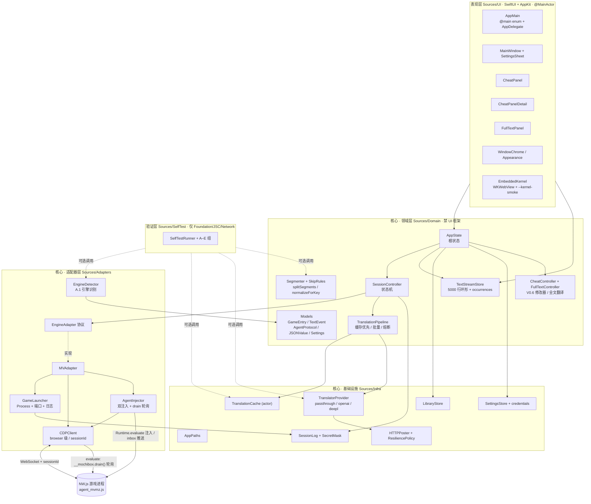
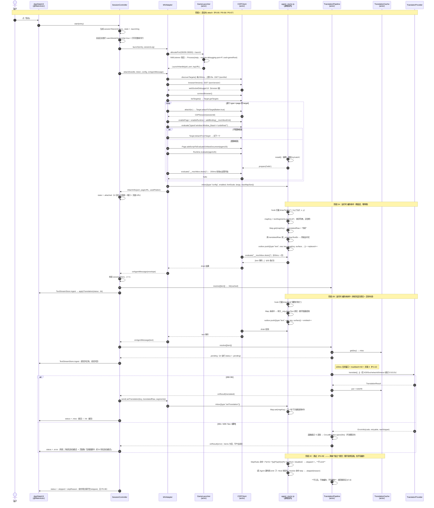
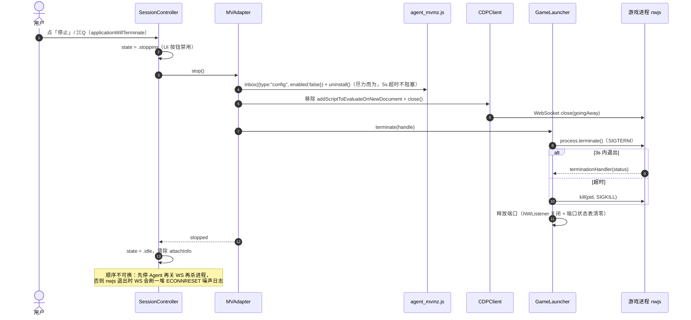
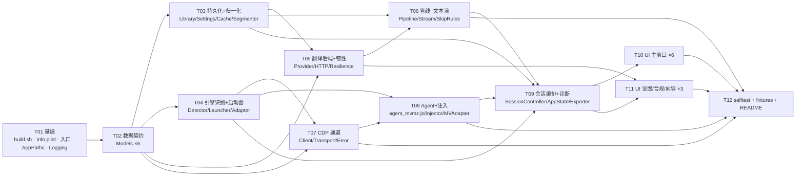

# MochiBox · 系统设计 + 任务分解（v3.4 · 对齐 PRD v0.3.4 与 P0-01…P0-20）

> 路径核对：2026-10-23，对应 Sources/ 布局。本文正文是 v3.4 设计基线，V0.2–V0.6 的增量见各版本架构文档。

| 项 | 内容 |
|---|---|
| 文档 | 架构设计（Part A）+ 任务分解（Part B） |
| 作者 | 架构师 高见远 |
| 版本 | **v3.4**（含同日六轮内部修订，不升版号：① `P1` 抽取须复用 `SkipRules`；② 抽取判据升为**三层优先级**、排除项高于白名单且落到**元素级**；③ 新增 **§7.8 跳过与缓存的规范顺序**；④ 失败面由两条扩为**三条**——补"假译文"断言；⑤ 明确**跳过判定的作用对象是剥码归一后的 `text` 而非 `raw`**，`skipReason` 参数改名 `for normalizedText:`，补 `\C[2]350` / `\C[2]10秒後` 正反配对；⑥ 把第 (3) 条断言的判据由**内容**（`translatedRaw == raw`，**会误伤 `"OK"`/`"BGM"` 这类恒等翻译**）改为**来源**（该条目的 `text` 按同一 `skipReason` 是否应为 nil），并明确 (2) 须同时验内存索引与落盘文件）**：对齐 PRD **v0.3.4**（`P0-09` 的 `numeric` 由 `\d+` 收紧为 `^\d+$` 并写入四个反例、`\C[2]` 正反配对、跳过项"两不"、三条并列断言、`P1-10` 缓存纯度改为需求口径、`§5.1` 跳过判定作用对象、`§4.2` 语言只读断言；其中正则一条经源码核实**实现本已符合，属文档缺口补全而非线上缺陷**）；并含 v3.3/v3.2/v3.1/v3 的 PRD v0.3.2、v0.3.1、v0.2 逐轮对齐（`402` 索引勘误、`325` 入抽取范围、`101` 语义拆分与空值三"不得"、`provider`/`settings` 闭包挂钩 `P0-12`/AC2.2c、`surfaceKind`/`order` 入契约、语言单向 `ja → zh-Hans`、AC2.2 拆 a/b/c、12 错误码 + `detail`） |
| 输入 | `docs/prd.md`（**v0.3.4**）、`docs/re-findings.md`、`docs/archive/v0.1/cdp-validation.md` |
| P0 范围 | **严格 = PRD v0.3.4 §3.1 的 20 条**（v0.3.4 对 `P0-09` 是**收紧**，条目数仍 20），不含静态预翻译（P1-10）、不含 `Window_Message.startMessage` 数据层替换 |
| 技术基线 | Swift 5 语法模式（`-swift-version 5`）/ SwiftUI + AppKit / 零第三方依赖 / 仅 CLT 的 `swiftc` 构建 |
| 产物 | 源码 + `Scripts/build.sh` → `MochiBox.app`（ad-hoc 签名，不公证，不启用 App Sandbox） |
| 规模预估 | 50 个文件，约 7000–7700 行（含 `agent_mvmz.js` 约 380 行，**不含 sha256 实现**） |

> **⚠ 状态说明（唯一一处已知陈旧，下轮修订）**：`§3.2` 的 `retryable` 与 `T05` 的响应→`code` 映射，**以 `docs/prd.md` §5.2/§3.2 为准**；本文对应表述待下轮重写。具体为：`retryable` 语义是"**立即重试是否有意义**"（`bad_response` 按 `httpStatus >= 500` 判、`circuit_open` 为 `false`），失败响应只映射 **4 个 code**（`500` 与非 JSON 同归 `bad_response`，`200` 属成功路径）。依据：`docs/acceptance-assertion-rules.md` 的权威边界——需求口径以 PRD 为准。

## 0. 使用须知（先读这一节再读正文）

### 0.1 本轮（V0.1）实际交付子集 —— 已被主理人裁剪

本轮只交付 **"可编译 + 可运行 + 自检绿"** 的核心子集。以下部分**本轮不做**，相关设计已冻结、不得再追加：

| 冻结项 | 原属任务 | 说明 |
|---|---|---|
| L1 静态预翻译 | （已降为 P1-10） | 见 §5 草案，本轮不实现 |
| 诊断导出 `DiagnosticsExporter` | T09 | 仅保留 `SessionLog` 写文件，导出功能下一轮 |
| 日志滚动（按份数保留 50 份） | T01 | V0.1 只写单文件；现已按份数保留最近 50 份，会话创建时裁剪一次 |
| `OnboardingSheet`（首启向导） | T11 | 本轮不实现 |
| `DetailPane`（选中行详情区） | T10 | 本轮不实现 |

> 因此**本文 §9 的任务表是"完整 P0 视图"**，不是本轮施工单。下一轮施工从 v0.2 的 §7 任务表继续（主理人另发）。

### 0.2 目录布局以**已落地实现**为准（本文 §2 是目标态，不是施工令）

工程师已按下表落地，**本轮不得为此返工**：

| 已落地路径 | 本文（目标态）路径 | 处置 |
|---|---|---|
| `Sources/App/`（`AppMain.swift`、`AttachCLI.swift`、`Constants.swift`） | `Sources/UI/AppMain.swift` | **保持现状** |
| `Sources/Infra/`（`Stores.swift`、`Translators.swift`、`FullTextStore.swift`） | `Sources/Core/`（部分内容） | **保持现状**（`Infra` ≡ 本文的 `Core`） |
| `Sources/Domain/`、`Sources/Adapters/` | 同名 | 一致 |
| `Sources/SelfTest/`、`Sources/UI/` | 同名 | 一致 |

本文的 `Sources/Core/` 只是目标态称呼，**实际不存在该目录**：`AppPaths`（约 `:14`）与 `SessionLog`（约 `:151`）落在 `Sources/Infra/Stores.swift`，三种 Store 与 `TranslationCache` 同文件；翻译 provider / `HTTPPoster` / `ResiliencePolicy` 在 `Sources/Infra/Translators.swift`。

**对 `build.sh` UI 依赖门禁的影响（唯一需要随手改的一处）**：门禁的目录清单按落地布局为
`Sources/Domain`、`Sources/Adapters`、`Sources/Infra`、`Sources/SelfTest`，再对 `Sources/App/` 做**文件级**排除（`AppMain.swift` 允许 import SwiftUI/AppKit，`AttachCLI.swift`/`Constants.swift` 不允许）：

```bash
UI_HITS=$(grep -REl '^import (SwiftUI|AppKit)' \
  "$ROOT/Sources/Domain" "$ROOT/Sources/Adapters" "$ROOT/Sources/Infra" \
  "$ROOT/Sources/SelfTest" "$ROOT/Sources/App/AttachCLI.swift" \
  "$ROOT/Sources/App/Constants.swift" 2>/dev/null || true)
[ -z "$UI_HITS" ] || { echo "error: 核心层出现 UI 框架依赖（违反 P0-18）: $UI_HITS" >&2; exit 2; }
```

### 0.3 表述纪律（硬要求）

- 合成 fixture / 替身页**必须在源码注释与 `README.md` 中显式标注"合成替身，非真实 MV 运行时"**。
- E2E / smoke 结论**只能**表述为 **"通道与管线在合成页面上跑通"**；**不得**表述为"兼容 RPG Maker MV/MZ"。
- 真实引擎兼容性一律进交付报告的 **Known Issues → 未验证项**。

---

# Part A · 系统设计

## 1. 实现思路（Implementation Approach）

### 1.1 核心难点与应对

| # | 难点 | 本质 | 本设计的应对 |
|---|---|---|---|
| D1 | macOS 上没有 `CreateRemoteThread`/DLL 劫持 | 无"进程内注入"原语 | 放弃通用注入，只走 **NW.js/Chromium 的 `--remote-debugging-port` + CDP** 这一条合法通道（`re-findings.md` §11；`archive/v0.1/cdp-validation.md` 已实测） |
| D2 | 直连 page 级 WebSocket 在本机**握手成功但永无响应** | 本机 Chromium 沙箱/渲染进程边界 | **强制 browser 级端点**：`GET /json/version` → `webSocketDebuggerUrl` → `Target.getTargets` → `Target.attachToTarget{flatten:true}` → 所有请求带 `sessionId`。**禁止**直连 `/devtools/page/<id>` |
| D3 | 页面里 `fetch('http://127.0.0.1:…')` 在 `file://` 源下受 PNA/CORS 双重限制 | 浏览器安全模型 | **只保留 CDP 一条传输**：Host 用 `Runtime.evaluate` **拉取**（poll `__mochibox.drain()`）Agent 队列，再用 `Runtime.evaluate` **推送** `__mochibox.inbox(json)`。页面内零网络代码 |
| D4 | MV 的转义码（`\C[3]`、`\N[1]`）不能被翻掉，否则原文/译文段数错位 | 字符串是"控制码 + 自然语言"混排 | 权威定义见 PRD §5.1：`splitSegments` 切 `code`/`text` 段 → 只把 `text` 段用 `U+001F` 连接送后端 → 段数校验 → 按原段序回填 |
| D5 | 译文比日文长，`drawTextEx` 逐字绘制会断行/溢出 | 排版约束 | P0 只做**手动字号缩放**（`fontScale` 乘 `contents.fontSize`，P0-15），自动降档留 P1-07。PRD 已接受的取舍 |
| D6 | P0-18 要求 `--selftest` 在**无图形会话（SSH）**下跑，而 App 本身是 SwiftUI 应用 | 进程入口只能有一个，`NSApplication` 初始化即依赖 WindowServer | **入口用 `@main enum` 而非 `@main struct App`**：`--selftest` 分支在 `MochiBoxApp.main()` **之前**返回，全程不创建 `NSApplication`（本机已实测该模式可编译可运行）；并强制 **核心层不得 `import SwiftUI`/`AppKit`**，由 `build.sh` 做 grep 门禁 |
| D7 | 无 Xcode 工程、无 SPM | 构建工具链 | 单 target 多文件，`swiftc -parse-as-library` 一次编译全部 `.swift`，手工组装 `.app` bundle |
| D8 | 首句译文的到达时间不可控（P0 无静态预翻译） | 后端 RTT 是外部变量 | 把"快"拆成可测的三档（PRD v0.2 AC2.2a/b/c）：**采集** 2s（只考上屏）、**收敛** 5s（`pending` 必须转出）、**确定性基线** 1s（指向 selftest 的本地 mock 后端 RTT ≤50 ms，把"我方内部延迟"与"后端延迟"彻底解耦）。P0 内部再去掉一切额外等待：`drain` 200ms 轮询、`ingest` 立即入队、120ms 窗口到点即发。**正式解法仍是 P1-10**（见 §5 草案） |

### 1.2 框架与库选型

全部为 **Apple 系统框架**，零第三方依赖：

| 用途 | 选型 | 理由 |
|---|---|---|
| UI | SwiftUI（`WindowGroup`/`List`/`Table`）+ AppKit（`NSOpenPanel`、`NSApplicationDelegate`、拖放） | CLT 自带；SwiftUI 写表单/列表最快；文件选择器与退出钩子必须 AppKit |
| HTTP（发现端点 + 翻译后端） | `URLSession`（`Foundation`） | 系统自带，`async/await` 原生，超时/取消可控 |
| WebSocket（CDP） | `URLSessionWebSocketTask` | 系统自带；通常不发 `Origin` 头，可绕开 Chromium ≥111 的 `--remote-allow-origins` 限制（403 时才走重试分支） |
| 端口可用性探测 | `Network.NWListener`（`127.0.0.1:port`）；selftest C 组用它起本地 mock HTTP 服务 | 已实测 |
| 哈希（缓存键） | `CryptoKit.SHA256` | 系统框架（非第三方），已实测可编译 |
| Agent 脚本自检 | `JavaScriptCore.JSContext` | P0-18 D 组指定；已实测 `import JavaScriptCore` + 链接通过 |
| 持久化 | `library.json` / `settings.json` / `credentials.json` / `cache.jsonl`（`Codable` + 原子写 + 追加写） | **明确不用 SQLite**：PRD §5.6 已把缓存契约定义为"追加写 JSONL + compaction"，引入 SQLite 会产生两个真相源，且 P0-10/P0-19 的验收（可读、可导出、行数可见）反而更难做。`SQLite3` 仍可用（已实测），保留给 P1-02 |
| 日志 | 自建 `SessionLog`（`FileHandle` 追加）+ `os.Logger` 旁路 | 需要会话分文件、按份数保留 50 份、脱敏，`os.Logger` 不便于导出诊断 |
| **不引入** | SQLite3 / SwiftData / CoreData / Combine 之外的响应式框架 / 任何 npm、pip、SPM 依赖 | 净室与可分发要求 |

### 1.3 分层与模块边界（P0-18 的硬前提）

**四层，严格单向依赖，箭头只向内**。除表现层外全部属于"核心层"，禁止 `import SwiftUI` / `import AppKit`，禁止创建 `NSApplication`、`NSWindow`、`NSOpenPanel`** —— 这是 P0-18（SSH 下可跑）的结构性保证，由 `build.sh` 强制校验（见 §2.10）。

> **路径说明**：下表"目录"列写的是**目标态**；实际落地布局见 §0.2（`Sources/Core/` 不存在，其内容由 `Sources/Infra/` 承担；`Sources/App/` 含 `AppMain`+`AttachCLI`+`Constants`）。门禁的实际目录清单见 §0.2 的 shell 片段。

| 层 | 目录（目标态） | 允许 import | 职责 |
|---|---|---|---|
| **表现层** | `Sources/UI/`（入口为 `Sources/App/AppMain.swift`） | SwiftUI、AppKit、WebKit、Foundation | 纯展示 + 用户意图；`@MainActor`；**不做 IO、不认识 CDP/HTTP**；只与 `AppState` 交互 |
| **核心 · 领域** | `Sources/Domain/` | Foundation、CryptoKit | 模型（严格对齐 PRD §5）、文本分段与缓存键、缓存、翻译管线、会话状态机、文本流 |
| **核心 · 适配器** | `Sources/Adapters/` | Foundation、Network（仅 launcher 端口探测） | `EngineAdapter` 抽象；MV/MZ 适配器 = `GameLauncher` + `CDPClient` + `AgentInjector` |
| **核心 · 基础设施** | `Sources/Infra/`（目标态称 `Sources/Core/`） | Foundation、os | `AppPaths`、`SessionLog`、`SecretMask`、各 Store 的装配 |
| **验证层** | `Sources/SelfTest/` | Foundation、JavaScriptCore、Network | `--selftest`，**不 import 任何 UI 框架**，只写临时目录 |

关键边界决定：

1. **`EngineAdapter` 是唯一知道"引擎怎么启动/怎么注入"的地方**；`SessionController` 只按状态机调用它的 7 个方法；未来 Ren'Py 适配器只需新增一个实现，领域层零改动。
2. **`TranslationPipeline` 是唯一知道"缓存优先 + 批量 + 熔断"的地方**；Agent、UI 都只提交条目、只接结果回调。
3. **`TranslationCache` 是 `actor`**，串行化所有追加写；`TextEvent.status` 由 `TextStreamStore`（`@MainActor`）单点决定。
4. **`agent_mvmz.js` 不引用任何 Host 侧概念**（不知道端口、不知道缓存文件）：只认 `inbox()` 推来的 `key → translatedRaw` 与 `config`。因此可被 `JSContext` 独立单测。
5. **`--selftest` 走独立装配路径**：`SelfTestRunner` 自己构造 `AppPaths(tempRoot:)` + 各 store + mock 后端，**不经过 `AppState`**，因此不触碰 UI 层。

### 1.4 架构图



> 5 行说明：宿主自己用 `Process` 启动 NW.js 游戏并追加 `--remote-debugging-port`；用 browser 级 CDP 端点 attach 到游戏页面后注入 `agent_mvmz.js`；Agent hook 引擎三个绘制函数，把原文放入内存队列，命中译文时直接替换绘制形参；宿主以 200ms 轮询 `drain()` 拉取、以 `inbox()` 推回译文；缓存优先、120ms 批量、按错误码退避与熔断（熔断期零请求、不产出译文，队列保留到冷却后继续）。

---

## 2. 文件清单

约定：`MTool-M/` 为仓库根。**单 target**，所有 `.swift` 一次编译。

### 2.1 基础设施与入口

| 相对路径 | 职责 | 预估行数 |
|---|---|---|
| `Scripts/build.sh` | `swiftc` 单命令编译 → 组装 `.app` → 拷贝资源 → ad-hoc 签名 → **核心层 UI 框架依赖门禁** | 140 |
| `Scripts/Info.plist` | bundle 元信息（键清单见 §2.10） | 65 |
| `Sources/App/AppMain.swift` | `@main enum MochiBoxMain`（先分流 `--selftest`/`--kernel-smoke`/`--play`，再 `MochiBoxApp.main()`）+ `MochiBoxApp` + `AppDelegate`（`applicationWillTerminate` 清理）+ 菜单 | 171 |
| `Sources/App/AttachCLI.swift` | `--attach` / `--play` 两条 CLI 入口：参数解析、启动与附着、drain 循环、退出码 | 905 |
| `Sources/App/Constants.swift` | 全局常量（端口 / 超时 / 批量 / 上限）与版本号 | 212 |
| `Sources/Infra/Stores.swift` | `AppPaths`（约 `:14`）：运行时目录解析、`--selftest` 临时根覆盖、0600 权限；`SessionLog`（约 `:151`）：会话文件、`yyyyMMdd-HHmmss`、按份数保留最近 50 份、结构化 `k=v`、`SecretMask` 脱敏 | 794 |

### 2.2 领域 · 模型（严格对齐 PRD §5）

| 相对路径 | 职责 | 预估行数 |
|---|---|---|
| `Sources/Domain/Models/EngineModels.swift` | `EngineKind`（优先级/显示名/缓存族）/ `SupportLevel` / `EngineReason` / `EngineConfidence` | 130 |
| `Sources/Domain/Models/LibraryModels.swift` | `GameEntry`（PRD §5.7）/ `LibraryFile` | 69 |
| `Sources/Domain/Models/JSONModels.swift` | 最小 `JSONValue`（Codable+Sendable 递归枚举），用于 CDP 无类型响应与未知 payload 透传 | 139 |
| `Sources/Domain/Models/ErrorModels.swift` | `ErrorCode`（§5.5，含属性元数据表）/ `ErrorInfo` / `MochiBoxError` / `SecretMask` | 249 |
| `Sources/Domain/Models/SegmentModels.swift` | `SegmentKind` / `Segment`（§5.1）；独立成叶子，切断 TextEvent ↔ Translation 的循环 | 28 |
| `Sources/Domain/Models/TextEventModels.swift` | `TextStatus` / `SurfaceKind` / `TextEvent`（PRD §5.2 逐字段） | 130 |
| `Sources/Domain/Models/AgentProtocolModels.swift` | `AgentEnvelope`（§5.3 两段解码）+ 5 种 Agent→Host payload + `AgentConfig` / `TranslationPushItem` + `HostCommand`（§5.3 6 种指令 + `rpc`） | 213 |
| `Sources/Domain/Models/TranslationModels.swift` | `TranslationRequest` / `TranslationResult`（§5.4 逐字段）/ `BackendKind` / `LanguagePair` / `PipelineOutcome` / `PipelineBatchResult` / `BackendStatus` | 100 |
| `Sources/Domain/Models/StoreModels.swift` | `CacheEntry`（§5.6）/ `CacheStats` / `StreamStats` / `RandomHex` / `Timestamp`（`Settings`/`Credentials` 在 `Sources/Infra/Stores.swift`） | 112 |

### 2.3 领域 · 持久化与文本归一化

| 相对路径 | 职责 | 预估行数 |
|---|---|---|
| `Sources/Infra/Stores.swift` | `LibraryStore`（约 `:497`）：`library.json` 原子写、损坏改名 `library.json.bak-<ts>` + 空库、`missing` 标记、按 path 去重、`schemaVersion`；`SettingsStore`（约 `:532`）：`settings.json`/`credentials.json` 0600 原子写、字段级回落 + 告警、`complianceAckVersion` 判定；`TranslationCache`（约 `:589`，actor）：`cache.jsonl` 追加写、`seq` 最大者胜、`hitCount` 增量行、`maxCacheEntries` LRU、compaction、按语言对分片 | 794 |
| `Sources/Domain/Segmenter.swift` | **唯一权威实现 PRD §5.1**：`splitSegments` / `normalizeForKey` / `cacheKey` / `reassemble`；`SkipRules`（约 `:369`）同文件 | 423 |

### 2.4 领域 · 翻译与管线

| 相对路径 | 职责 | 预估行数 |
|---|---|---|
| `Sources/Infra/Translators.swift` | `HTTPPoster`（约 `:23`）：`URLSession` 薄封装、JSON POST、超时、取消、状态码分流、响应体脱敏截断；`TranslatorProvider`（约 `:125`）：`Passthrough` / `OpenAICompatible` / `DeepL`（§5.4 三种形状 + 响应 → `ErrorInfo` 映射 + 段数校验）；`ResiliencePolicy`（约 `:437`）/ `CircuitBreaker`（约 `:458`）：120ms 窗口、`maxBatch`、并发闸门、退避、熔断、错误提示去重 | 497 |
| `Sources/Domain/TranslationPipeline.swift` | `actor`：`resolve()` 缓存优先（hit 即返、miss 入队返 `pending`）；**熔断检查在出队之前**（不消费队列）→ 批量出队 → provider（解析失败对半拆块 ≤4 层、自适应批量上限）→ 段数校验 → 写缓存 → 主线程回调 | 409 |
| `Sources/Domain/Segmenter.swift`（`SkipRules` 约 `:369`） | 纯数字 / 纯标点符号空白 / `tooShort` / `disabled` 判定与 `skipReason` 映射（PRD §5.2 + P0-09） | 423 |

### 2.5 领域 · 会话与文本流

| 相对路径 | 职责 | 预估行数 |
|---|---|---|
| `Sources/Domain/TextStreamStore.swift` | `@MainActor ObservableObject`：5000 行环形、**800ms 滑动窗口**按行身份（`surface + U+0000 + raw`）去重（`:76-91`）、每 occurrence 一行 + `occurrences` 递增、`status` 单点决策、命中率、`setPaused`、`clear` 只清视图 | 448 |
| `Sources/Domain/SessionController.swift` | 会话状态机（`idle→launching→attaching→attached→translating→stopping`）、`start/stop/reconnect`、`sessionToken`、信封校验与分发、`config`/`setTranslation(s)`/`drop`/`clear` 下发、字号与开关下发 | 1008（含 `AppState`） |
| `Sources/Domain/SessionController.swift`（`AppState` 约 `:727`） | `@MainActor` 根状态：当前游戏、会话、设置、统计、合规版本、库；`addGame`/`addGames`/`removeGame`/`startSession`/`stopSession`/`reconnectSession`/`saveSettings`/`acknowledgeCompliance`/`clearCache`；诊断导出未实现 | 同文件 |

### 2.6 适配器层

| 相对路径 | 职责 | 预估行数 |
|---|---|---|
| `Sources/Adapters/EngineAdapter.swift` | `protocol EngineAdapter`、`LaunchLayout`、`LaunchTransport`、`LaunchHandle`、`LaunchOptions`、`AttachInfo`、`AdapterProbe`、`AdapterState`；`MVAdapter`（约 `:190`）：`probe`/`launch`/`attach`（选 target → 探测游戏符号 → 注入 → hello → `config`）/`startTextPump`/`send`/`stop` | 783 |
| `Sources/Adapters/EngineDetector.swift` | PRD §A.1 的 14 条固定优先级、深度 ≤2、`.app/Contents/Resources/app.nw` 归一、`engineEvidence`(≤5)、`engineConfidence`、5 个 `reason` | 357 |
| `Sources/Adapters/Launcher/GameLauncher.swift` | 4 种可执行布局、端口分配（`39200–39300` + `NWListener` 探活 + 20 次重试）、`Process` 启动 + `currentDirectoryURL` + stdout/stderr 落盘、`terminate()`+3s+`kill()`、stderr 尾 20 行；同目录 `ChildProcessLauncher` / `ProcessTerminator` / `WebPortAssignments` 拆出 | 777 |
| `Sources/Adapters/CDP/CDPClient.swift` | `actor CDPClient`：`/json/list` 轮询（250ms/25s）、`/json/version`、browser WS、`Target.getTargets`、`attachToTarget{flatten}`、`Page.enable`/`Runtime.enable`/`addBinding`、`evaluate`、`addScriptToEvaluateOnNewDocument`、`reconnect`、`close`；`CDPTransport` 收发循环与 `CDPError` 映射同文件 | 457 |
| `Sources/Adapters/AgentInjector.swift` | 读 bundle 资源、`Page.addScriptToEvaluateOnNewDocument` + `Runtime.evaluate` 双注入、等 `hello`（5s）、幂等校验、`drain` 轮询、`inbox` 推送、`ensureAgentAlive` | 398 |

> V0.4 起新增 `Sources/Adapters/PageChannel/`（`PageChannel` 协议 + CDP/WebKit 两种实现入口）与 `Sources/Adapters/Web/`（静态服务、浏览器解析与回收），详见 `docs/archive/v0.4/architecture-v0.4-embedded-kernel.md`；V0.6 的修改器/全文翻译适配在 `Sources/Adapters/EngineAdapter.swift` 与 `Sources/Domain/CheatController.swift`、`Sources/Domain/FullTextController.swift`。

### 2.7 表现层（UI）

| 相对路径 | 职责 | 预估行数 |
|---|---|---|
| `Sources/UI/MainWindow.swift` | 主窗口：库列表 + 会话控制 + 右栏三段切换（翻译流 / 作弊 / 全文）+ 状态栏 + 工具栏 + 拖放接收 + 设置 sheet（`SettingsSheet` 同文件，约 `:668`）+ 首启合规 alert；`GameRow`/`TextStreamRow` 为同文件私有视图 | 905 |
| `Sources/UI/CheatPanel.swift` | V0.6 修改器面板：左侧分组 + 右侧表单、顶部快照 1s 刷新（仅页面可见时）、危险操作统一二次确认 | 782 |
| `Sources/UI/CheatPanelDetail.swift` | `CheatPanel` 的五个具体页：物品 / 角色 / 世界 / 流程 / 高级 | 855 |
| `Sources/UI/FullTextPanel.swift` | V0.6 全文翻译页：阶段与进度、扫描/翻译/重试/取消、译文导入导出、前 500 条列表 + 搜索 | 419 |
| `Sources/UI/WindowChrome.swift` | 窗口级毛玻璃（`NSVisualEffectView(.underWindowBackground, .behindWindow)`） | 97 |
| `Sources/UI/Appearance.swift` | 深/浅色外观自适应的集中出口（压暗层与弱填充规则的唯一处） | 62 |
| `Sources/UI/EmbeddedKernel/*` | `--play` 窗口模式的 NSApplication 引导、`WKWebView` 内核、WebKit 页面通道、`--kernel-smoke` 诊断入口 | 1313 |

### 2.8 验证层与脚本

| 相对路径 | 职责 | 预估行数 |
|---|---|---|
| `Sources/SelfTest/SelfTestRunner.swift` | TAP runner：`ok N - name` / `not ok N - name: detail` / `# pass X fail Y`、`--filter`/`--verbose`、临时目录隔离、退出码；A–E 五组用例全部在本文件（`MARK: - A 组` … `E 组`） | 1114 |
| `Sources/SelfTest/EscapeCaseSupport.swift` | F 组：转义码大小写不敏感的双端护栏（JavaScriptCore 载入**真实** `Resources/agent_mvmz.js`，与 Swift `Segmenter` 逐段比对） | 130 |
| `Sources/SelfTest/LauncherCaseSupport.swift` | F 组：启动策略 / Web 根识别 / 端口确定性 / 错误文案 / 真浏览器生命周期 | 392 |
| `Sources/SelfTest/WebCaseSupport.swift` | F 组（Web 运行后端）：`web_live_*` 开真 socket 发真请求，不 mock handler | 470 |
| `Resources/agent_mvmz.js` | 页面内 Agent：`window.__mochibox`、hook、`mapKeyOf`（纯字符串，**无哈希**）、队列/去重/幂等/降级、`inbox`/`drain`/`install`/`uninstall`/`probe` | 2439 |
| `Fixtures/mock_openai_server.mjs` | 零依赖 OpenAI 兼容 mock 后端：词典模式（默认）与 `--echo` 回声模式；既是 E2E 的替身后端，也是 AC2.2c 的确定性基线 | 118 |
| `Fixtures/mv_stub/index.html` | MV 替身页（`Window_Base`/`Bitmap`/`SceneManager` 桩），文件头写死注释"合成替身，非真实 MV 运行时"（§0.3 硬要求） | 967 |
| `README.md` | 构建、运行、Gatekeeper 首次打开、**无 App Sandbox 安全说明**、合规声明、**替身/未验证项声明**（"通道与管线在合成页面上跑通"、真实兼容性为 Known Issues） | 140 |

### 2.9 可裁剪项

V0.1 的裁剪项已全部落地，**当前不存在这些独立文件**：`DetailPane` / `OnboardingSheet` 从未单独成文件（库列表、文本流、状态栏、设置都在 `Sources/UI/MainWindow.swift`）；`CDPTransport` / `CDPError` 已并入 `Sources/Adapters/CDP/CDPClient.swift`。

### 2.10 构建方式（硬要求：`swiftc` 单命令可编译）

`Scripts/build.sh` 核心：

```bash
#!/usr/bin/env bash
set -euo pipefail
ROOT="$(cd "$(dirname "$0")/.." && pwd)"
APP="$ROOT/.build/MochiBox.app"
BIN="$ROOT/.build/MochiBox"

# 0) P0-18 结构门禁：核心层与验证层不得依赖 UI 框架
#    目录清单按当前落地布局（没有 Sources/Core，基础设施在 Sources/Infra）；
#    Sources/App/ 做文件级排除：只有 AppMain.swift 允许 import SwiftUI/AppKit
UI_HITS=$(grep -REl '^import (SwiftUI|AppKit)' \
  "$ROOT/Sources/Domain" "$ROOT/Sources/Adapters" "$ROOT/Sources/Infra" \
  "$ROOT/Sources/SelfTest" "$ROOT/Sources/App/AttachCLI.swift" \
  "$ROOT/Sources/App/Constants.swift" 2>/dev/null || true)
[ -z "$UI_HITS" ] || { echo "error: 核心层出现 UI 框架依赖（违反 P0-18）: $UI_HITS" >&2; exit 2; }

# 1) 编译（-swift-version 5 保守语法；-parse-as-library 允许 @main enum）
swiftc -O -wmo -swift-version 5 -parse-as-library -module-name MochiBox \
  -target arm64-apple-macos13.0 \
  $(find "$ROOT/Sources" -name '*.swift' | sort) \
  -o "$BIN" \
  -framework SwiftUI -framework AppKit -framework Network \
  -framework JavaScriptCore -framework Security
# -target 13.0 在本机 SDK 上失败时：回落 $(sw_vers -productVersion | cut -d. -f1).0 并打印提示

# 2) 组装 bundle
rm -rf "$APP"; mkdir -p "$APP/Contents/MacOS" "$APP/Contents/Resources"
cp "$BIN" "$APP/Contents/MacOS/MochiBox"
cp "$ROOT/Scripts/Info.plist" "$APP/Contents/Info.plist"
cp "$ROOT/Resources/agent_mvmz.js" "$APP/Contents/Resources/agent_mvmz.js"
printf 'APPL????' > "$APP/Contents/PkgInfo"

# 3) ad-hoc 签名（不公证，仅供本机/自签名分发）
codesign -s - --force --deep "$APP" 2>/dev/null || echo "warn: codesign 失败，产物仍可本机运行"
```

`.app` 目录结构：

```
MochiBox.app/
└── Contents/
    ├── Info.plist
    ├── PkgInfo                  # APPL????
    ├── MacOS/
    │   └── MochiBox             # swiftc 产物，同时是 --selftest 入口
    └── Resources/
        └── agent_mvmz.js        # Bundle.main.url(forResource:withExtension:)
```

`Info.plist` 必要键：

| 键 | 值 | 必需 | 说明 |
|---|---|---|---|
| `CFBundleExecutable` | `MochiBox` | ✔ | 与 `MacOS/` 下文件名一致 |
| `CFBundleIdentifier` | `app.mochibox.MochiBox` | ✔ | |
| `CFBundlePackageType` | `APPL` | ✔ | |
| `CFBundleName` / `CFBundleDisplayName` | `MochiBox` | ✔ | 菜单栏名 |
| `CFBundleShortVersionString` / `CFBundleVersion` | `0.1.0` / `1` | ✔ | 关于页与诊断导出 |
| `CFBundleInfoDictionaryVersion` | `6.0` | ✔ | |
| `LSMinimumSystemVersion` | `13.0` | ✔ | 与 `-target` 一致 |
| `NSHighResolutionCapable` | `true` | ✔ | 否则 Retina 下文本流模糊 |
| `NSPrincipalClass` | `NSApplication` | ✔ | SwiftUI App 由 bundle 启动时需要 |
| `NSAppTransportSecurity.NSAllowsArbitraryLoads` | `true` | ✔ | **理由**：`endpoint` 由用户自填，可能是 `http://` 的 Ollama/反代；ATS 会拦非 loopback 的 http。仅放行用户显式填写的地址，不做任何自动外联 |
| `LSApplicationCategoryType` | `public.app-category.utilities` | ✖ | 可选 |
| `NSHumanReadableCopyright` | 净室实现声明 | ✖ | 合规 |

**不使用** `LSUIElement`；**不写**任何 entitlement / `com.apple.security.app-sandbox`（主理人 D-5 定案：非沙盒 + 直接 `Process` spawn + 只监听 `127.0.0.1`）。

> **分发口径（PRD v0.3 §A.3，README 必须写全三项）**：① Gatekeeper 首次打开的放行方式（右键→打开 / `xattr -d com.apple.quarantine`）；② **未签名 / 未公证 / 非沙盒** 三个事实明示；③ **不进 Mac App Store**。
> **唯一的"沙盒兼容"声明**：本设计**不提供**沙盒路径。将来若要上架或开沙盒，§A.2（`Process` spawn 游戏可执行文件）与 P0-05 / P0-16 必须**重写并重新裁定** —— 沙盒会直接掐断本产品的核心链路。此条仅为**非 V0.1 路径**的标注，不作为设计前瞻。

---

## 3. 数据结构与接口（逐条对齐 PRD §5）

> 全部为接口签名/数据结构，**不含实现**。Swift 5 语法模式；`Sendable`/`actor` 只标注并发意图。

### 3.0 与 PRD §5 的对齐关系（先看这张表）

| PRD 位置 | 本设计的 Swift 类型 | 对齐状态 |
|---|---|---|
| §5.1 `Segment` / `normalizeForKey` / `key` | `Segment`、`SegmentKind`、`Segmenter` 全部方法 | **逐字段一致**（`kind`/`value`；NFKC→空白折叠→trim；`engineFamily\|src\|tgt\|` + `U+001F` join + SHA256 小写 hex） |
| §5.2 `TextEvent` 22 字段 | `TextEvent` | **22 字段名/类型/可选性完全一致**；另加 2 个可选扩展字段（见下） |
| §5.3 信封 + 5 种 Agent→Host + 6 种 Host→Agent | `AgentEnvelope`、5 个 payload struct、`HostCommand` | 一致；`drop`/`clear`/`ping` 均实现 |
| §5.3 `window.__mochibox` 成员 | Agent JS | PRD 要求的成员全部存在；**额外**加 `drain()`/`probe()`（见 §6.1 说明） |
| §5.4 `TranslateRequest` / `TranslateResult` | `TranslationRequest` / `TranslationResult` | **逐字段一致** |
| §5.5 `ErrorInfo`（6 字段）+ 12 个 `code` | `ErrorInfo` + `ErrorCode` | **逐字段一致**（含 v0.2 新增的 `detail`）；`cdp_timeout` / `segment_count_mismatch` 已按 v0.2 删除，其余成因进 `detail`（见 §3.2 注 2） |
| §5.6 缓存记录 9 字段 | `CachedEntry` | **逐字段一致** |
| §5.7 `library.json` | `LibraryFile` + `GameEntry` | 一致（`engineConfidence`/`engineEvidence`/`supportLevel`/`reason` 全保留） |
| §5.8 `settings.json` 22 字段 | `Settings` | **22 字段逐字段一致**，不增不减 |

**`TextEvent` 的 2 个可选字段 `surfaceKind` / `order`（PRD v0.3 已正式入 §5.2，不再是"本文扩展"）**：

| 字段 | 类型 | 来源与用途 |
|---|---|---|
| `surfaceKind` | `String?` = `dialogue`/`menu`/`system` | 由 `surface` 派生（`Window_Message`→`dialogue`、`Window_Base`→`menu`、`Bitmap`→`system`）。用于 P1-06 分类导出。**P0 只写不读** |
| `order` | `Int?` | 会话内单调递增，**从 1 开始**，用于 P1-06 还原阅读顺序。**P0 只写不读** |

> 这两字段现已是**契约内字段**（PRD v0.3 §5.2 + D-3），不是可选扩展。T02 验收已同步：`TextEvent` 的 JSON 键与 §5.2 表格逐字段相同，两者都是可选（`String?`/`Int?`）。

**明确不进 P0 的类型**（随 L1 预翻译一起移到 P1，见 §5 草案）：`PrewarmProgress`、`ExtractedText`、`Pretranslator`、`MVMZTextExtractor`、`AdapterProbe.dataRoot`、`Settings.prewarm*`、`Settings.extraLaunchArgs`。

**`Settings` 的两个命名细节**（避免工程师自行发挥）：

```swift
// Sources/Infra/Stores.swift（Settings）—— PRD §5.8 的 26 个字段，键名逐字一致
struct Settings: Codable, Sendable {
    var schemaVersion: Int = 2          // < 2 的存量文件读入时把 maxBatch/maxConcurrent 迁到 60/4
    var backendType: BackendKind = .passthrough
    var endpoint: String = ""
    var model: String = "gpt-4o-mini"
    /// 语言：字段保留两个 String（为后续扩展留位），但 P0 **单向固定** ja → zh-Hans。
    /// UI 只读展示，不给下拉框（PRD v0.3 D-1）；写盘时为恒定的 "ja"/"zh-Hans"。
    /// 字段名**禁止**用 fromLang/toLang 别名（PRD §5.4 显式规定）。
    var srcLang: String = "ja"
    var tgtLang: String = "zh-Hans"
    var timeoutSec: Int = 15
    var batchWindowMs: Int = 120
    var maxBatch: Int = 60
    var maxConcurrent: Int = 4
    var batchCharBudget: Int = 4000     // 单请求输入字数上限；块内再按它切子块
    var maxOutputTokens: Int = 0        // 0 = 按输入字数自动估算
    /// 关闭推理（思考）的请求体字段：auto / thinkingDisabled / reasoningEffortNone /
    /// openRouterEffortNone / vllmEnableThinkingFalse / siliconflowEnableThinkingFalse / never
    /// （即 `ReasoningOffMode.rawValue`，camelCase、大小写敏感）。
    /// 存 String 而非 enum：手改 settings.json 写错值时回落 auto，而不是让整份设置解码失败。
    var reasoningOffMode: String = "auto"
    var attachTimeoutSec: Int = 25
    var debugPortRange: [Int] = [39200, 39300]
    var agentEnabled: Bool = true
    var fontScale: Double = 1.0
    var gameFontFamily: String = ""     // 空 = 自动（苹方系）；Agent 再拼回退链
    var maxTextRows: Int = 5000
    var maxCacheEntries: Int = 100000
    var cacheRetranslateOnBackendChange: Bool = false
    var allowSendTextToBackend: Bool = true
    var telemetryEnabled: Bool = false       // 仅占位，本轮不实现任何上报
    var logLevel: String = "info"
    var complianceAckVersion: Int = 0
    var ui: UISettings = .init()             // 对应 PRD 的 "ui.language"
    struct UISettings: Codable, Sendable { var language: String = "zh-Hans" }

    /// 越界/非法类型回落默认值，返回被修正的字段名列表（调用方记一条日志）
    /// PRD v0.2 的 `ui` 特例：`ui` 整块缺失或类型非法 → 整块换默认（不逐子字段回落）；
    ///                        `ui` 存在但 `language` 非法 → 仅 `language` 回落 + 记日志
    func normalized() -> (Settings, [String])
    static let kComplianceVersion = 1
}
```

> `ui.language` 在 JSON 里是嵌套对象 `{"ui":{"language":"zh-Hans"}}`，Swift 侧用 `ui.language` 表示，**不要**拍平成 `uiLanguage` 键（否则 PRD §5.8 的字段名不成立）。classDiagram 里写作 `uiLanguage` 仅为图示简洁。

### 3.1 引擎与游戏库（PRD §5.7 / §A.1）

```swift
// Sources/Domain/Models/LibraryModels.swift（GameEntry）

enum EngineKind: String, Codable, Sendable, CaseIterable {
    case renpy, kirikiri, mz, mv, easyrpg, rgss3, rgss2, rgss1
    case tyrano, wolf, unity, godot, siglus, unknown
    var priority: Int { get }        // §A.1 顺序，越小越先命中
    var displayName: String { get }  // "RPG Maker MV" / "Ren'Py" ...
    var family: String { get }       // "mvmz"（缓存键的 engineFamily）
}

enum SupportLevel: String, Codable, Sendable {
    case p0, p1, p2, none, unknown
    var uiLabel: String { get }      // 可启动 / 需 P1 适配器（未实现）/ 暂不支持（需 Wine 后端）/ 不支持 / 未知
}

enum EngineReason: String, Codable, Sendable {
    case noSignatureMatched = "no_signature_matched"
    case signatureConflict  = "signature_conflict"
    case permissionDenied   = "permission_denied"
    case emptyDirectory     = "empty_directory"
    case notADirectory      = "not_a_directory"
}

enum EngineConfidence: String, Codable, Sendable { case high, medium, low }

struct GameEntry: Codable, Identifiable, Sendable, Hashable {
    let id: String
    var name: String
    var path: String
    var engine: EngineKind
    var engineConfidence: EngineConfidence
    var engineEvidence: [String]     // ≤5
    var supportLevel: SupportLevel
    var reason: EngineReason?
    var addedAt: Double              // Unix ms
    var lastLaunchedAt: Double?
    var launchCount: Int
    var missing: Bool
    var isLaunchable: Bool { get }   // supportLevel == .p0 && !missing
}

struct LibraryFile: Codable, Sendable {
    var schemaVersion: Int           // 1
    var games: [GameEntry]
}

struct DetectionResult: Sendable {
    var engine: EngineKind
    var confidence: EngineConfidence
    var evidence: [String]
    var supportLevel: SupportLevel
    var reason: EngineReason?
}
```

### 3.2 文本事件（PRD §5.2 逐字段）与错误

```swift
// Sources/Domain/Models/TextEventModels.swift

enum SegmentKind: String, Codable, Sendable { case text, code }
struct Segment: Codable, Sendable, Equatable, Hashable {
    var kind: SegmentKind
    var value: String
}

/// PRD §5.2 status 的 8 个取值，一字不差
enum TextStatus: String, Codable, Sendable {
    case hit, miss, pending, translated, passthrough, skipped, error, paused
}

/// PRD v0.2 §5.5 的 12 个 code，一字不差（细分成因走 ErrorInfo.detail）
enum ErrorCode: String, Codable, Sendable {
    case authFailed          = "auth_failed"
    case rateLimited         = "rate_limited"
    case quotaExceeded       = "quota_exceeded"
    case network             = "network"
    case timeout             = "timeout"
    case badResponse         = "bad_response"
    case segmentMismatch     = "segment_mismatch"
    case unsupportedProtocol = "unsupported_protocol"
    case circuitOpen         = "circuit_open"
    case launcherNoExecutable = "launcher_no_executable"
    case attachFailed        = "attach_failed"
    case agentNoHello        = "agent_no_hello"
    var retryable: Bool { get }      // network / timeout / rateLimited 为 true；circuit_open 为 false（PRD §5.2）
    var uiMessage: String { get }    // 中文一句话，UI 与 QA 只看这个 + code
}

/// PRD v0.2 §5.5 的 6 个字段（第 6 个 detail 为 v0.2 新增）
struct ErrorInfo: Codable, Sendable, Equatable {
    var code: ErrorCode
    var message: String
    var retryable: Bool
    var httpStatus: Int?
    var rawSnippet: String?          // 前 512 字符，已脱敏
    var detail: String?              // 机器可读细分；**不参与 UI 与 QA 断言**，仅日志/诊断
}


/// PRD §5.2 的 22 个字段，顺序与类型完全对齐；末尾 2 个为可选扩展
struct TextEvent: Codable, Identifiable, Sendable {
    var id: String
    var ts: Double
    var lastSeenTs: Double
    var sessionId: String
    var gameId: String
    var engine: String               // "mvmz"
    var surface: String              // Window_Message / Window_Base / Bitmap
    var sceneClass: String?
    var raw: String
    var segments: [Segment]
    var text: String
    var key: String
    var status: TextStatus
    var translated: String?
    var translatedSegments: [Segment]?
    var backend: BackendKind?
    var latencyMs: Int?
    var cached: Bool
    var occurrences: Int
    var skipReason: String?          // numeric / punctuation / whitespace / tooShort / disabled
    var error: ErrorInfo?
    // ---- 可选扩展（P1-06 留位，P0 只写不读）----
    var surfaceKind: String?         // dialogue / menu / system
    var order: Int?
}
```

> **注 1**：PRD §5.2 的 `status` 有 8 个值，其中 `miss`（新译）与 `pending`（已入队等后端）语义不同，本设计严格区分：`pending` 只在"已入队但后端未返回"时短暂存在，返回成功即改 `miss`（首见）/`hit`（缓存或重复）。
>
> **注 2（PRD v0.2 已收敛，实现按此表落地）**：`code` 与 `detail` 的对应关系是**唯一权威**，工程师不得新增近似 `code`，新增成因一律进 `detail`。
>
> | 失败分支 | `code` | `detail` | 处置动作（决定状态机走向） |
> |---|---|---|---|
> | 可执行文件解析不到 | `launcher_no_executable` | `no_executable_found` | 终止，展示已尝试路径列表（**spawn 之前失败，无进程可管**） |
> | 端口 20 次 bind 均失败 | `attach_failed` | `port_exhausted` | 终止，提示放宽 `debugPortRange` |
> | 进程启动后立即非 0 退出 | `attach_failed` | `process_exited_early` | 终止，`rawSnippet` = stderr 前 512 字符 |
> | CDP 端点 25 s 未出现 | `attach_failed` | `discovery_timeout` | 终止，`rawSnippet` = 最近一次 `/json/list` 响应体 |
> | WebSocket 握手失败（含 403） | `attach_failed` | `ws_handshake_failed` | 若 `/json/version` 主版本 ≥111 → 加 `--remote-allow-origins` 重试一次 |
> | Agent 5 s 未发 `hello` | `agent_no_hello` | `injection_no_handshake` | **不重启进程**，只重新注入一次；二次失败才终止 |
> | 后端返回段数不符 | `segment_mismatch` | `backend_segment_count` | 剔除空段；单条重试一次；仍不符整条丢弃，不写缓存（**不降级整块**） |
> | 本地拼接段数不符 | `segment_mismatch` | `local_segment_count` | 同上 |
>
> **`launcher_no_executable` 与 `agent_no_hello` 必须保持独立 `code`**，因为它们决定不同的恢复路径：前者在 spawn 之前失败（无进程），后者端口与 WS 都已通（应重注入而非重启）。若合并，"重启游戏"和"重新注入"会被迫走同一分支。
>
> **`detail` 不参与 UI 与 QA 断言**：UI 只展示 `code + message`；QA 只断言 `code`。因此 `detail` 的取值可在实现期自由调整，不会打挂用例。

### 3.3 Agent ↔ Host 协议（PRD §5.3）

```swift
// Sources/Domain/Models/AgentProtocolModels.swift

/// 两段解码：先解 header，再按 type 解 payload；未知 type / 未知字段不报错
struct AgentEnvelope: Decodable, Sendable {
    var v: Int
    var type: String
    var sessionToken: String
    var payload: JSONValue
}
struct PayloadBox<T: Decodable & Sendable>: Decodable, Sendable { var payload: T }

// ---- Agent → Host（PRD §5.3 表，5 种）----
struct HelloPayload: Decodable, Sendable {
    var agentVersion: Int
    var ua: String
    var href: String
    var engineGuess: String          // "mvmz"
    var hooks: [String]
}
struct AgentTextPayload: Decodable, Sendable {    // = TextEvent 子集
    var ts: Double
    var surface: String
    var sceneClass: String?
    var raw: String
    var segments: [Segment]
    var text: String
    /// PRD §5.3 要求必填。**语义 = 页面侧 mapKey（text 段 U+001F join），不是 sha256 cacheKey**。
    /// Host 收到后一律丢弃并用 Segmenter.cacheKey(segments) 重算，此值仅进日志对账。
    var key: String
    var frame: Int?                  // 可选扩展：同帧去重用
}
struct AgentErrorPayload: Decodable, Sendable {    // type == "error"
    var code: String
    var message: String
    var stack: String?
    // code 约定：start_message_* 属**诊断**而非故障（Agent 回报"这条消息有哪几行未命中译文"），
    // Host 侧降级为 info 并节流；仅非该前缀才按"内部错误"打 warn。新增 start_message_xxx 自动进 info。
}
struct AgentStatsPayload: Decodable, Sendable {
    var emitted: Int, replaced: Int, skipped: Int, errors: Int, queueLen: Int
}
struct AgentPongPayload: Decodable, Sendable { var t: Double }

// ---- Host → Agent（PRD §5.3 表，6 种）----
struct AgentConfig: Codable, Sendable {           // 全量配置，幂等
    var enabled: Bool
    var fontScale: Double
    var srcLang: String
    var tgtLang: String
    var maxMapSize: Int              // 页面 Map 上限，默认 20000
}
struct TranslationPushItem: Codable, Sendable {
    /// **语义 = 页面侧 mapKey**（`Segmenter.joinForBackend(segments)`），不是 sha256 cacheKey。
    /// Agent 用它查自己的 Map；两端口径一致因为都从 segments 派生。
    var key: String
    var translatedRaw: String
    var segments: [Segment]
}
enum HostCommand: Sendable {
    case config(AgentConfig)
    case setTranslation(TranslationPushItem)
    case setTranslations([TranslationPushItem])   // ≤200/次
    case drop([String])
    case clear
    case ping(Double)
    /// "window.__mochibox && window.__mochibox.inbox(<json>)"，Host 侧拼装避免转义歧义
    func evaluateExpression() throws -> String
}
```

### 3.4 翻译请求 / 响应（PRD §5.4 逐字段）

```swift
enum BackendKind: String, Codable, Sendable { case passthrough, openai, deepl }

struct TranslationRequestItem: Codable, Sendable {
    var key: String
    var text: String                 // U+001F 连接
    var segments: [Segment]
}
struct TranslationRequest: Codable, Sendable {
    var items: [TranslationRequestItem]
    var srcLang: String              // BCP-47 简化值
    var tgtLang: String
    var backend: BackendKind
    var timeoutMs: Int               // 默认 15000
    var requestId: String
}
struct TranslationResultItem: Codable, Sendable {
    var key: String
    var translatedText: String
    var translatedSegments: [Segment]?
    var cached: Bool
    var latencyMs: Int?
}
struct TranslationResult: Codable, Sendable {
    var requestId: String
    var items: [TranslationResultItem]
    var backend: BackendKind         // 熔断期仍为 .passthrough，但 items 为空、error.code = circuit_open
    var error: ErrorInfo?            // 整批失败时填，items 为空
}

struct LanguagePair: Codable, Sendable, Hashable {
    var src: String
    var tgt: String
    var cacheShard: String { get }   // "cache.ja-zh-Hans.jsonl"
}
```

### 3.5 翻译后端协议

```swift
// Sources/Infra/Translators.swift（TranslatorProvider）
protocol TranslatorProvider: Sendable {
    var kind: BackendKind { get }
    /// 批大小由 ResiliencePolicy 保证，实现内部不得自行拆分
    func translate(_ batch: [TranslationRequest]) async throws -> [TranslationResult]
}

struct PassthroughProvider: TranslatorProvider {
    var kind: BackendKind { .passthrough }
    func translate(_ batch: [TranslationRequest]) async throws -> [TranslationResult]
}

struct OpenAICompatibleProvider: TranslatorProvider {
    init(
        endpoint: String,
        apiKey: String,
        model: String,
        maxOutputTokens: Int = 0,                    // 0 = 按输入字数自动估算
        reasoningOffMode: ReasoningOffMode = .auto,
        session: URLSession
    )
    var kind: BackendKind { .openai }
    func translate(_ batch: [TranslationRequest]) async throws -> [TranslationResult]
    /// 关闭推理要注入的请求体字段；nil = 不发送（一次只返回一组）
    func reasoningOffField() -> [String: Any]?
    /// 设置页"测试连接"：固定探针句 "こんにちは"
    func probe(timeoutMs: Int) async -> (ok: Bool, status: Int?, latencyMs: Int, error: ErrorInfo?)
}

struct DeepLProvider: TranslatorProvider {
    init(endpoint: String, apiKey: String, session: URLSession)
    var kind: BackendKind { .deepl }
    func translate(_ batch: [TranslationRequest]) async throws -> [TranslationResult]
    func probe(timeoutMs: Int) async -> (ok: Bool, status: Int?, latencyMs: Int, error: ErrorInfo?)
}
```

**`reasoningOffMode`（关闭推理，PRD §5.8）**：DeepSeek 官方已于 2026-07-24 停用 `deepseek-chat`/`deepseek-reasoner`，现役 `deepseek-flash` **默认开启思考** —— 思维链先吃光 `max_tokens`，`content` 为空、`finish_reason=length`，用户侧表现为"翻译全失败"；关闭后 `temperature=0` 才真正生效。字段按模式**只发一组**（同时发两套会被部分后端判 400）：

| 取值 | 注入字段 |
|---|---|
| `auto`（默认） | `URL(endpoint)?.host` 含 `deepseek` → `{"thinking":{"type":"disabled"}}`；**其它 host 一律不发**（未知字段会被第三方端点判 400） |
| `thinkingDisabled` | `{"thinking":{"type":"disabled"}}` |
| `reasoningEffortNone` | `{"reasoning_effort":"none"}`（`minimal` 不等于关闭，官方映射为 `low`） |
| `openRouterEffortNone` | `{"reasoning":{"effort":"none"}}` |
| `vllmEnableThinkingFalse` | `{"chat_template_kwargs":{"enable_thinking":false}}` |
| `siliconflowEnableThinkingFalse` | `{"enable_thinking":false}` |
| `never` | 不发送任何字段 |

**400/422 回退**：字段注入后若响应 400/422（后端不认识该字段），去掉**本次注入的键**、重发同一请求**一次**；仍失败则按 `bad_response` 上报，不再进入 429/5xx 的退避重试。宁可退回"带思考"的旧行为，也不要因为一个可选开关让整批翻译失败。

### 3.6 引擎适配器协议

```swift
// Sources/Adapters/EngineAdapter.swift

enum LaunchLayout: String, Sendable {
    case nwjsSubBundle      // <root>/nwjs.app/Contents/MacOS/nwjs
    case innerAppBundle     // <root>/<name>.app/Contents/MacOS/<exe>
    case outerAppBundle     // 输入本身是 .app：<root>/Contents/MacOS/nwjs|nw
    case unknown
}

struct AdapterProbe: Sendable {
    var launchLayout: LaunchLayout
    var warnings: [String]
    // 注：P1-10 静态预翻译需要的 dataRoot 不进 P0，见 §5 草案
}

struct LaunchHandle: Sendable {
    var pid: Int32
    var port: Int
    var executableURL: URL
    var arguments: [String]
    var gameRoot: URL
    var logURL: URL
    var startedAt: Date
}

struct AttachInfo: Sendable {
    var pageURL: String
    var browserVersion: String?
    var agentVersion: Int
    var hooks: [String]
    var usedFlatten: Bool
    var allowOriginsRetryUsed: Bool
}

protocol EngineAdapter: AnyObject, Sendable {
    var engine: EngineKind { get }
    func probe(_ gameRoot: URL) throws -> AdapterProbe                       // 纯磁盘，不启动进程
    func launch(_ entry: GameEntry, sessionLog: SessionLog) async throws -> LaunchHandle
    func attach(
        _ handle: LaunchHandle,
        sessionToken: String,
        config: AgentConfig,
        onAgentMessage: @escaping @Sendable (AgentEnvelope) -> Void,
        onStateChange: @escaping @Sendable (AdapterState) -> Void
    ) async throws -> AttachInfo
    func startTextPump() async
    func send(_ command: HostCommand) async throws
    func stop() async                                                        // 关 WS → terminate → 3s → kill
    func ensureAgentAlive() async                                            // hook 被插件覆盖时幂等重装
}

enum AdapterState: Sendable {
    case launching, discovering, handshaking, attaching, injecting, awaitingHello
    case attached(Start)
    case failed(ErrorInfo)
    case stopping, stopped
    struct Start: Sendable { var port: Int; var pageURL: String; var usedFlatten: Bool }
}

struct EngineAdapterRegistry {
    static func adapter(for engine: EngineKind) -> EngineAdapter?   // P0 仅 .mv/.mz
}
```

### 3.7 CDP 客户端公开 API

```swift
// Sources/Adapters/CDP/CDPClient.swift

struct CDPTarget: Sendable, Decodable {
    var id: String
    var type: String            // "page" / "webview" / ...
    var title: String?
    var url: String
    var webSocketDebuggerUrl: String?
}
struct CDPBrowserVersion: Sendable, Decodable {
    var browser: String         // "Chrome/111.0.5563.64"
    var protocolVersion: String?
    var webSocketDebuggerUrl: String
}
struct CDPSession: Sendable {
    var sessionId: String
    var targetId: String
    var url: String
    var flatten: Bool           // false 表示走了 Target.sendMessageToTarget 降级
}
struct CDPEvaluateResult: Sendable {
    var value: JSONValue?
    var exceptionText: String?
    var byValue: Bool
}
struct CDPOptions: Sendable {
    var discoverPollMs: Int = 250
    var discoverTimeoutSec: TimeInterval = 25
    var handshakeTimeoutSec: TimeInterval = 5
    var evaluateTimeoutSec: TimeInterval = 8
    var agentHelloTimeoutSec: TimeInterval = 5
    var maxPendingRequests: Int = 64
}

actor CDPClient {
    init(port: Int, options: CDPOptions = .init())

    func discoverTargets() async throws -> [CDPTarget]        // GET /json/list（仅就绪探测）
    func browserVersion() async throws -> CDPBrowserVersion   // GET /json/version（attach 唯一入口）
    func connectBrowser() async throws                        // 连 browser 级 webSocketDebuggerUrl
    func listTargets() async throws -> [CDPTarget]             // Target.getTargets
    func attach(to targetId: String) async throws -> CDPSession  // attachToTarget{flatten:true}，失败降级

    func send(_ method: String, params: JSONValue?, sessionId: String?,
              timeout: TimeInterval) async throws -> JSONValue

    func enablePage(_ s: CDPSession) async throws
    func enableRuntime(_ s: CDPSession) async throws
    func addBinding(_ s: CDPSession, name: String) async throws
    func addScriptToEvaluateOnNewDocument(_ s: CDPSession, source: String) async throws -> String
    func removeScriptToEvaluateOnNewDocument(_ s: CDPSession, identifier: String) async throws

    func evaluate(_ s: CDPSession, expression: String,
                  awaitPromise: Bool, timeout: TimeInterval) async throws -> CDPEvaluateResult

    func onEvent(_ handler: @escaping @Sendable (CDPEvent) -> Void)
    func reconnect(existing: CDPSession) async throws -> CDPSession
    func close() async
}
```

**为什么必须 browser 级**（`archive/v0.1/cdp-validation.md` 第 1 条坑）：直连 `/devtools/page/<id>` 本机实测只握手成功、`Runtime.evaluate` 永不返回；browser 端点 + `attachToTarget(flatten:true)` + `sessionId` 全链路正常。**代码中禁止出现 `/devtools/page/` 字符串**。

**本设计新增的两条规则**：

1. **目标识别**：`attach` 后第一次 `Runtime.evaluate` 必须探测 `typeof window.Window_Base !== 'undefined' || typeof window.SceneManager !== 'undefined'`。不成立 → `Target.detachFromTarget` 换下一个 `type=="page"` 的 target。游戏 `.app` 内常有更新页/广告页，选错会永远收不到 `hello`。
2. **`flatten` 降级**：`attachToTarget{flatten:true}` 在极老 NW.js（Chromium < 63）会报错 → 改用 `Target.attachToTarget{flatten:false}` + `Target.sendMessageToTarget{sessionId, message}` 封装（`CDPSession.flatten == false`），上层 API 不变。

### 3.8 领域服务接口

> **⚠ 本节的 `TranslationPipeline` 有一条验收级约束（不是架构偏好）**：`provider` 与 `settings` 必须是**闭包参数**，每批出队重新取值；**禁止**改写成 pipeline 的存储属性或初始化时捕获一次。
> 理由有 PRD 出处，不必另立论点：**`P0-12` 的验收原文是"保存后立即生效（无需重启）"**，而 **AC2.2c 要求"同一进程内切到 mock 后端再计时"**。一旦有人把它"优化"成存储属性，挂掉的不是某个架构约定，而是 `P0-12` 本身 + AC2.2c 无法执行。
> 因此 QA 或 code review 发现"改完设置要重启才生效"时，**直接按 `P0-12` 提缺陷即可**，无需先论证设计约束。同一约束在 §7.7 与 T12 验收里各有一处交叉引用。

```swift
// Sources/Domain/Segmenter.swift —— PRD §5.1 的唯一权威实现
enum Segmenter {
    static func splitSegments(raw: String, engineFamily: String) -> [Segment]
    static func normalizeForKey(_ text: String) -> String
    static func cacheKey(engineFamily: String, srcLang: String, tgtLang: String,
                         segments: [Segment]) -> String
    static func joinForBackend(_ segments: [Segment]) -> String        // U+001F
    static func reassemble(segments: [Segment], translatedText: String) throws -> String
    static func textSegmentCount(_ segments: [Segment]) -> Int
}

// Sources/Domain/Segmenter.swift（SkipRules）
enum SkipRules {
    /// ⚠ 参数是**剥码并归一后的 text**，不是 `raw`。
    /// 若把 `raw`（含 `\C[2]` 等转义码前缀）传进来，`^\d+$` 因前缀而不匹配 →
    /// `\C[2]350` 会被送去翻译并写进缓存，与 P0-09 的断言直接冲突。
    /// 正反配对：`\C[2]350` → skipped(numeric)；`\C[2]10秒後` → 必须翻译。
    static func skipReason(for normalizedText: String, enabled: Bool, minLength: Int) -> String?
}

// Sources/Infra/Stores.swift（TranslationCache，PRD §5.6）
actor TranslationCache {
    init(shardURL: URL, maxEntries: Int, log: SessionLog)
    func loadIndex() async throws
    func get(_ key: String) -> CachedEntry?
    func put(_ entry: CachedEntry) async
    func noteHit(_ key: String) async          // 内存计数；每 200 次命中或退出时写增量行
    func flush() async
    func clearAll() async throws
    func dropKeys(_ keys: [String]) async
    func stats() async -> CacheStats
}
struct CachedEntry: Sendable {                 // PRD §5.6 的 9 个字段
    var key: String
    var text: String
    var translatedText: String
    var srcLang: String
    var tgtLang: String
    var backend: BackendKind
    var seq: Int
    var ts: Double
    var hitCount: Int
}
struct CacheStats: Sendable {
    var count: Int, bytes: Int, hits: Int, newTranslations: Int
    var hitRate: Double                        // hits/(hits+newTranslations)，分母不含 skipped
}

// Sources/Domain/TranslationPipeline.swift
actor TranslationPipeline {
    /// `provider` 与 `settings` 都是**闭包而不是值**：每批出队时重新取一次，
    /// 从而保证"设置页保存后立即生效、无需重启"（P0-12）与
    /// "测试时进程内切 mock 后端而不重启"（PRD v0.3 AC2.2c 的硬约束）都成立。
    /// 禁止把它们改成存储属性 —— 那会让后端切换退化成"重启才生效"。
    init(provider: @escaping @Sendable () -> TranslatorProvider,
         cache: TranslationCache,
         settings: @escaping @Sendable () -> Settings,
         policy: ResiliencePolicy,
         log: SessionLog)
    /// 判定顺序是**规范性的**，不得重排（每一步的取舍见 §7.8）：
    ///   ① normalizeForKey → ② SkipRules.skipReason → ③ 缓存查 → ④ 入队
    /// 命中 ② 时返回 .skipped(reason)：**不入队、不查缓存、不写缓存**。
    /// 这正是 P0-09 的"跳过项既不请求后端、也不写缓存"——两条独立的失败面，
    /// 只做到"不请求后端"是**不完整**的（脏条目会污染 P0-20 的条数与命中率）。
    func resolve(_ items: [TranslationRequestItem]) async -> [PipelineOutcome]
    func submit(_ items: [TranslationRequestItem]) async
    /// 熔断期的回调是**空 items + error.code = circuit_open**：不是"译文 = 原文"的降级批次。
    /// 调用方须把在飞条目落成失败（条目可再次入队，**不是**提示"立即重试"），**不得**把 items 写进缓存/语料。
    func onResult(_ handler: @escaping @Sendable (PipelineBatchResult) -> Void)
    func backendStatus() async -> BackendStatus
    func cancelAll() async
    func flush() async
}
enum PipelineOutcome: Sendable {
    case hit(CachedEntry)
    case pending
    case skipped(String)
    case disabled
}
struct PipelineBatchResult: Sendable {
    var items: [TranslationResultItem]
    var backend: BackendKind
    var error: ErrorInfo?
}
enum BackendStatus: Sendable, Equatable {
    case ok
    case degraded(ErrorInfo)
    case circuitOpen(until: Date)
}

// Sources/Domain/TextStreamStore.swift
@MainActor final class TextStreamStore: ObservableObject {
    @Published private(set) var rows: [TextEvent]
    @Published private(set) var stats: StreamStats
    var maxRows: Int                                        // 默认 5000（P0-08）
    func ingest(_ p: AgentTextPayload, sessionId: String, gameId: String, order: Int) -> TextEvent
    func applyTranslation(key: String, translatedRaw: String, segments: [Segment]?,
                          backend: BackendKind, latencyMs: Int?, cached: Bool)
    func applySkip(key: String, reason: String)
    func applyError(key: String, error: ErrorInfo)
    func setPaused(_ paused: Bool)
    func clear()
}
struct StreamStats: Sendable {
    var sessionCount: Int, hitCount: Int, newCount: Int
    var skippedCount: Int, errorCount: Int
    var hitRate: Double
}

// Sources/Domain/SessionController.swift
@MainActor final class SessionController: ObservableObject {
    enum State: Equatable { case idle, launching, attaching(AdapterState), attached, translating, stopping }
    @Published private(set) var state: State
    @Published private(set) var attachInfo: AttachInfo?
    @Published private(set) var lastError: ErrorInfo?
    @Published private(set) var backendStatus: BackendStatus

    init(deps: SessionDeps)
    func start(_ entry: GameEntry) async
    func stop() async
    func reconnect() async
    func setTranslationEnabled(_ on: Bool) async      // P0-14
    func setFontScale(_ scale: Double) async           // P0-15
    func applyLanguagePair(_ pair: LanguagePair) async
    func retranslate(key: String) async                // P1-08 留位，P0 可只清该 key 缓存后重查
}

/// 不做 Sendable（持有 @MainActor 的 TextStreamStore），只在 MainActor 上传递
struct SessionDeps {
    var paths: AppPaths
    var settingsStore: SettingsStore
    var cache: TranslationCache
    var pipeline: TranslationPipeline
    var stream: TextStreamStore
    var log: SessionLog
}
```

### 3.9 `--selftest` 接口（PRD P0-18）

```swift
// Sources/SelfTest/SelfTestRunner.swift —— 仅 import Foundation / JavaScriptCore / Network
struct SelfTestCase: Sendable {
    var group: String           // "A".."E"
    var id: String              // "A01" ...，用于 --filter
    var name: String            // "mz_signature_detected"
    var p0: [String]            // 覆盖的 P0-ID，如 ["P0-03"]
    var run: @Sendable (SelfTestContext) async throws -> Void   // 抛错 = 失败
}
struct SelfTestContext: Sendable {
    var tempRoot: URL           // 临时目录，绝不写用户库
    var verbose: Bool
}
```

---

## 4. 程序调用流程（时序图）

### 4.1 启动 → attach → 注入 → 运行时采集与回绘（命中 / 未命中两条链路）



### 4.2 停止与清理（P0-16）



---

## 5. 全文翻译的扫描口径（V0.6 已落地；原 P1 静态预翻译提案）

> **状态**：本节标题沿自 P1 提案，内容已是现行规范 —— 5.1–5.5 是全文翻译的扫描口径（`architecture-v0.6-cheat-and-fulltext.md` §4 为实现契约），5.6 记录已落地的逐行降级，5.7 是已知行为。不再有「不进 P0」的含义。
>
> **动机**：P0 的首句必然走 `miss → pending → 网络 → 新译`，真实后端 RTT 大时用户会先看到日文（PRD v0.2 的 AC2.2b 只保证 5s 内收敛）。L1 预翻译能让首句直接 `命中`，是"零等待"的正式解法。撤出 P0 后该体验缺口记在 R11。
>
> **⚠ "启动前"要分成两层看（PRD v0.3.1 §P1-10 已按此写清，v0.3.2/v0.3.3/v0.3.4 均未改动此段）**：
> | 层 | 能否在启动前 / 与启动并行 | 说明 |
> |---|---|---|
> | ① 写入本地 `cache.jsonl` | **可以**（纯磁盘 + 网络，不依赖游戏进程） | 预译结果落盘，这一步甚至可以在用户点启动之前就做完 |
> | ② 灌入页内 Map（经 `inbox()`） | **不可以**，必须 attach 成功后 | `inbox()` 的存在前提是 CDP 通道，物理上不可能更早 |
>
> 所以正确时序是：`点启动 → 并行[启动游戏 / 读 data 预译并写 cache] → attach 成功 → 批量 inbox 灌入 → 首句命中`。
> **关键约束（可验，不是口号）**：预翻译是**后台任务**，不得阻塞启动按钮与 attach；其超时或失败**只降级为运行时翻译**，不得让会话进入错误态。
> **验收方向**：**断网或预译失败时，启动耗时不变、首句正常走运行时翻译** —— 这一条才真正锁住"预译完才允许 attach"这个设计倒退，光写"不阻塞"没法测。
> **本轮范围**：V0.1 连①都不做（无 L1），因此**不要为"启动前写缓存"提前造接口**，本节的 ①/② 都只在 P1 实现。
>
> **⚠ 抽取规则表的可信度**：§5.2 的指令码（`101/401/405/102/320/324/325`）与 §5.3 的字段路径是**基于公开的 RPG Maker MV/MZ 数据结构整理**的，PRD P1-10 里的对应列表（v0.3.3 起，v0.3.4 未改）标注为"凭记忆核对过、实现前需对 `rpg_objects.js` 再核一遍"。**P1 开工前必须用真实 `data/*.json` 或 `rpg_objects.js` 复核一遍再写代码**，不要直接照抄本表。
>
> **已显式标出的四处易错点**（详见 §5.2 表下方那张复核表，PRD v0.3.3 起已同步、v0.3.4 未改，两份文档口径一致）：
> ① **`402` 是 `parameters[1]`**（`parameters=[分支索引, 分支名]`，`[0]` 是整数分支索引），`parameters[0]=actorId` 的是 `320/324/325`，两组最易串 —— 这是本轮用真实 `data/Map*.json` 复核后修正的点；
> ② `320/324/325` 取 `[1]`；
> ③ `101` 的 `[4]`（说话人名字）是 **MZ 的 5 元素布局**，**MV 的 `101` 只有 4 个元素、无说话人字段** → `[4]` 必为空，须 `guard` 跳过；
> ④ `101` 的 `[0]`/`[1]` 是 **`faceName` / `faceIndex`（资源文件名与索引）**，**必须排除**：翻译文件名再回填会导致**立绘加载失败** —— 这不是"多抽一点无害"，而是会破坏游戏。
>
> **`101` 的空值处置已升为需求侧可验要求**（PRD v0.3.3 起）：**不得崩溃 / 不得把空串送后端 / 不得回填空串**。
>
> **`325`（Change Profile）已确认属于 P1-10 抽取范围**（PM 上轮曾整条误删、已恢复）：角色简介是玩家可见的界面文本，`parameters[1]`。**这一行是防复发标记，请保留**。

### 5.1 抽取根

| 引擎 | `dataRoot` |
|---|---|
| MZ（`js/rmmz_core.js`） | `<gameRoot>/data` |
| MV（`www/js/rpg_core.js`） | `<gameRoot>/www/data`，不存在则回落 `<gameRoot>/data` |
| 输入是 `.app` | `gameRoot` 先按 §A.1 归一为 `Contents/Resources/app.nw`（存在则用它），再套上表 |

**只读**（`open(forReading)`），绝不写游戏目录（PRD §7.2 验收：目录哈希前后一致）。**不读** `js/plugins.js`、`js/*.js`、任何媒体资源、任何 `note`。

记法：`$` = 单文件 JSON 根；`$[i]` = 数组元素；命令对象记作 `c`（`c.code` / `c.parameters`）。

### 5.2 事件命令流（`Map*.json` / `CommonEvents.json` / `Troops.json`）

| 文件 | 命令流路径 |
|---|---|
| `Map001.json` … `Map999.json` | `$[i].events[j].pages[k].list[l]` |
| `CommonEvents.json` | `$[i].list[l]` |
| `Troops.json` | `$[i].pages[j].list[l]`（默认**不抽**） |

**抽取判据分三层，优先级从高到低**（下表是第 ③ 层；PRD 的 `P1-10` 派活口径按同一结构写，见 `PRD v0.3.4 待办`）：

| 层 | 判据内容 | 冲突时的处理 |
|---|---|---|
| ① **排除语义（最高优先级）** | 注释、插件参数、事件脚本、**一切资源标识（文件名与索引）** | 命中即**不抽**，**即使它落在白名单 code 里** |
| ② **白名单语义** | 对话 / 正文 / 选项 / 改名 / 昵称 / 简介 / 界面术语 | 仅在 ① 未命中时生效 |
| ③ **号码表（最低优先级）** | 下表，当前最佳猜测 | 与 `rpg_objects.js` 冲突时**改号码表**，不动 ①② |

> **排除是元素级、不是 code 级**：`101` 就是活例子 —— 同一 code 内 `[4]`（说话人）在白名单、`[0]`（`faceName`）在排除。**只看 code 必然判错，必须落到元素级**。
> 为什么排除优先级更高：白名单漏一条只是"少抽"（漏译，用户可感知可补救），排除项错一条是"抽了不该抽的"（`faceName` 那种会直接把游戏**弄坏**）。两者失败代价不对称，所以优先级也不对称。

按下表按 `c.code` 分派（**白名单策略：只抽下表 7 个 code**；表内以 `—` 列出的是排除项，用于核对"确实不抽"）：

| code | 取值表达式 | 语义 | 默认 |
|---|---|---|---|
| `101` | `c.parameters[4]`（String，trim 后非空；**仅 MZ 是 5 元素**） | 说话人名字（对话框名牌）。**MV 的 `101` 只有 4 元素、无此字段，`[4]` 恒为空** | **抽（MZ）/ 跳过（MV）** |
| `401` | `c.parameters[0]` | 正文行 | **抽** |
| `405` | `c.parameters[0]` | 滚动文字行 | **抽** |
| `102` | `c.parameters[0][*]` | 选项文本数组 | **抽** |
| `320` | `c.parameters[1]`（`[0]`=actorId） | Change Actor Name | **抽** |
| `324` | `c.parameters[1]` | Change Nickname | **抽** |
| `325` | `c.parameters[1]` | Change Profile（角色简介） | **抽** |
| `402` | `c.parameters[1]` ⚠ **易错，不是 `[0]`**（`[0]` 是分支索引） | "When [选项]" 分支标签 | 不抽（与 102 重复） |
| `101` 的 `[0]`/`[1]`（同一 code 的其他元素，非独立 code） | `faceName`（如 `Actor1.png`）/ `faceIndex`（Int） | 立绘**资源文件名与索引** | **排除** —— 文件名不是自然语言；翻译后会被回填成乱码 → **立绘加载失败**。抽了不是"无害冗余"，而是**会破坏游戏** |
| `103`/`104`/`105`/`111`/`411`/`412` | — | 输入数字 / 选物品 / 变量 / 条件 | 排除 |
| `121`/`122`/`123` | — | 开关 / 变量 / 自开关操作 | 排除 |
| `108`/`408` | — | Comment 及续行 | **排除** |
| `355`/`655` | — | Script 及续行 | **排除** |
| `357`/`657` | — | Plugin Command 及续行 | **排除** |
| `301`/`302`/`303`/`318`/`319`/`601`/`604` | — | 战斗 / 商店 / 敌人 | 排除 |

> **⚠ 四处已标出的易错点（P1 开工前必须对 `rpg_objects.js` 逐个复核，PRD v0.3.3 起已同步标注、v0.3.4 未改）**
> | # | 位置 | 易错点 | 复核不通过时的后果 |
> |---|---|---|---|
> | ① | `402` | **是 `parameters[1]`，不是 `[0]`**；`402` 的 `parameters` 是 `[分支索引, 分支名]`（真实 `Map011.json` 实测 `[0, "作る！"]`）。`parameters[0] = actorId` 的是 `320`/`324`/`325` —— 这两组命令长得像，最容易串 | 无害：`402` 默认不抽，索引写错也不进抽取结果（但仍要改对，避免下一个人照抄） |
> | ② | `320`/`324`/`325` | 这三条才是 `[1]`（`[0]` = `actorId`） | **有损**：取错会把整数 actorId 当文本翻译，或漏抽名字/昵称/简介 |
> | ③ | `101` | `parameters[4]` 是**MZ 的 5 元素布局**（`faceName, faceIndex, background, positionType, speakerName`）；**MV 的 `101` 只有 4 个元素、没有说话人字段**，此时 `[4]` 必为空 | 必须 `guard` 掉空值并跳过（记一次 `detail`） |
> | ④ | `101` 的 `[0]`/`[1]` | 是 `faceName`（文件名）/ `faceIndex`（Int），**不是文本** | `[0]` **会破坏游戏**：翻 `faceName` 再回填 → 立绘加载失败；`[1]` 取错时被 `P0-09` 的纯数字跳过（`^\d+$`）拦住，**不产生计费也不回填**，但仍不得依赖跳过规则兜底 |
>
> **`101` 的空值处置（PRD v0.3.3 起为需求侧可验要求、v0.3.4 未改，三个"不得"逐条对应三种真实故障）**：
> ① **不得崩溃**；② **不得把空串送后端**（白烧一次翻译请求）；③ **不得回填空串**（会把游戏里原有的说话人抹掉）。
>
> **实现前必须做的一件事：P1 抽取要先过 `SkipRules`，不能指望运行时兜底。** `P0-09` 的纯数字/纯符号跳过（`\d+`、`^[\p{P}\p{S}\s]*$`）只在**运行时翻译链路**生效；P1 是**离线一次性写 `cache.jsonl`**，写进去的垃圾 key 不会被运行时规则清理，只会白占缓存、拉低命中率统计。所以 P1 抽取管道必须**复用同一个 `SkipRules.skipReason(...)`**（不另写一套正则），凡 `skipReason != nil` 的取值**直接不落盘**。这也是"`faceIndex` 误取为什么仍要修"的真正原因 —— 跳过规则能防计费，但不能防脏数据。
>
> **这条的脏数据比崩溃更难发现，因为它不会报错**：缓存条数与命中率是 `P0-20` 要显示在设置页的东西，P1 的脏 key 只会让用户看到一个**虚高的条数和一个失真的命中率**，且没有任何机制会提醒它存在。
>
> **P1 的可验方向（不是"注意一下"）**：构造含纯数字（`"3"`）、纯符号（`"！？"`）、资源文件名（`"Actor1.png"`）的样本 → 跑预翻译 → **断言 `cache.jsonl` 中不出现这些条目**，且 `0` 次后端请求（`newTranslations` 计数不变）。这条与运行时的 `P0-09` 验的是**同一份规则的两个入口**，必须同时绿。
>
> 复核结果与本表不符时**以 `rpg_objects.js` 为准**并回改本表；不要"以文档为准"去改代码。**这条纪律 PRD v0.3.3 起已同样写入**，两份文档口径一致 —— 出现"PRD 说 A、源码是 B"时，谁都不能拿 PRD 压源码。

### 5.3 数据库文件字段

| 文件 | 抽取表达式 |
|---|---|
| `MapInfos.json` | `$[i].name` |
| `Actors.json` | `$[i].name`、`$[i].nickname`、`$[i].profile` |
| `Classes.json` | `$[i].name` |
| `Skills.json` | `$[i].name`、`$[i].description`、`$[i].message1`、`$[i].message2` |
| `Items.json` / `Weapons.json` / `Armors.json` | `$[i].name`、`$[i].description` |
| `States.json` | `$[i].name`、`$[i].message1` … `$[i].message4` |
| `Enemies.json` | `$[i].name`（可选，默认抽） |
| `System.json` | `$.gameTitle`、`$.currencyUnit` |
| `System.json` | `$.terms.basic[*]`、`$.terms.commands[*]`、`$.terms.params[*]`（索引 0 常为空串→跳过） |
| `System.json` | `$.terms.messages.*`（对象内每个字符串值；非字符串跳过） |
| `System.json` | `$.elements[1...]`、`$.skillTypes[1...]`、`$.weaponTypes[1...]`、`$.armorTypes[1...]`、`$.equipTypes[1...]`、`$.variables[1...]`、`$.switches[1...]` |
| `Tilesets.json` / `Animations.json` | **不抽**（游戏内不显示，纯噪声） |

### 5.4 必须排除（denylist，优先于 allowlist）

| 排除对象 | 路径 |
|---|---|
| 注释/元数据 | 任意层级 `note`、`meta`、`note_*` |
| 编辑器内部名 | `Map*.json` 的 `$[i].displayName`、`$[i].events[j].name`、`pages[k].image`、`.conditions`、`.moveRoute`、`.trigger`、`.priority` |
| 战斗数值 | `params`、`traits`、`damage`、`effects`、`actions`、`dropItems`、`learnings`、`equipments` |
| 插件数据 | `System.json.plugins`、`js/plugins.js`（整文件不读） |
| 其它文件 | `*.js`、`*.rpgmvp`、`*.png`、`*.m4a`、`*.ogg` 一律不读 |

### 5.5 抽取后的过滤、去重与规模控制

1. `raw` 为 `String` 且 `trimmed.count >= 2`（`minLength` 默认 2）。
2. `SkipRules.skipReason` 命中（`^\d+$` / `^[\p{P}\p{S}\s]*$`）→ **丢弃：不入队、不请求后端、不落盘**（顺序见 §7.8；只做到"不发请求"仍会往 `cache.jsonl` 写脏条目）。**作用对象是剥码后的 `text`**：`\C[2]350` 判 `numeric` 跳过，`\C[2]10秒後` 必须抽取 —— 若对 `raw` 判，前者会因前缀而不匹配。
3. `Segmenter.splitSegments(raw, engineFamily: "mvmz")` 后若 text 段总长为 0 → 丢弃。
4. 用 `Segmenter.cacheKey` 去重（同句在 5 张地图出现只算 1 条）。
5. 规模闸门（P1 新增设置字段，**P0 的 `Settings` 不含**）：`prewarmEnabled`(true)、`prewarmScope`(system,common,map,actors,classes,skills,items,weapons,armors,states)、`maxPrewarmSegments`(3000)、`prewarmIncludeTroops`(false)、`prewarmBatchSize`(20)。
6. 优先级：`pipeline.submit(priority: .low)`，运行时 miss 为 `.high`，预翻译不得抢占。

### 5.6 `Window_Message.startMessage` 替换（逐行降级已落地）

**已落地**：在 `$gameMessage._texts` 被 `drawTextEx` 逐行消费**之前**原地替换为"`code` 段原样 + `text` 段译文"，使整句多行在一帧内全部就位。约束：保持数组长度与转义码位置不变；已落地实现改为逐行降级：未命中的行保留原文，命中行照常替换（2026-10-26 离线实测，**运行态语料**（attach 时 `loadPersisted()` 已 purge「译文=原文」条目；判据是 `normalize(译文)==normalize(原文)` 且 `origin != manual`，与 `FullTextQuality` 的 `identical` 标记不是同一判据、计数也不同）：完全未译 231/5940 → 69/5940，增益 162 条消息 / 199 行。若快照尚未 purge（本机 5515 条，purge 后 5328 条），基线为 210/5940 → 69/5940，增益 141/169；差异集中在 21 条消息 —— 「老人」标签行 20 条 + 「成功！」1 条（未 purge 时算命中，purge 后没有条目，旧实现因此整条退回日文）。剔除 60 条结构性空占位消息（`101+401['']`，等按键用）后：171/5880 → 9/5880。141 条（未 purge 口径）里 125 条只被纯标点行拖住、16 条被真正缺译行拖住；purge 口径多出的 21 条属"条目被清掉"，不重复归因。开场图按"已译消息数 / 该图消息数"：Map002 已译 0/36 → 31/36、Map015 已译 1/25 → 23/25（同一组数据按"未译"口径是 36/36 → 5/36、24/25 → 2/25）。复算必须先冻结快照并注明是否已被 purge —— 同一份代码在两种快照下基线分别是 231 与 210，修复后同为 69）；`_texts` 只存在内存、不入存档，改写安全。对 MZ 需 feature-detect `$gameMessage.speakerName()`。

### 5.7 已知行为（未修）：glossary keepAsIs 与加载期 purge 的交互

- 现象：术语 / HP-MP 整串命中的 keepAsIs 条目写成 `origin = .machine` + 译文与原文相同；`loadPersisted()` 每次 attach 的 purge 会清掉它，下次翻译再补回来。
- 影响：被清掉期间这些条目不参与下发，全文翻译的进度 / 计数会来回抖；不影响最终正确性（下一次翻译会写回同样的条目）。
- 结论：自愈，暂不修。若将来修，属「purge 与 glossary keepAsIs 的交互」这一独立事项。

---

## 6. Agent JS 的边界（`Resources/agent_mvmz.js`）

### 6.1 对外对象（对应 PRD §5.3 的成员清单）

```js
window.__mochibox = {
  version: 1,
  installed: false,
  state: { enabled: true, fontScale: 1.0, mapSize: 0, errors: 0, emitted: 0, replaced: 0, skipped: 0 },
  _orig: { drawText, drawTextEx, bitmapDrawText },   // 与 PRD §5.3 完全一致，P0 只有这三个
  install(), uninstall(),
  inbox(jsonString),        // Host → Agent 唯一入口（PRD 要求）
  emit(type, payload),      // PRD 要求
  drain(),                  // 扩展：Agent → Host 唯一出口，见下
  probe()                   // 扩展：hook 存活自检，返回被覆盖的方法名数组
}
```

> **`drain()` 与 `probe()` 是 PRD 成员表之外的扩展**。理由（主理人裁决「传输只用 CDP 一条通道、Host 用 `Runtime.evaluate` poll 拉取」）：PRD §5.3 描述的 `Runtime.bindingCalled`（`__mochiboxEmit`）在极老 NW.js 的新文档上下文中可能不可用；`drain()` 让链路不依赖 binding。
> **实现要求**：`emit()` 仍然调用 `__mochiboxEmit(JSON.stringify(envelope))`（若存在）**并且**写入 `outbox`。Host 侧 `CDPClient` 同时监听 `Runtime.bindingCalled` 与 `drain()` 轮询，按消息自增 `id` 去重。**binding 是加速通道，drain 是保底通道，二者任一可用即可正常工作**。

### 6.2 函数清单

| 函数 | 职责 |
|---|---|
| `install()` | 幂等装配 3 个 hook（P0-08）；已 `installed===true` 直接 return；整体 try/catch；每个 wrapper 打 `__mochiboxHooked` 标记 |
| `uninstall()` | 逐 hook 校验 `proto.method === wrapper` 再还原为 `_orig.*`；置 `installed=false` |
| `emit(type, payload)` | 组信封 `{v:1, type, payload, sessionToken}`；走 `__mochiboxEmit`（若存在）+ 写 `outbox` |
| `drain()` | `JSON.stringify(outbox.splice(0,50))`；空则 `"[]"`；**必须** try/catch 永不抛 |
| `inbox(json)` | `JSON.parse` → 分派 `config` / `setTranslation` / `setTranslations` / `drop` / `clear` / `ping`；未知 `type` 忽略 |
| `probe()` | 返回当前被我们替换的方法名数组，供 Host 检测"插件是否覆盖了 hook" |
| `mapKeyOf(raw)` | **页面侧译文映射键**，不做哈希：`splitSegments(raw)` 后取 `text` 段，`\u001F` join（若全为 `code` 段则用 raw 本身）。`Map<mapKey, translatedRaw>` 的键就是它 |
| `splitSegments(raw)` | 识别 `\X[..] \N[..] \V[..] \P[..] \PX[..] \PY[..] \FS[..] \C[..]` 与 `\{ \} \| \! \. \$ \> \< \^ \\ \G`，输出 `[{kind:'code'\|'text', value}]` |
| ~~`sha256hex(str)`~~ | **已删除（主理人实现期简化）**：Agent 侧**不计算任何哈希**。理由见下方 §6.2.1 |
| `refreshWindows()` | 收集 `SceneManager._scene` 下 `Window_*` 实例调 `refresh()`（`setTimeout(0)` 防重入） |

#### 6.2.1 两级 key：两侧语义**不共享**（重要，工程师必读）

| key | 计算方 | 形态 | 用途 |
|---|---|---|---|
| **页面侧映射键** `mapKey` | **Agent**（纯字符串处理，无哈希） | `text` 段以 `\u001F` 连接的原文字符串 | `window.__mochibox` 内部 `Map<mapKey, translatedRaw>` 的键，用于 hook 时 O(1) 查译文 |
| **持久化缓存键** `cacheKey` | **Host**（`CryptoKit.SHA256`） | `lowerHex(SHA256("mvmz\|ja\|zh-Hans\|" + mapKey))` | `cache.jsonl` 的行键（PRD §5.1），跨会话/跨语言对复用 |

**契约三条（不可违反）**：

1. **Agent 永不计算哈希** —— 没有 `sha256hex`，也不做 NFKC/空白折叠（这些归一化会改变要绘制的字符串，属于会引入 bug 的地方）。手写 JS 加密算法在此场景收益为零、风险为正。
2. **`cacheKey` 的唯一权威在 Host**。Agent 在 `text` 事件里带的 `key` 字段（PRD §5.3 要求必填）填的是 **`mapKey`**；Host 收到后**一律丢弃、用 `Segmenter.cacheKey(segments)` 重算**，`mapKey` 只进日志用于对账。
3. **Host → Agent 的 `setTranslation.key` 填 `mapKey`**（不是 `cacheKey`），因为 Agent 要用它查自己的 Map；`TranslationPushItem.segments` 里带着原段，Host 可用 `Segmenter.joinForBackend(segments)` 无歧义地重建 `mapKey`，所以两边不会错位。
4. **Host 重建 `mapKey` 时必须用 Agent 上报的 `segments`**，不得用本端 `splitSegments(raw)` 重切 —— 两侧分段器实现若有一处细微差异（例如对 `\$` 的处理），重切会让 `mapKey` 与 Agent 的 Map 键错开，表现为"译文明明下发了却永不命中"。**`segments` 是两端之间唯一的分段真相**。

> 这样"缓存键"这件事只有一处实现（Swift）、只有一个测试点（B 组），而页面侧键是"随手可验的字符串"，D 组可读性也好（断言 `Map.has("こんにちは")` 而不是断言一段 hex）。

### 6.3 Hook 策略（P0 只做 PRD P0-08 的三个）

| # | Hook | 采集 | 替换 | 策略 |
|---|---|---|---|---|
| H1 | `Window_Base.prototype.drawTextEx` | ✔ | ✔ | **对话正文主路径**。命中 → 用 `translatedRaw` 替换 `text` 形参后调原函数；按 `fontScale` 临时乘 `this.contents.fontSize`（try/finally 还原，P0-15）。`text` 非 String 直接透传 |
| H2 | `Window_Base.prototype.drawText` | ✔ | ✔ | **菜单/系统文本**（`drawText(text,x,y,maxWidth,align)`）。命中替换 `text`；`maxWidth` 不变 |
| H3 | `Bitmap.prototype.drawText` | ✔ | ✖ | **只采集不改写**：位图上的数字/名字若被改写会破坏无关图像（P0-09 要求"数值类文本不被替换"）。用 `inDrawDepth` 抑制嵌套（H1/H2 内部会调 `contents.drawText`，否则同串被采集两次） |

**明确不在 P0**：`Window_Message.prototype.startMessage` 的数据层替换（见 §5.6 P1 提案）。

**去重**：`recent[surface + raw]` 记**最后出现时间戳**；同一 `surface + raw` 距上次 **≤ 800ms** 再次出现 → 不 emit 且**续期时间戳**（持续可见只算一次显示）；距上次 **> 800ms** → 新增一行。**不得按帧号分桶**（跨帧重绘压不住，会重现行数风暴）。H3 在 `inDrawDepth > 0` 时跳过。
> 依据：PRD P0-08「行身份 = `surface` + `raw`；去重窗口 = 同一显示窗口（默认 800ms），不得按帧号分桶」。实测（可控时钟）：首绘 1 条 → 隔 1600ms 再绘累计 2 条 → 随后连续 8×400ms 重绘累计仍 2 条（续期生效）。**推论**：AC3.1「同一句 3 次 → 3 行」的"3 次"必须是**离屏后再次出现**（间隔 > 窗口）；**持续可见 = 1 行**，`occurrences` 不增。

**采集永不阻塞绘制**：所有 hook 内部先做 O(1) 判断（enabled / 纯数字 / 纯符号），Map 查询 O(1)，**没有 await、没有网络、没有日志**；未命中立即调原函数返回，本次显示原文。

### 6.4 幂等保护与失败降级

| 场景 | 处理 |
|---|---|
| 重复注入（`addScriptToEvaluateOnNewDocument` + `Runtime.evaluate`，页面刷新后又来一次） | `install()` 首行 `if (this.installed) return;`；`installed` 只在**全部 hook 装配成功后**置 `true` |
| 页面没有 RPG Maker 类（attach 到错误 target） | `typeof Window_Base === 'undefined'` → 不装 hook，`emit('error',{code:'engine_symbols_missing'})`，Host 据此换 target |
| 某个类缺失（MV/MZ 版本差异） | 逐 hook 独立 `typeof` 探测，缺哪个跳哪个，`hooks` 数组如实上报，不整体失败 |
| hook 内部异常 | wrapper 整体 `try{...}catch(e){ state.errors++; emit('error',{code:'hook_error',message:String(e),stack:e.stack}) }` 后 **无条件** `return orig.apply(this, arguments)` |
| 插件在 hook 之后覆盖同名方法 | Host 每 10s `ensureAgentAlive()`：`evaluate("__mochibox.probe()")`，发现方法名缺失 → 重 `install()`（幂等，只补缺） |
| ~~`sha256` 超长输入~~ | **已删除**：Agent 侧无哈希，不再需要切片规则。Host 侧 `CryptoKit.SHA256` 无输入长度限制 |
| `outbox` 溢出 | 环形 2000，丢最旧，`state.errors++`，不额外发 error（避免刷屏） |

### 6.5 MV 与 MZ 的差异点（**运行时 feature-detect，不做版本号判断**）

| 差异 | MV | MZ | 本设计处理 |
|---|---|---|---|
| 核心文件 | `js/rpg_core.js`、`js/rpg_windows.js` | `js/rmmz_core.js`、`js/rmmz_windows.js` | 只用于**引擎识别**（§A.1）；Agent 不读文件名 |
| 全局符号 | `Window_Base`、`Bitmap`、`SceneManager` 挂 `window` | 同（`rmmz_*` 内部 IIFE，最终仍挂 `window`） | 统一按全局探测 |
| `drawTextEx` / `drawText` 签名 | 一致 | 一致 | 同一 wrapper |
| `Bitmap.prototype.drawText` 签名 | 一致 | 一致 | 同一 wrapper |
| 字体 | `$gameSystem` 设置 | 同 | 替换时不碰 `fontFace`（字体替换是 P1-03） |
| 行高 | 由 `contents.fontSize` 推导 | 同 | `fontScale` 只乘 `contents.fontSize`，不改行高 |
| 私有状态 | `Window_Message._textState` | 结构相近但扩展了字段 | **P0 完全不碰私有字段**（只 hook 公开方法） |

**结论**：Agent **不判断"我是 MV 还是 MZ"**，一律 feature-detect + try/catch，同一份 `agent_mvmz.js` 两侧通用。

---

## 7. 共享约定（Shared Knowledge）

### 7.1 错误类型

```swift
struct MochiBoxError: Error, Sendable {
    var code: ErrorCode
    var message: String          // 面向用户的中文一句话
    var retryable: Bool
    var httpStatus: Int?
    var rawSnippet: String?      // ≤512 字符，已脱敏
    var underlying: String?      // 仅进日志，不进 UI/诊断导出
    var asErrorInfo: ErrorInfo { get }
}
```

- 所有对外抛出的错误**必须**是 `MochiBoxError`；底层 `NSError`/`POSIXError` 在边界转换。
- `rawSnippet` 出场前必须过滤 `apiKey` / `Bearer` / `DeepL-Auth-Key`（`SecretMask`）。
- **`bad_response` 的 `message` 必须带 `finish_reason`**（缺 `choices[0]` 时写 `unknown`）：空 `content` 与"content 不是 JSON 数组"两条路径都要带，否则日志里分不清是 `length` 截断还是 `stop` 拒答/换形状。
- **关闭推理字段的 400/422 回退**：`reasoningOffMode` 注入的字段被拒时，先去字段重发一次（见 §3.5）；仍为 400/422 → `bad_response`（保留 `httpStatus`），**不**走 429/5xx 的退避路径。该重发是 provider 内部的**一次**补救，不叠加 `ResiliencePolicy` 的重试。
- UI 只消费 `ErrorInfo`（`Codable`、可进诊断导出）。

### 7.2 日志格式（P0-19）

```
[2026-10-20T12:01:03.123+08:00][INFO][session=8f2e][MVAdapter] attach ok port=39231 page="file:///…/index.html" flatten=true
```

- 字段序：时间（ISO8601 带毫秒与偏移）、级别（`DEBUG|INFO|WARN|ERROR`）、`[session=<前4位>]`、`[<组件>]`、消息、`k=v`。
- 组件名 = 类型名（`MVAdapter`/`CDPClient`/`TranslationPipeline`/`LibraryStore`…）。
- 会话日志首行必须写 `userAttestsOwnership=true`（PRD §7.3）；P0-05 要求启动前打印**完整命令行**。
- 保留：开新会话文件时裁剪一次，按份数保留最近 50 份（`K.logRetentionCount`），超出删最旧；
  只认 `session-yyyyMMdd-HHmmss.log`，其它文件不动，当前正在写的文件不删。
- 脱敏：`apiKey` → `sk-…后4位`（不足 8 字符 → `***`）；`credentials.json` 内容**永不**进日志与诊断导出。

### 7.3 线程 / 并发规则

| 层 | 隔离域 | 规则 |
|---|---|---|
| `AppState`、`SessionController`、`TextStreamStore`、全部 SwiftUI View | `@MainActor` | **禁止**同步 IO、`Thread.sleep`、`Process.waitUntilExit`；`@Published` 变更不做逐事件重排（状态栏 ≥1s 节流） |
| `CDPClient`、`GameLauncher`、`TranslationCache`、`TranslationPipeline`、`SessionLog` | `actor` | 内部状态只由 actor 保护；对外只暴露 `async` 方法 |
| `EngineDetector`、`Segmenter` | `nonisolated` 静态方法 | 调用方必须 `Task.detached(priority: .userInitiated)`（P0-03：>500ms 不得在主线程） |
| `HTTPPoster` | 无状态 `struct` + `URLSession` | 由 provider 在 pipeline actor 上下文调用 |
| Agent 消息回调 | actor → `@MainActor` | 一律 `Task { @MainActor in … }` 跳跃；回调签名 `@Sendable`；**回调里不 await** |
| 进程终止 | `GameLauncher` actor | `terminate()` 后 `await` 一个 `withTaskGroup` 的 3s 超时，再 `kill` |

### 7.4 文件路径约定（PRD §A.4）

```
~/Library/Application Support/MochiBox/
├── library.json                 # 0644 原子写
├── settings.json                # 0600 原子写
├── credentials.json             # 0600 原子写
├── cache/
│   └── cache.ja-zh-Hans.jsonl   # 按语言对分片，追加写
├── logs/
│   └── session-20261020-120103.log   # 按份数保留最近 50 份
└── export/
    └── diagnostics-<yyyyMMdd-HHmmss>.txt
```

- `AppPaths(root:)` 可被 `--selftest` 指定为 `FileManager.temporaryDirectory/MochiBox-selftest-<pid>/`，进程退出删除。
- 写入前 `createDirectory(withIntermediateDirectories: true)`；原子写 = 写 `.tmp-<uuid>` → `chmod` → `rename()`。

### 7.5 端口分配策略（PRD §7.5）

| 项 | 规则 |
|---|---|
| 范围 | `debugPortRange` 默认 `[39200, 39300]`（101 个） |
| 选取 | `Int.random(in:)`，跳过本会话已用端口、跳过最近 30s 内失败过的端口 |
| 探活 | `NWListener(using: .tcp, on: NWEndpoint.Port(rawValue:))` + host `127.0.0.1`，`ready` 即可用，随即 `cancel()` |
| 重试 | 最多 20 次；全失败 → `attach_failed` + `detail = "port_exhausted"`（见 §3.2 注 2 权威表） |
| 已知竞态 | 探活到 `Process` 启动之间有毫秒级窗口 → attach 超时后换端口重试**一次**（仅一次，避免循环重启游戏） |
| 释放 | `stop()` 与 `applicationWillTerminate` 都释放；`bind` 只允许 `127.0.0.1`，**代码中不得出现 `0.0.0.0`** |

### 7.6 超时与节流（唯一权威表）

| 项 | 默认 | 出处 |
|---|---|---|
| CDP 就绪轮询间隔 | 250 ms | P0-06 |
| CDP attach 总超时 | 25 s（`attachTimeoutSec` 5–120） | P0-06 |
| WebSocket 握手超时 | 5 s | 本设计 |
| `Runtime.evaluate` 单次超时 | 8 s | 本设计 |
| `drain()` 轮询间隔 | 200 ms | 主理人裁决（poll 拉取） |
| 每次 `drain()` 最多取 | 50 条 | 本设计（单帧 evaluate 不过大） |
| Agent `hello` 等待 | 5 s | P0-07 / §A.2 |
| `hello` 失败后重注入 | 1 次 | 本设计 |
| `ensureAgentAlive` 周期 | 10 s | 本设计 |
| 翻译批量窗口 | 120 ms（`batchWindowMs` 0–2000） | P0-13 |
| 单批上限 | 60（`maxBatch` 1–200） | P0-13 |
| 并发上限 | 4（`maxConcurrent` 1–8）；每波最多取 `maxBatch×maxConcurrent` = 240 条 | P0-13 |
| 单请求字数预算 | 4000（`batchCharBudget` 500–20000），超出切子块顺序发 | P0-13 |
| 解析失败拆块 | 任何 `bad_response` 且块内 >1 条 → 对半拆，最多 4 层（如 80→40→20→10→5） | P0-13 |
| 自适应批量上限 | 拆块成功后压到"成功子块"的条数；整波无解析失败时每波 +10 恢复 | P0-13 |
| 单请求 `max_tokens` | 0 = 自动估算，夹在 **512–4096**；> 0 用用户值（`maxOutputTokens` 0–32768） | P0-12 |
| 关闭推理注入 | `auto`：endpoint host 含 `deepseek` → `{"thinking":{"type":"disabled"}}`，其它 host 不发；显式模式的字段表见 §3.5 | P0-12 |
| 关闭推理字段被拒（400/422） | 去掉该字段重发**同一请求 1 次**；仍失败 → `bad_response`（不进入退避重试） | P0-12 |
| 翻译单请求超时 | `max(timeoutSec×1000, 15000+条数×250)` ms，`timeoutSec` 1–120（默认 15） | P0-12 / P0-13 |
| 重试 | 3 次，退避 0.5/1/2 s（仅 429/5xx/network/timeout） | P0-13 |
| 熔断 | 连续 5 次失败 → open 30 s（零请求、不消费队列、不产出译文）→ 半开 1 次试探 | P0-13 |
| 后端错误提示去重 | 同 `code` 60 s 内只提示一次 | AC3.3 |
| 字号滑杆下发 | 拖动 50 ms 节流，松手立刻发终值 | P0-15 |
| 状态栏刷新 | ≥1 s | §4.1 |
| 缓存 `hitCount` 落盘 | 每 200 次命中或退出 | P0-10 |
| 进程 SIGTERM→SIGKILL | 3 s | P0-16 |
| Agent `stats` 上报 | 2 s（在 `drain` 里捎带） | PRD §5.3 |
| 文本流内存上限 | 5000 行（`maxTextRows`） | P0-08 |

### 7.7 其它跨切面约定

- **JSON 编码**：`JSONEncoder` + `dateEncodingStrategy` 自定义（统一 ms `Double`）+ `outputFormatting = [.sortedKeys, .withoutEscapingSlashes]`。
- **协议版本**：信封 `v = 1`；`v != 1` → `unsupportedProtocol`，丢弃并日志。
- **`sessionToken`**：16 hex，每会话新生成；Host 校验不匹配即丢弃并 `warn` 计数（不弹窗）。
- **`U+001F` 是保留字符**：译文含 `U+001F` 但段数不匹配 → 先剔除空段、单条重试一次；仍不匹配 → `segment_mismatch`，整条丢弃、**不写缓存**，且**不得**把整块标成降级。
- **错误码治理（PRD v0.2 §5.5 的四条规则，实现期必须遵守）**：① 一个 `code` 只承载一个语义，同一语义不得有两个 `code`；② 新增成因一律进 `ErrorInfo.detail`，**不得新增近似 `code`**；③ QA 只断言 `code`，UI 只展示 `code + message`；④ 禁止"兜底 code"（如自创 `internal_error`）—— 未分类异常归入语义最近的既有 code 并在 `detail` 里写清。
- **`detail` 的取值是工程自由**：允许在实现期调整（如 `process_exited_early` 细化为带退出码），只要不改变 `code` 即可，不影响 QA 用例。
- **跳过规则双端一致**：Host 侧（`ingest` 前）判一次置 `status=.skipped` + `skipReason`；Agent 侧也判一次（省 evaluate 往返，只 `skipped++` 不 emit）。
- **后端切换即时生效（P0-12 + AC2.2c 的结构前提）**：`TranslationPipeline` 持有的是 `provider`/`settings` **闭包**，每批出队重新取值；设置页保存只改 `SettingsStore` 的内存值 + 落盘，**不重建 pipeline、不重启 App**。因此"填 endpoint → 保存 → 下一次请求就走新后端"天然成立，这也是 AC2.2c"进程内切 mock 再计时"能成立的原因。**禁止**把 provider/settings 改成 pipeline 的存储属性。
- **合规联动**：`allowSendTextToBackend == false` → 保存时强制 `backendType = passthrough`，UI 顶部常驻提示。
- **`complianceAckVersion`** 必须等于 `kComplianceVersion`（= 1）才跳过首启模态。

### 7.8 跳过与缓存的关系（规范顺序，不得重排）

**判定顺序（`TranslationPipeline.resolve` 与 P1 抽取管道共用同一套语义）**：

```
① Segmenter.splitSegments(raw) → ② 取 text 段拼接 → ③ normalizeForKey
④ SkipRules.skipReason(normalizedText) → ⑤ cacheKey + cache.get → ⑥ 入队
```

**两个"作用对象"必须写清，否则实现者会各按各的理解写**：

| 规则 | 作用对象 | 反例（会踩的坑） |
|---|---|---|
| 跳过判定（`^\d+$` / `^[\p{P}\p{S}\s]*$`） | **剥码后的 `text`**（再 `normalizeForKey`） | 若对 `raw` 判：`\C[2]350` 因有前缀不匹配 → 被送翻 + 写缓存，与 P0-09 断言冲突 |
| 缓存键 | text 段以 `U+001F` 连接后归一化 | 若对 `raw` 算键：同一句话加不加 `\C[2]` 会变成两个 key，缓存命中率崩掉 |
| 回填与展示 | 保留原 `raw` 的 `code` 段原样，只替换 `text` 段 | —— |

**正反配对（QA 断言，缺一即覆盖不全）**：`\C[2]350` → **`skipped(numeric)`、译文列为空**；`\C[2]10秒後` → **必须翻译**。只给"纯数字要跳过"一条，会被读成"带控制码一律跳过"。

**命中 ④ 即终止**：返回 `.skipped(reason)`，**不入队、不查缓存、不写缓存**。

**`skipReason` 的取值顺序（即规范）**：`whitespace → numeric → punctuation → chinese → tooShort`。
`chinese` 是 v0.7 新增的第五类：**无假名 + 汉字 ≥ 8 + ≥2 个不同的中文虚词**（`的们吗吧呢这那你您着过把被给让`；
刻意**不含** `我/他/了/是` —— 它们在日文汉字词里太常见，收进来会把日文整句误判成中文而漏译）。
`agent_mvmz.js` 的 `isPredominantlyChinese` 与 Swift 侧逐条一致，contract `10_skip_parity` 钉住两端。

**唯一的 `ignoreCache` 例外（全文翻译的「术语违例自动重译」）**：坏译文就在缓存里，照常走 ⑤ 会直接 `hit` 回来，
所以由调用方在 request 级传 `ignoreCache=true` 跳过缓存查询，结果仍按原 key 覆盖写回。
它**只跳过 ⑤，不重排顺序** —— ④ 的跳过判定照常先跑，`skipped` 项不会因为重译被送进后端。

**这个顺序不能重排，两个反例都是真实会发生的**：

| 若把顺序改成 | 后果 |
|---|---|
| 先查缓存再判 skip | 缓存里已存在的纯数字条目会 `hit` 并**回填到游戏里** —— 跳过的意义完全失效（且这类条目正是被污染的缓存产生的，形成自我维持的脏循环） |
| 先入队再判 skip | 脏条目在批处理/落盘环节已经写进缓存，之后无论怎么判都清不掉 —— 正是"防了计费、没防脏数据"的那个缺口 |

**三个独立失败面，各要一条断言（不是"两条"就够）**：

| # | 失败面 | 断言 | 只做前几条时能蒙过去的实现 |
|---|---|---|---|
| (1) | **计费** | `newTranslations` 计数不变、无 HTTP 出站 | 只做 (2) 时："送后端翻完再丢掉"照样烧钱 |
| (2) | **脏数据** | `cache` 不新增条目（**文件条数 + 内存索引两者都算**，见下） | 只做 (1) 时："不发请求但把原文当译文写进缓存"也能过 |
| (3) | **假译文** | 跳过项的 `status` 必须是 `.skipped`，**不得**落在 `.hit`/`.translated`；**缓存中不得存在"该条目的 `text` 按同一 `skipReason` 应判非 nil"的条目** | 只做 (1)(2) 时：界面中文栏有内容、内容是日文原文，**伪装成成功**（用户以为已翻译） |

> **(3) 的判据必须是"来源"而不是"内容"** —— 这一条上一版写错过，这里留记录：
> ❌ 曾写作"非 `passthrough` 时 `translatedRaw` **不得等于** `raw`"。**这条会误伤正确实现**：日式 RPG 里 `"OK"`、`"BGM"`、`"HP"`、`"SAVE"`、拉丁缩写、罗马字人名，后端**合法地**返回与原文相同的串（恒等翻译），缓存条目自然满足 `translatedRaw == raw` → **正确实现被判失败**。更糟的是工程师可能为此"修复"，把恒等译文强行再翻一遍。
> ✅ 正确判据：**问来源** —— 这个条目是不是由跳过路径产生的？等价可验形式：取条目对应的 `text`，跑同一个 `SkipRules.skipReason`，**若返回非 nil 就不该存在这个条目**。这样恒等翻译（"OK"→"OK"）不受影响，因为 `"OK"` 不是纯数字/纯符号，`skipReason` 返回 nil。
>
> **`passthrough` 的边界仍然保留**（只对 `status` 标记有意义，不是内容判据）：`passthrough` 时 `translatedRaw == raw` 是**设计要求**（P0-11），但必须 `status = .passthrough` 显式标记 + 顶部提示条，**不得静默写进缓存冒充译文**。同一个内容，标了 `passthrough` 是正常功能，没标才是假译文 —— QA 只看状态字段，不需要判断"像不像假译文"。
>
> **熔断不是 `passthrough` 的第二种形态**：P0-11 的直通是"逐条返回 `translatedText = text`"；熔断期的批次结果只是 `backend = .passthrough` 作降级标记，**`items` 为空、`error.code = circuit_open`**，一条"原文当译文"的条目都不带。调用方（尤其全文语料）必须按 `backend == .passthrough` **或** `error.code == circuit_open` 整批拒绝：满足任一条就落失败/未译，绝不写进缓存或语料。

**为什么这条对 P0 也成立（不是 P1 专属）**：`cache` 的条数与命中率是 `P0-20` 要在设置页显示的东西。跳过路径一旦写入脏条目，用户看到的是**虚高的条数与失真的命中率**，而且没有任何机制会报错提醒它存在 —— 比崩溃更难发现。**更麻烦的是它不可自愈**：脏条目一旦落盘，之后换成正确实现也救不回来（除非用户手动清缓存），属于"一次写错、永久污染"的自增强型缺陷 —— **这就是它优先级高于普通 bug 的原因：必须在首版写对，不能靠下个版本修。**

> **(2) 要同时验两个载体**：运行时缓存是**内存索引（`Map`）+ 异步落盘**，只验 `cache.jsonl` 条数会漏掉"已进内存、尚未落盘"的脏条目。所以 (2) 必须**同时**断言 `cache.count`（内存）与文件条数；P1 的产物是文件，(2) 在 P1 侧只需验文件，但**判据同源**。

**双端判定的分工**：Agent 侧判一次（省 `evaluate` 往返，只 `skipped++` 不 emit）；Host 侧**必须再判一次**（防 Agent 漏判/被插件覆盖）。两侧命中同一份规则，因此**任一侧实现变化都不能改变这里的顺序**。

**自查清单（工程师交付前逐条对）**：① skip 判定是否在 `cache.get` 之前；② skip 分支是否**没有任何** cache 写入调用；③ 跳过时 `StreamStats.skippedCount` 是否 +1 且命中率分母**不含** skipped；④ P1 抽取管道是否复用同一 `skipReason` 且同样不落盘；⑤ `numeric` 是否用 `^\d+$`（**锚定**）；⑥ 传进 `skipReason` 的是**剥码后的 `text`**而非 `raw`。

**⚠ `numeric` 正则必须锚定（**文档缺口，非线上缺陷** —— 定性很重要）**

PRD `P0-09` 曾写作"纯数字 → `\d+` 直接跳过"，**未锚定**；架构按语义"**纯**数字"取 `^\d+$`。未锚定的 `\d+` 会把 `"10秒後"`、`"第2章"`、`"350G"` 判成数字而**跳过整句**。

**但经主理人对源码核实，V0.1 实现本就没有这个缺陷**：
- `Segmenter.swift:230` 用的是**逐字符 `allDigits` 累加**，语义等于 `^\d+$`；
- `SessionController.swift:303` 的 skip 在入队前就返回，走不到写缓存。

所以这是一次**文档缺口补全 / 防未来回归**，**不是线上缺陷**（V0.1 从未漏译一句，也从未写过一条脏缓存）。记录口径必须按前者：不改交付结论、不触发回滚讨论。**把 C 类问题说成 A 类，和漏报一样有害 —— 会让团队对风险信号脱敏。**

- **实现一律用 `^\d+$`**（`numeric` 分支），与 `punctuation` 那条已锚定的 `^[\p{P}\p{S}\s]*$` 保持对称；
- **PRD v0.3.4 已改为 `^\d+$`，并把三个反例写成了验收条款**（`10秒後`/`第2章`/`350G` 必须翻译，判 `skipped` 即失败）—— 两文档现已一致，本节保留此记录以防回退；
- 判据：`skipReason` 的枚举值 `numeric`（PRD §5.2）本身就是"纯数字"，锚定是唯一自洽读法，不是实现偏好。

---

# Part B · 任务分解

## 8. 依赖包清单

**无第三方包。** 不需要 `Package.swift`、不需要 SPM/CocoaPods/Electron/Node/Python 运行时。

| 依赖 | 版本 | 用途 | 链接 |
|---|---|---|---|
| `Foundation` | macOS 13.0+ | 全部基础类型、`URLSession`、`Process`、`FileManager`、`JSONEncoder` | 隐式 |
| `SwiftUI` | macOS 13.0+ | 主窗口/表单/列表（**仅 `Sources/UI`**） | `-framework SwiftUI` |
| `AppKit` | macOS 13.0+ | `NSOpenPanel`、`NSApplicationDelegate`、拖放（**仅 `Sources/UI`**） | `-framework AppKit` |
| `Network` | 10.14+ | `NWListener` 端口探活 + selftest C 组 mock HTTP | `-framework Network` |
| `JavaScriptCore` | 系统 | selftest D 组在 `JSContext` 跑 `agent_mvmz.js`（**仅 `Sources/SelfTest`**） | `-framework JavaScriptCore` |
| `CryptoKit` | 10.15+ | `SHA256` 缓存键 | Swift autolink |
| `Security` | 系统 | P0 不用；预留给 P1-05 Keychain | `-framework Security` |
| `os` | 系统 | `os.Logger` 旁路 | 隐式 |
| Swift 编译器 | 5.9+（本机 6.4，`-swift-version 5`） | — | Command Line Tools |
| `codesign` | 系统 | ad-hoc 签名 | shell |

> `SQLite3` 已实测可用（3.54）但**本设计不用**（理由见 §1.2）。

## 9. 任务列表（12 条，每条标注覆盖的 P0-ID）

**通用验收前提**：每个任务完成后 `Scripts/build.sh` 必须仍编译通过（含 §2.10 第 0 步的 UI 依赖门禁）。**不写单元测试**（QA 负责）；但 `--selftest`（P0-18）是产品功能，由 T12 实现。

---

### T01 · 项目基础设施与构建骨架

| 项 | 内容 |
|---|---|
| **源文件** | `Scripts/build.sh`、`Scripts/Info.plist`、`Sources/App/AppMain.swift`、`Sources/Infra/Stores.swift`（`AppPaths` / `SessionLog`） |
| **依赖** | 无 |
| **优先级** | P0 |
| **覆盖 P0** | `P0-19`（日志文件/滚动/脱敏/`userAttestsOwnership` 首行）、`P0-18`（入口分流骨架 + 核心层 UI 门禁）、`P0-20`（路径与 0600 权限） |
| **产出** | ① `build.sh` 一条命令产出 `MochiBox.app`（含第 0 步 grep 门禁、`-target arm64-apple-macos13.0` 失败回落、组装、ad-hoc 签名）；② `Info.plist` 含 §2.10 全部必需键（含 ATS）；③ `@main enum MochiBoxMain` 先分流 `--selftest`（此阶段输出 `not ok 1 - selftest_not_implemented` 并 exit 1）再 `MochiBoxApp.main()`；④ 空窗口 + 菜单 + `AppDelegate.applicationWillTerminate` 清理钩子（空实现，T09 填充）；⑤ `AppPaths` 目录解析 + `--selftest` 临时根 + 0600；⑥ `SessionLog` actor 全部能力 + `SecretMask` |
| **验收** | `./Scripts/build.sh` 退出 0 并生成 `.app`；`open .build/MochiBox.app` 出现空窗口；SSH 下 `MochiBox --selftest` 可运行、不弹窗、输出 TAP、退出码 1；在 `Sources/Domain` 里临时加一行 `import SwiftUI` → `build.sh` **必须**以退出码 2 失败；日志首行含 `userAttestsOwnership=true`；`settings/credentials` 写入后 `ls -l` 为 `-rw-------` |

---

### T02 · 数据契约模型与协议编解码

| 项 | 内容 |
|---|---|
| **源文件** | `Sources/Domain/Models/` 下 9 个模型文件（`LibraryModels`/`JSONModels`/`TextEventModels`/`AgentProtocolModels`/`TranslationModels`/`EngineModels`/`ErrorModels`/`SegmentModels`/`StoreModels`）与 `Sources/Infra/Stores.swift`（`Settings` / `Credentials`） |
| **依赖** | T01 |
| **优先级** | P0 |
| **覆盖 P0** | `P0-08`（`TextEvent` 契约）、`P0-09`（`Segment`/转义码契约）、`P0-10`（`CachedEntry` 契约）、`P0-18`（E 组编解码）、`P0-20`（`Settings` 22 字段 + 默认值） |
| **产出** | 与 PRD §5 **字段名逐字一致**的 `Codable` 结构体（`TextEvent` 22 字段 + 2 可选扩展、`Settings` 22 字段、`CachedEntry` 9 字段、`TranslationRequest/Result`、`library.json`）；`JSONValue`；`AgentEnvelope` 两段解码 + `PayloadBox<T>`；5 种 Agent→Host payload；6 种 `HostCommand` + `evaluateExpression()`；`Settings.normalized()` 越界回落（返回告警数组） |
| **验收** | `swiftc` 通过；`Settings()` 默认值与 PRD §5.8 表格**逐字段相同**；`TextEvent` 的 JSON 键与 §5.2 表格**逐字段相同**（多出的只有 `surfaceKind`/`order` 且为可选）；`AgentEnvelope` 对未知 `type`/未知字段不抛错；`v != 1` 可判别；`HostCommand.clear` 编码为 `{"type":"clear","payload":{}}` |

---

### T03 · 持久化层与文本归一化

| 项 | 内容 |
|---|---|
| **源文件** | `Sources/Infra/Stores.swift`（`LibraryStore` / `SettingsStore` / `TranslationCache`）、`Sources/Domain/Segmenter.swift` |
| **依赖** | T02 |
| **优先级** | P0 |
| **覆盖 P0** | `P0-04`（库持久化/损坏恢复/`missing`）、`P0-20`（设置持久化/原子写/回落）、`P0-10`（缓存追加写/命中/淘汰/compaction/命中率）、`P0-09`（分段与回填规则） |
| **产出** | ① `LibraryStore`：原子写、损坏 → `library.json.bak-<ts>` + 空库、`missing` 标记、按 path 去重、`schemaVersion`；② `SettingsStore`：`settings.json`/`credentials.json` 0600 原子写、字段级回落 + 告警、合规版本判定；③ `TranslationCache`：追加写 JSONL、`seq` 最大者胜、`hitCount` 增量行、`maxCacheEntries` LRU、行数 >2×唯一 key 触发 compaction（临时文件 + rename）、按语言对分片、`stats()`；④ `Segmenter`：PRD §5.1 的唯一权威实现（`splitSegments`/`normalizeForKey`/`cacheKey`/`joinForBackend`/`reassemble`） |
| **验收** | `cacheKey("mvmz","ja","zh-Hans", split("\\C[2]魔物 が来た"))` 与 §5.1 公式逐字节一致（NFKC + 空白折叠 + `U+001F` join + 小写 hex SHA256）；`"AB"+"C"` 与 `"A"+"BC"` 的 key **不同**；重建 `TranslationCache` 后同 key 仍命中；损坏的 `library.json` 启动为空库且原文件被改名；`>maxCacheEntries` 时淘汰并写日志条数；`compaction` 期间崩溃不留半文件；**`ui` 块解码（PRD v0.2 §5.8）：`ui` 整块缺失/类型非法 → 整块换默认（不逐个回落）；`ui` 存在但 `language` 非法 → 仅该子字段回落且记一条日志** |

---

### T04 · 引擎识别与游戏启动器

| 项 | 内容 |
|---|---|
| **源文件** | `Sources/Adapters/EngineAdapter.swift`、`Sources/Adapters/EngineDetector.swift`、`Sources/Adapters/Launcher/GameLauncher.swift` |
| **依赖** | T01、T02 |
| **优先级** | P0 |
| **覆盖 P0** | `P0-03`（引擎识别）、`P0-05`（启动器）、`P0-16`（进程侧终止） |
| **产出** | ① `EngineDetector`：§A.1 的 14 条固定优先级、深度 ≤2、`.app/Contents/Resources/app.nw` 归一、`engineEvidence` ≤5、`engineConfidence`、5 个 `reason`；② `GameLauncher` actor：4 种可执行布局、端口分配 + 探活 + 20 次重试、`Process` 启动（`--remote-debugging-port`、`currentDirectoryURL`、stdout/stderr 落日志）、`terminate()`+3s+`kill()`、stderr 尾 20 行、完整命令行日志；③ `EngineAdapter` 协议 + `LaunchHandle`/`AdapterProbe`/`AttachInfo`/`AdapterState`/`Registry` |
| **验收** | 伪造 9 类引擎目录 → `engine`/`supportLevel`/`reason` 全对；空目录 → `unknown`+`no_signature_matched`；`.app/Contents/Resources/app.nw` 能识别；扫描 5000 文件目录不阻塞 UI（`Task.detached`）；缺可执行文件 → `launcher_no_executable` + 已尝试路径列表；启动失败显示 stderr 前 20 行；`stop` 后 `ps -ax \| grep -c nwjs` 回到启动前 |

---

### T05 · 翻译后端与韧性策略

| 项 | 内容 |
|---|---|
| **源文件** | `Sources/Infra/Translators.swift`（`TranslatorProvider` / `HTTPPoster` / `ResiliencePolicy`） |
| **依赖** | T02、T03（`Segmenter` 段数校验） |
| **优先级** | P0 |
| **覆盖 P0** | `P0-11`（直通后端）、`P0-12`（OpenAI/DeepL 形状 + 6 类响应 + key 脱敏）、`P0-13`（批量/并发/重试/熔断）、`P0-17`（断网降级） |
| **产出** | ① `TranslatorProvider` 协议；② `PassthroughProvider`（零网络、`cached=false`、不写缓存）；③ `OpenAICompatibleProvider`（`POST {endpoint}/v1/chat/completions`、Bearer、system 指令要求"逐条翻译、保持 `U+001F` 段数与顺序、仅输出 JSON 数组"、剥 ``` 围栏、取 `choices[0].message.content`）+ `probe()`；④ `DeepLProvider`（`/v2/translate`、`DeepL-Auth-Key`、`preserve_formatting`）+ `probe()`；⑤ `HTTPPoster`（超时/取消/状态码分流/512 字符脱敏截断）；⑥ `ResiliencePolicy`（120ms 窗口、`maxBatch` 60 / 并发 4、字数预算 4000、条数放大超时、0.5/1/2 退避×3、`CircuitBreaker` 5→30s→半开、错误提示 60s 去重） |
| **验收** | `passthrough` 下 `translatedText === text` 且 HTTP 计数为 **0**；200/401/429/500/超时/非 JSON 六种响应 → 六个明确 `ErrorCode` 且 `retryable` 正确；段数不匹配 → 先剔除空段、单条重试一次，仍不匹配 → `segment_mismatch` 且不写缓存、不降级整块；连续 5 次失败后 `backendStatus()` 为 `circuitOpen`，30s 后一次半开试探；断网时新句 10s 内变 `passthrough` 或 `error`+可重试，App 不崩 |

---

### T06 · 缓存优先翻译管线、文本流与跳过规则

| 项 | 内容 |
|---|---|
| **源文件** | `Sources/Domain/TranslationPipeline.swift`、`Sources/Domain/TextStreamStore.swift`、`Sources/Domain/Segmenter.swift`（`SkipRules`） |
| **依赖** | T03、T05 |
| **优先级** | P0 |
| **覆盖 P0** | `P0-10`（缓存优先、命中不发起 HTTP、命中率）、`P0-08`（文本流 5000 行/去重/四列数据）、`P0-13`（批量出队与并发）、`P0-14`（`已暂停` 状态）、`P0-09`（纯数字/符号跳过） |
| **产出** | ① `TranslationPipeline` actor：`resolve()`（**判定顺序 `normalize → skipReason → cache.get → 入队`，见 §7.8**：hit 即返 / miss 入队返 `pending` / skip 返 `.skipped` 且**不进队、不碰缓存**）、`submit()`、批量出队 → provider → 段数校验 → 写缓存 → 主线程回调、`backendStatus()`、`cancelAll()`；② `TextStreamStore`：5000 行环形、同帧同 `surface` 去重、每 occurrence 一行 + `occurrences` 递增、`status` 单点决策、命中率（分母不含 `skipped`）、`setPaused`、`clear` 只清视图；③ `SkipRules` |
| **验收** | AC3.1：同一句 3 次 → 3 行，第 1 行 `新译(miss)`、后两行 `命中(hit)`，`occurrences` = 3；同 key 第二次**不发起 HTTP**（计数桩 = 1）；**AC2.2b：`pending` 行必须在 5s 内转为 `新译` 或 `错误`，不得停留超 5s，不得出现无状态空行**；`"350"` → `status=skipped, skipReason=numeric` 且不进 pipeline；`"???"` → `punctuation`；>5000 行只留最近 5000；`setPaused(true)` 后新行 `status=.paused` 且**采集不中断**；`hitRate` 与底栏显示一致。**跳过路径的三条独立断言（§7.8，缺一即判失败）**：(a) `"350"`/`"???"` 处理后 **HTTP 请求计数不变**（`newTranslations` 不变）；(b) **`cache` 不新增条目**（`cache.count` 与 `cache.jsonl` 双双不变 —— 只验文件会漏掉"已进内存未落盘"的脏条目）；(c) 跳过项的 `status` **不得**落在 `.hit`/`.translated`，且**不得存在"其 `text` 按同一 `skipReason` 应判非 nil"的缓存条目**（**判来源，不判内容**：不能用 `translatedRaw == raw` 当判据 —— `"OK"`/`"BGM"`/罗马字人名这类**恒等翻译是合法的**，用内容判据会把正确实现判成失败）。**反例（不得跳过）**：`"10秒後"`、`"第2章"`、`"350G"` 必须进入翻译流程并产出译文，**判为 `skipped` 即失败**；**转义码正反配对**：`"\C[2]350"` → **`skipped(numeric)` 且译文列为空**（只验"原文保留"不够，否则"跳过判定根本没跑"也能过），`"\C[2]10秒後"` → **必须翻译**（证明判定作用在剥码后的 `text` 而非 `raw`） |

---

### T07 · CDP 通道（browser 级端点）

| 项 | 内容 |
|---|---|
| **源文件** | `Sources/Adapters/CDP/CDPClient.swift`（含 `CDPTransport` / `CDPError`） |
| **依赖** | T02（`JSONValue`）、T04（`LaunchHandle`） |
| **优先级** | P0 |
| **覆盖 P0** | `P0-06`（端点等待 / attach / 错误片段 / `--remote-allow-origins` 重试一次） |
| **产出** | ① `/json/list` 就绪轮询（250ms/25s，仅探测）；② `/json/version` → browser `webSocketDebuggerUrl` → 连接（**唯一 attach 入口**）；③ `Target.getTargets` → `attachToTarget{flatten:true}` → `sessionId` 透传；④ `flatten` 不支持时降级 `sendMessageToTarget`；⑤ 握手 403 → `handshakeRejected403`（供上层加 `--remote-allow-origins` 重启一次）；⑥ 请求 `id` ↔ continuation 关联 + 单请求超时 + 断线全失败；⑦ `reconnect(existing:)`；⑧ 事件回调（`bindingCalled`/`consoleAPICalled`/`detachedFromTarget`） |
| **验收** | 用 Chrome for Testing 带 `--remote-debugging-port` + 本地页面：`connectBrowser → listTargets → attach → Runtime.evaluate("1+1")` 返回 `2`；**全量代码 grep 不到 `/devtools/page/`**；25s 未起端口 → `attach_failed` + `detail=discovery_timeout` 且 `rawSnippet` 为最近一次 `/json/list` 响应体前 512 字符；握手 403 → `attach_failed` + `detail=ws_handshake_failed`（上层据此追加 `--remote-allow-origins` 重试一次）；页面被关 → `targetGone`（映射为 `attach_failed`）不挂死；`close()` 后无残留 pending continuation |

---

### T08 · Agent JS 与注入器

| 项 | 内容 |
|---|---|
| **源文件** | `Resources/agent_mvmz.js`、`Sources/Adapters/AgentInjector.swift`、`Sources/Adapters/EngineAdapter.swift`（`MVAdapter`） |
| **依赖** | T07、T04、T02 |
| **优先级** | P0 |
| **覆盖 P0** | `P0-07`（双注入/幂等/`uninstall` 复原）、`P0-08`（三个 hook 采集与去重）、`P0-09`（译文替换转义码不变/数值不替换）、`P0-14`（`config.enabled` 下发）、`P0-15`（`config.fontScale` 生效） |
| **产出** | ① `agent_mvmz.js`：`window.__mochibox`（PRD §5.3 全部成员 + 扩展 `drain`/`probe`）、3 个 hook（H1 `drawTextEx`、H2 `drawText`、H3 `Bitmap.drawText` 只采集）、`splitSegments`/`mapKeyOf`（**纯字符串，无哈希，见 §6.2.1**）、同帧去重、幂等、逐 hook try/catch 降级、`outbox` 环形 2000；② `AgentInjector`：读 bundle 资源、`addScriptToEvaluateOnNewDocument` + `Runtime.evaluate` 双注入、等 `hello`（5s）、幂等校验、200ms `drain` 轮询、`inbox` 推送、`ensureAgentAlive` 10s；③ `MVAdapter`：`probe`/`launch`/`attach`（选 target → 探测游戏符号 → 注入 → hello → `config`）/`startTextPump`/`send`/`stop` |
| **验收** | P0-07：注入后 `__mochibox.version === 1`；重复注入不叠 hook（`_orig.drawTextEx` 引用不变）；`uninstall()` 后 `drawTextEx === __mochibox._orig.drawTextEx`；P0-08：`drawTextEx("こんにちは")` 产生 1 条 `text` 事件，同帧同内容只 1 条；**AC2.2a：首句出现后 2s 内文本流新增一行、原文列正确（含转义码原样）、状态 ∈ {`命中`,`新译`,`pending`}**；P0-09：`inbox({type:"setTranslation", payload:{key:<mapKey>, translatedRaw:"你好", segments}})` 之后再次 `drawTextEx("こんにちは")`，**`_orig.drawTextEx` 收到的第一个实参必须是 `"你好"`**（D 组同一断言），含转义码样本时**转义码位置不变**，`state.errors === 0`；P0-15：`fontScale=0.8/1.3` 时 `contents.fontSize` 被乘且绘制无异常；attach 到非游戏页时能自动换 next target。**跳过不 emit（P0-09 + §7.8）**：`drawTextEx("350")` / `drawText("???")` 后 `state.skipped` 递增、**`outbox` 不新增条目**（`drain()` 返回空数组）—— 若 Agent 侧漏判而 emit 了，Host 侧复判必须仍能拦下（`.skipped`，不进队、不写缓存）。**注意：不要求、也不允许 Agent 侧出现任何哈希实现**（见 §6.2.1；原 sha256 双端一致性验收已按主理人决定作废） |

---

### T09 · 会话编排与诊断导出

| 项 | 内容 |
|---|---|
| **源文件** | `Sources/Domain/SessionController.swift`（含 `SessionController` / `AppState`） |
| **依赖** | T03、T04、T06、T08 |
| **优先级** | P0 |
| **覆盖 P0** | `P0-16`（停止/退出清理编排）、`P0-19`（诊断导出）、`P0-06`（重新连接）、`P0-05`（命令行日志/失败态回退）、`P0-14`、`P0-15`（下发编排）、`P0-02`（库↔会话联动） |
| **产出** | ① `SessionController` 状态机 + `sessionToken` + 信封校验（`v`/`token`）+ 6 种命令下发 + `start/stop/reconnect/retranslate/setTranslationEnabled/setFontScale`；② `AppState` 根状态 + `addGame`/`scanDirectory`/`exportDiagnostics`/`acknowledgeCompliance`；③ 诊断导出**未实现**：仅 `SessionLog` 落盘（`DiagnosticsExporter` 从未落地） |
| **验收** | 会话头按 `启动中 → 连接中 → 已连接` 变化并显示真实端口与页面 URL；`停止` 后进程退出、状态回 `未连接`、端口释放；`⌘Q` 走同一清理；"重新连接"不重启进程即可再 attach；诊断导出 `grep -c 'sk-'` = 0 且 `endpoint` 可见、`credentials.json` 内容不出现；导出文件名带时间戳；`library.json` 内容原样进导出 |

---

### T10 · UI 主窗口（库 / 会话 / 文本流 / 详情 / 状态栏）

| 项 | 内容 |
|---|---|
| **源文件** | `Sources/UI/MainWindow.swift`（库列表 / 会话头 / 四列文本流 / 状态栏 / 设置 sheet 均在此）；`Sources/App/AppMain.swift`（填充 `⌘O`/`⌘+`/`⌘-` 命令） |
| **依赖** | T09 |
| **优先级** | P0 |
| **覆盖 P0** | `P0-02`（三种添加入口/扫描/去重）、`P0-08`（四列文本流 UI）、`P0-14`（译文开关控件）、`P0-15`（字号滑杆与快捷键）、`P0-16`（停止按钮）、`P0-17`（降级提示条）、`P0-01`（触发合规模态） |
| **产出** | 三区布局 + 工具栏；库列表（引擎/支持级别/`missing`/`+`/扫描多选/重复聚焦）；会话头（状态机文本、端口、页面 URL、可展开错误条 + "最近响应" + "启动命令行"）+ 启动/停止/重连/清空；四列文本流（状态配色、右键菜单、双击复制、选中联动、"未配置翻译后端"常驻条）；详情区（分段徽标、`key`、出现次数、延迟、`surface`、后端、复制/重译）；状态栏（≥1s 节流）；拖放入口；空态与"不支持"原因卡片 |
| **验收** | AC1.1（拖入 MV 目录 3s 内出条目 + 证据可见）、AC1.2（Unity 显示不支持 + 原因）、AC1.3（空目录 `未知` + 原因码）、AC1.4（重启后条目与顺序不变）；AC2.1（三态文本 + 端口 + URL）；AC2.4（停止后回未连接）；`⌘O`/拖入/`[+]` 三入口均入库且重复 path 不新建；字号滑杆拖动 50ms 节流、松手持久化；5000 行滚动不卡顿；`⌘+`/`⌘-` 生效 |

---

### T11 · UI 设置 / 合规 / 首启向导

| 项 | 内容 |
|---|---|
| **源文件** | `Sources/UI/MainWindow.swift`（`SettingsSheet` 约 `:668` 与首启合规 alert）；`Sources/App/AppMain.swift`（挂 `⌘,` 与 `.sheet`） |
| **依赖** | T09、T05（`probe`） |
| **优先级** | P0 |
| **覆盖 P0** | `P0-01`（合规）、`P0-12`（设置页 + 测试连接 + 错误提示去重）、`P0-20`（保存即生效/回落）、`P0-19`（导出诊断与"关于"页自检入口） |
| **产出** | ① 合规模态（三项 + "我已知悉" + 不可交互遮罩 + 写 `complianceAckVersion`）；② 设置 sheet 六分组（翻译后端含"测试连接"、**语言（只读展示「日本語 → 简体中文（P0 固定）」，不给下拉框，PRD v0.3 D-1）**、会话、缓存、合规、关于），字段校验（http(s)、端口范围）、`allowSendTextToBackend=false` 立刻降级、key 掩码/显示、"清空缓存"二次确认、App 内跑 selftest 只读展示；③ 首启三步向导（加游戏 → 选后端 → 启动），未配置后端时常驻"去配置"入口 |
| **验收** | P0-01：全新配置启动不可交互，点"我已知悉"后 `settings.json` 写入 `complianceAckVersion`，删除该字段重启后重现；P0-12：错误 key 的"测试连接"显示 401；保存后**立即生效无需重启**；endpoint 非 http(s) 阻止保存；同一错误 60s 内只提示一次；`settings.json`/`credentials.json` 为 `0600`；缓存分组显示条数/大小/命中率/路径；**语言项为只读，界面上无法把 `srcLang`/`tgtLang` 改成 `ja → zh-Hans` 以外的值，`settings.json` 里两字段恒为 `"ja"`/`"zh-Hans"`** |

---

### T12 · `--selftest` 实现、fixtures 与文档

| 项 | 内容 |
|---|---|
| **源文件** | `Sources/SelfTest/SelfTestRunner.swift`、`Sources/SelfTest/{EscapeCaseSupport,LauncherCaseSupport,WebCaseSupport}.swift`、`Fixtures/mv_stub/index.html`、`Fixtures/mock_openai_server.mjs`、`README.md` |
| **依赖** | T01–T11 |
| **优先级** | P0 |
| **覆盖 P0** | `P0-18`（主）、`P0-17`（断网下全绿）、`P0-19`（selftest 输出进诊断） |
| **产出** | ① `SelfTestRunner`：TAP 输出、`--filter`/`--verbose`、临时目录隔离、不初始化 `NSApplication`、不写用户库、末行 `# pass X fail Y` + 退出码；② A–E 五组用例（**照 PRD §3.2 表实现**，≥12/4/5/5/4，总数 ≥20）；③ 替身与替身页：`Fixtures/mv_stub/index.html`（**MV 替身页**，`Window_Base`/`Bitmap`/`SceneManager` 桩，供 CDP 联调与 `Tests/qa/run_stub_probes.sh`（该脚本已随 E2E 重写移除，历史实现见 git 历史；当前入口见 docs/testing.md））+ `Fixtures/mock_openai_server.mjs`（OpenAI 兼容 mock 后端，词典 / `--echo` 两种模式）；引擎特征目录由 A 组用例在临时目录内合成，不落仓库；④ `README.md`：构建、运行、Gatekeeper 首次打开（右键→打开 / `xattr -d com.apple.quarantine`）、**无 App Sandbox 安全说明**、合规声明、**替身与未验证项声明** |
| **验收** | P0-18：SSH 下 `MochiBox --selftest` 全绿退出码 0、任一失败退出码 1、总用例 ≥20、`--filter B` 只跑 B 组、`--verbose` 打印 detail；运行前后 `~/Library/Application Support/MochiBox/` 内容**不变**；断网执行仍全绿；`Fixtures/mv_stub/index.html` 与 `Fixtures/mock_openai_server.mjs` 为仓库内静态替身、无需生成步骤；README 的 Gatekeeper 步骤在新机器可执行；**C 组的 mock 后端必须可独立复用**（`node Fixtures/mock_openai_server.mjs <P>` 常驻；客户端侧用 `MochiBox --play <游戏目录> --provider openai --endpoint http://127.0.0.1:<P>` 接入；App 本身不内建 mock 后端），因为 PRD v0.2 的 **AC2.2c 确定性基线**要把它填进设置页 `endpoint` 做手工验收。**表述纪律（§0.3，逐条核）**：① 替身页 `Fixtures/mv_stub/index.html` 顶部必须有注释 `合成替身，非真实 MV 运行时`；② `README.md` 必须有"未验证项"小节，写明真实 MV/MZ 兼容性未验证、AC2.3 未自验；③ README 与交付说明中**不得出现**"兼容 RPG Maker MV/MZ"这类表述，只能写"通道与管线在合成页面上跑通"。**AC2.2c 执行约束（PRD v0.3）**：C 组的 mock 服务就是 AC2.2c 的基线后端，**复用同一实现，禁止另写第二个 mock**；切 mock 必须走**进程内**配置注入（设置页保存即时生效，见 §7.7 与 §3.8 的闭包约束），**不得**用"改 `UserDefaults` → 重启 App"的方式；若因未切 mock 而得到 `passthrough` 状态，**判为用例执行错误（不是失败）**，须重跑。**若发现"切 mock 必须重启才生效"，不要当成 T12 的用例问题：那是 `P0-12`（保存后立即生效）的实现缺陷**，按 §3.8 的验收级约束退回 T05/T06 修 `TranslationPipeline`，不要在 selftest 里绕过 |

## 10. 任务依赖图



**关键路径**：`T01 → T02 → T04 → T07 → T08 → T09 → T10 → T12`（8 跳）。
**可并行**：T03 与 T04 同时开工；T05→T06 一条、T04→T07→T08 一条；T10 与 T11 严格并行（都只依赖 T09）。
**串行收敛点**：T09（需 T03/T04/T06/T08）、T12（全量）。

## 11. P0-ID ↔ 任务 反查表（QA 用）

| P0-ID | 主责任务 | 配合任务 | 验收所在 |
|---|---|---|---|
| P0-01 合规提示 | T11 | T09（`complianceAckVersion`） | T11 验收 |
| P0-02 添加游戏目录 | T10 | T03（去重）、T09（联动） | T10 验收 |
| P0-03 引擎识别 | T04 | T02（`GameEntry`） | T04 验收 + A 组 |
| P0-04 游戏库持久化 | T03 | — | T03 验收 |
| P0-05 MV/MZ 启动器 | T04 | T01（日志）、T09（命令行打印） | T04 验收 |
| P0-06 CDP 等待与 attach | T07 | T04、T09（重连） | T07 验收 |
| P0-07 Agent 注入 | T08 | T07 | T08 验收 + D 组 |
| P0-08 采集与文本流 | T06 | T08（hook）、T10（UI） | T06/T08/T10 验收 + D 组 |
| P0-09 译文回绘 | T08 | T06（跳过规则）、T03（分段） | T08 验收 + D 组 |
| P0-10 本地翻译缓存 | T03 | T06（命中率）、T05（段数校验） | T03/T06 验收 + B 组 |
| P0-11 直通后端 | T05 | — | T05 验收 |
| P0-12 HTTP 后端 + 设置 | T05 | T11（设置页） | T05/T11 验收 + C 组 |
| P0-13 批量与韧性 | T05 | T06（出队） | T05 验收 |
| P0-14 翻译开关 | T06 | T08（下发）、T10（控件） | T06/T08 验收 |
| P0-15 字号缩放 | T08 | T10（滑杆）、T09（下发） | T08/T10 验收 |
| P0-16 停止与清理 | T09 | T04（进程）、T10（按钮） | T09/T04 验收 |
| P0-17 无网络降级 | T05 | T10（提示条）、T12（断网全绿） | T05/T12 验收 |
| P0-18 `--selftest` | T12 | T01（入口）、全部 | T12 验收 + 五组 |
| P0-19 日志与诊断 | T01 | T09（导出）、T11（入口） | T01/T09 验收 |
| P0-20 设置持久化 | T03 | T02（字段）、T11（保存） | T03/T11 验收 |

---

# 附录 A · 假设与未决（Anything UNCLEAR）

| # | 事项 | 本设计的处理 | 若假设错误 |
|---|---|---|---|
| A1 | ~~PRD §5.4 与 §5.5 的 `segment_mismatch` / `segment_count_mismatch` 不一致~~ | **已在 PRD v0.2 收敛**：权威 `code = segment_mismatch`，`segment_count_mismatch` 删除，成因进 `detail`（`backend_segment_count` / `local_segment_count`） | 无（已闭环） |
| A2 | ~~`attach_failed` 未进枚举~~ | **已在 PRD v0.2 收敛**：12 个 code，`attach_failed` 入枚举，`cdp_timeout` 删除并入它，成因进 `detail`（`port_exhausted` / `process_exited_early` / `discovery_timeout` / `ws_handshake_failed`）。`launcher_no_executable` 与 `agent_no_hello` 保持独立（决定不同恢复路径） | 无（已闭环） |
| A3 | MA/MZ 的私有字段（`_textState` 等）跨小版本是否稳定 | **P0 完全不碰私有字段**，只 hook `drawText`/`drawTextEx`/`Bitmap.drawText` | 无影响 |
| A4 | 用户改 `srcLang`/`tgtLang` 后旧缓存是否复用 | **不复用**（key 含语言），切语言即换缓存分片，UI 明确提示 | 与 PRD §4.2 一致 |
| A5 | `--remote-allow-origins` 要不要默认加 | 默认**不加**；`URLSessionWebSocketTask` 通常不发 `Origin`。仅握手 403 时 `stop()` → 加 `--remote-allow-origins=http://127.0.0.1` → 重启一次（P0-06 的"重试一次"） | 某些 NW.js 版本会多一次重启（约 3s），功能不受影响 |
| A6 | 老 NW.js（Chromium < 63）不支持 `attachToTarget{flatten:true}` | 已设计 `Target.sendMessageToTarget` 降级（`CDPSession.flatten=false`） | 两者都不支持则该游戏不可用 → `attach_failed` + 明确文案 |
| A7 | 游戏是否会把 `data/*.json` 加密 | MV/MZ 加密只作用于 `img/audio`；**不尝试解密**（净室边界）。P0 不读 `data/*.json`，此假设只影响 P1-10 | P1-10 失效时仍可纯运行时兜底 |
| A8 | UI 多语言（`ui.language`） | P0 只做简体中文，字段保留不实现切换 | 与 PRD §5.8 一致 |
| A9 | ~~`surface` 的取值口径 / 是否需要 `surfaceKind`/`order`~~ | **已关闭（PRD v0.3 采纳）**：`surface` = 类名（契约），`surfaceKind`/`order` 已作为**可选字段正式写入 §5.2**，P0 只写不读 | 无（已闭环） |
| A10 | P0-09 的 `minLength`（太短不翻）PRD 未给具体值 | 默认 `2`（`はい`→`是` 这种单字日文会被误跳过，但避免把 `1`、`a` 送翻）；仅作内部常量不进 `Settings` | 若发现单字对话被跳过率过高，调成 1 |
| A11 | 是否需要为 P1-04（attach 已运行游戏）预留入口 | **不预留**；但 `CDPClient` 已接受任意 `port`，P1-04 只需加"手填端口"输入框 | 无 |

# 附录 B · 风险与未决

| # | 风险 | 概率 | 影响 | 应对 |
|---|---|---|---|---|
| **R1** | **无真实 MV/MZ 游戏可测** | 确定 | 高 | 三重替身：① `--selftest` A 组在临时目录 `touch` 出合成引擎特征（`js/rmmz_core.js`、`www/js/rpg_core.js`、`.app/Contents/Resources/app.nw` 等），不依赖真实引擎目录；② `Fixtures/mv_stub/index.html` **自写 MV 替身页**（`Window_Base`/`Bitmap`/`SceneManager` 桩 + 假 `$gameMessage`）用 Chrome for Testing 跑 CDP 全链路；③ `JSContext` 直接跑真实 `Resources/agent_mvmz.js`（D 组 + `EscapeCaseSupport`）。**表述纪律（主理人硬要求，见 §0.3）**：所有替身必须在源码注释与 `README.md` 显式标注 **"合成替身，非真实 MV 运行时"**；E2E 结论**只能**写"通道与管线在合成页面上跑通"，**不得**写"兼容 RPG Maker MV/MZ"；真实兼容性进交付报告 **Known Issues → 未验证项**（含 AC2.3 人工判定项） |
| **R2** | **attach 到错误 target**（游戏 `.app` 内有更新页/广告页） | 高 | 中 | attach 后必做游戏符号探测，失败即 `detach` 换下一个；`hello` 超时 5s 后重注入 1 次；全失败 → `attach_failed` + 列出所有候选 `url` |
| **R3** | **渲染进程沙箱失败**（`sandbox initialization failed`）→ `Runtime.evaluate` 超时 | 中 | 高 | P0 **不加** `--no-sandbox`（真实游戏安全）。失败时诊断卡给出**可复制的完整命令行**（含 `--no-sandbox --disable-gpu`），用户可自行在终端启动后用手填端口 attach（P1-04）；日志保留 stderr 尾部 |
| **R4** | **老 NW.js 兼容**：`/json/version` 404、`flatten` 不支持、`addScriptToEvaluateOnNewDocument` 缺失 | 中 | 高 | ① `flatten` 降级 `sendMessageToTarget`；② `addScriptToEvaluateOnNewDocument` 失败 → 只做 `Runtime.evaluate` + 监听 `Page.frameNavigated` 重注入；③ `/json/version` 404 → 回落 `/json/list` 的 `page.webSocketDebuggerUrl`，但**仍走 `Target.attachToTarget`**，绝不直连 page WS |
| **R5** | **ATS 拦截用户自填 `http://` 后端** | 中 | 中 | `Info.plist` 加 `NSAllowsArbitraryLoads=true`（§2.10）；"测试连接"用 `URLError` 域区分"网络不可达"与 ATS 拒绝并给不同文案 |
| **R6** | **译文溢出对话框** | 高 | 中 | P0 只提供手动字号 80–130%；文本流顶部提示"译文溢出可调小字号"；自动降档留 P1-07 |
| **R7** | **缓存 compaction 与并发写冲突** | 中 | 中 | `TranslationCache` 是 actor，compaction 期间**拒绝新 `put`**（返回"稍后重试"，由 pipeline 缓冲）；`cache.jsonl.tmp` + `rename`；启动时逐行校验 JSON，坏行跳过并计数 |
| **R8** | **`--remote-debugging-port` 的安全面**（本机任意进程可接管 = 任意代码执行） | 中 | 高 | 只绑 `127.0.0.1`；端口随机 + 30s 内不重用失败端口；`sessionToken` 校验；`stop`/`⌘Q` 必释放；README 安全说明明写"与游戏进程同等的信任边界" |
| **R9** | **TCC 权限**：游戏目录在 `~/Desktop`/`~/Documents`/`~/Downloads` 时首次读取会弹授权 | 中 | 低 | 检测 `EPERM` → `reason=permission_denied` + UI 文案引导去系统设置授权；不重试、不循环弹窗 |
| **R10** | 规模：50 文件 ≈ 7500 行，单工程师一次交付 | 中 | 中 | 任务按"模块可独立编译"切分（每任务后 `build.sh` 必须过）；关键路径上 T07/T08 风险最高，优先验证；`agent_mvmz.js` 开发期可用 `node --check` 只验语法（**不进产物依赖**） |
| ~~R11~~ | **已转为"设计依据"**（原"首句到达时间受后端 RTT 支配"） | — | — | PRD v0.2/v0.3 用 AC2.2 a/b/c 三档消解了验收歧义，剩下的是**产品权衡而非风险** → 已移入 **附录 D-1** |
| ~~R12~~ | **已作废（主理人实现期简化）**。原风险是"纯 JS `sha256hex` 与 Swift 端不一致 → 缓存永不命中" | — | — | **改由"两级 key 语义不共享"消解**（§6.2.1）：Agent 侧不计算哈希，页面侧 `mapKey` = text 段 `\u001F` join（纯字符串）；`cacheKey` 只在 Host 侧由 `Segmenter.cacheKey` 产出一处实现、一个测试点（B 组）。**两侧不再需要共享任何算法，因此不存在"算法漂移"这一类失败模式**。需保留的唯一一致性要求：Host 用 `Segmenter.joinForBackend(segments)` 重建 `mapKey` 给 Agent，两边都从 `segments` 派生而不是各自从 raw 猜 |

# 附录 C · 与 PRD / 主理人裁决的对照（含 v2 范围修正）

| 项 | PRD / 裁决 | 本设计（v2） | 理由 |
|---|---|---|---|
| attach 入口 | P0-06 写"轮询 `/json/list` … attach 成功需 `Page.enable`+`Runtime.enable`" | `/json/list` **仅**作就绪探测；attach 走 `/json/version` → `Target.getTargets` → `attachToTarget{flatten}` | `archive/v0.1/cdp-validation.md` 第 1 条坑：直连 page WS 永不返回。探测面与控制面分离，两者不冲突 |
| Agent 传输 | §5.3 写"经 `Runtime.bindingCalled` 的 `__mochiboxEmit`" | **主通道 = `Runtime.evaluate` 轮询 `drain()`**；binding 为加速且功能不依赖 | 主理人裁决"单通道 poll"；同时保留 §5.3 的 `emit`/`inbox` 定义以满足契约（`drain`/`probe` 为扩展成员） |
| Hook 集合 | P0-08：`drawText` / `drawTextEx` / `Bitmap.drawText` | **完全一致，只此三个** | v2 修正：`Window_Message.startMessage` 数据层替换已移出 P0（见 §5.6 P1 提案） |
| 静态预翻译 | PRD 无 | **移出 P0**，作为 `P1-10` 设计草案保留（§5） | v2 范围修正 |
| `Settings` 字段 | §5.8 的 22 字段 | **22 字段逐字段一致，不增不减** | v2 修正：`prewarm*`、`extraLaunchArgs` 全部移出，见 §5.5 与 R3 |
| `TextEvent` 字段 | §5.2 的 22 字段（v0.3 起含 `surfaceKind`/`order`） | **完全一致**：22 字段 + `surfaceKind: String?` + `order: Int?`，两者均为可选、**P0 只写不读**（A9 已由 PM 关闭） | v0.3 采纳了本文的派生字段方案 |
| 语言与字段名 | v0.3：**单向固定 `ja → zh-Hans`**；字段名 `srcLang`/`tgtLang`，**禁 `fromLang`/`toLang` 别名** | `Settings` 保留两个 String 字段（为扩展留位），但 UI **只读展示**、写盘恒为 `ja`/`zh-Hans`；全库不出现 `fromLang`/`toLang` | 与 D-1 一致；分片名保持 `cache.ja-zh-Hans.jsonl` |
| `ErrorCode` | v0.1：13 个（2 个语义重复，缺 `attach_failed`）→ **v0.2：12 个 + `ErrorInfo.detail`** | **完全按 v0.2 实现**：12 个 code 一一对应，`detail` 承载细分（见 §3.2 注 2 权威表）。`launcher_no_executable` / `agent_no_hello` 保持独立（决定恢复路径：前者 spawn 前失败、后者只重注入） | 已与 PM 达成一致（v0.2） |
| AC2.2 | v0.1：单条"2 秒内出译文" | **按 v0.2 拆三档**：a 采集 2s（`pending` 可接受）/ b 收敛 5s / c 确定性基线 1s（本地 mock 后端） | 把"我方内部延迟"和"外部后端延迟"解耦，CI 只跑 c |
| SQLite3 | 可用（已实测） | **不使用** | §5.6 已把缓存定义为 JSONL 追加 + compaction，双真相源更难验收 P0-10 |
| 端口失败重试 | P0-05 只说"启动前确认可用" | 追加"attach 超时后换端口重试**一次**" | 探活到 `Process` 启动之间有毫秒级竞态 |
| 引擎识别落库 | P0-04 只要求 `id/name/path/engine/addedAt` 不变 | 额外持久化 `engineConfidence`/`engineEvidence`/`supportLevel`/`reason` | G1 要求"未知项必有 reason"，重启后应仍可见 |
| 核心层依赖 | P0-18 只要求"不初始化 `NSApplication`" | **强制核心层/验证层禁止 `import SwiftUI`/`AppKit`，`build.sh` grep 门禁** | 结构性保证，比"coder 自觉"可靠；CI 与本地都能拦住 |

# 附录 D · 设计依据与已权衡取舍（非风险）

> 这里记的**不是**未闭合的风险，而是"为什么这样设计"的结论，避免下一轮被当成缺陷重新讨论。

| # | 取舍 | 结论与依据 | 代价 / 谁来兜 |
|---|---|---|---|
| **D-1** | **首句译文为什么要等后端**（P0 无静态预翻译） | P0 首句必然走 `miss → pending → 网络 → 新译`。内部延迟已被压到 ≈0.3s（`drain` 200ms + 批量窗口 120ms + `ingest` 立即入队），**剩下全是后端 RTT**，属于外部变量而非我方缺陷。验收因此拆三档：AC2.2a 2s 只考上屏（`pending` 可接受）、AC2.2b 5s 必须转出、AC2.2c 指向本地 mock 后端 1s 到 `新译`（CI 唯一自动化项，即内部延迟的回归门禁）。 | 真实后端（跨国 RTT >2s）时用户仍会先看到日文。**正式解法是 P1-10 静态预翻译**，已入 P1 池 |
| **D-2** | **默认后端 `passthrough`**（零配置可用 vs 开箱有译文） | 主理人裁决：不默认联网。首启向导引导配置 OpenAI 兼容端点，交付形态是"装上就能采集、配好才翻译"。 | 首启看不到译文；UI 顶部常驻"未配置翻译后端"提示 |
| **D-3** | **不启用 App Sandbox** | `Process` spawn 游戏可执行文件 + 写游戏目录日志 + 监听本地端口，三条都与沙盒冲突。 | 需 README 明示未签名/未公证/非沙盒/不进 App Store（§2.10）；将来要上架须重写 §A.2 与 P0-05/P0-16 |
| **D-4** | **缓存用 `cache.jsonl` 而不是 SQLite** | PRD §5.6 已把缓存契约定为"追加写 + compaction"，单写者本地缓存不需要 SQL；双真相源会让 P0-10 的验收更难。 | 依赖 compaction 正确性（R7 已覆盖） |
| **D-5** | **Agent 不做哈希、不做文本归一化** | 页面侧只需要一个"能查表的字符串"，`text` 段 `\u001F` join 足够；手写 JS 哈希收益为零、风险为正（见 §6.2.1）。 | 页面侧 `mapKey` 需由 Host 用 Agent 上报的 `segments` 重建，不能各自从 raw 重切（§6.2.1 第 4 条） |
