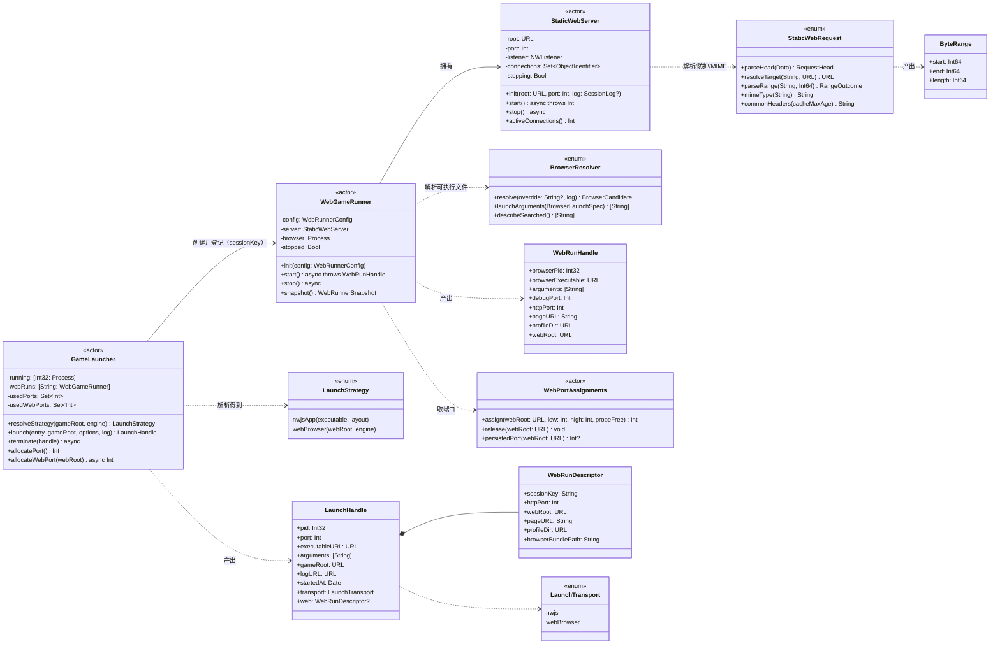

# V0.2 架构设计：Web 运行后端（静态 HTTP + Chromium 内核）

- 架构师：高见远
- 日期：2026-10-22
- 输入：`.workbuddy/briefs/2026-10-22-real-game-v02.md`（主理人实机侦察结论 0.1–0.7，全部采信，不复测）
- 适用代码基线：`Sources/**/*.swift` + `Resources/agent_mvmz.js`（`--attach` 链路已实测通）
- 文档定位：**只做设计，不含实现代码**。实现由工程师按第 10 节任务表逐条落地。

---

## 0. 一句话结论与增量边界

**Windows 版 MV/MZ 的"启动"本质是"把游戏目录用静态 HTTP 托管 + 用 Chromium 内核打开 `index.html`"，所以 V0.2 不走 Wine、不加 Wine 后端、不动用户盘上任何文件。** 相对 v0.1 的 `--attach` 路径，增量只有三件事：

| 增量 | 内容 | 为什么必须新增 |
|---|---|---|
| A | `GameLauncher` 的"可执行文件解析"从"只认 nwjs.app 布局"扩展为"nwjs.app 优先 → Web 运行后端 → 报错" | 现状对 Windows 发行版抛 `launcher_no_executable`，点启动即失败（brief §0.3）。这是 P0 阻断 |
| B | 新增 `WebGameRunner`（静态 HTTP 服务 + 浏览器进程 + 端口确定性派生），并把它的生命周期挂进既有 `terminate` | 产品在 macOS 上没有 nwjs 运行时，必须自己托管与拉壳 |
| C | 转义码双端改大小写不敏感 + 补 `\I[n]` | 真实数据 533 次 `\c[..]` / 104 次 `\v[..]` 会被当正文送后端（brief §0.5） |

**明确不在本文范围**：语言对可选、WKWebView 内嵌运行器、静态预翻译、Wine/CrossOver 后端、`lookup(raw,key)`（BUG-11）。也**不承诺**"支持所有 MV/MZ"——本轮成立的证据只有 1 个真实 MZ 游戏 + 标题/消息窗口两种 surface。

---

## 1. 方案总述

### 1.1 为什么用浏览器内核而不是 Wine

MV/MZ 的游戏逻辑是纯 JS/HTML + 素材，`Game.exe` 只是 NW.js 的 Windows 壳；把同一份目录用 `http://127.0.0.1:<port>/index.html` 打开，Chromium 就是 NW.js 的运行时。Wine 在这里要额外解决"Windows 图形栈 + 字体 + 音频驱动 + 壳进程调试端口转发"，换来的是**同一个 V8**——纯负收益。

配套的第二条硬事实：**Chromium 必须带 `--autoplay-policy=no-user-gesture-required`**。不带时 `AudioManager` 的 `play()` 被 autoplay 策略拒绝，MZ 的 `SceneManager.catchNormalError` 直接把游戏钉在错误页（`NotAllowedError: play() failed because the user didn't interact…`）。所以"浏览器运行器"不是"随手 open 一个 URL"，它的启动参数是**功能的一部分**，见 §5.2。

### 1.2 相对 `--attach` 的增量（复用不变）

`--attach <debugPort>` 已验证的链路是：

```
CDPClient.waitForReady → browserVersion → connect(WS) → listTargets → attach(page)
→ enablePage/enableRuntime → 探针确认是 RM 页面 → AgentInjector.injectAndHandshake
→ push(.config) → MVAdapter.startTextPump → SessionController/CLI 的 drain 循环
```

V0.2 **一行不改**这条链路。新增的只是它前面的一段：

```
[新] resolveStrategy → 静态服务起监听 → 拉浏览器（带调试端口）→ 得到 debugPort
→ 交给既有 attach（完全不变）
```

以及它后面的一段：

```
[改] terminate 除了 SIGTERM/SIGKILL 浏览器进程，还要关 HTTP 监听 + 强制关闭全部在飞连接
```

`SessionController.start`（150–226 行）的骨架也不变：`adapter.launch` → `adapter.attach` → `startTextPump`。因为分流发生在 `GameLauncher.launch` 内部，`SessionController` 与 `MVAdapter` 都不需要知道"这次是 nwjs 还是浏览器"。

### 1.3 分层落点（遵守 UI 依赖门禁）

| 层 | 新增内容 | 是否允许 import AppKit/SwiftUI |
|---|---|---|
| `Sources/Adapters/Web/` | 静态服务、请求解析、浏览器解析、运行器 | ❌ 只用 Foundation / Network / Darwin |
| `Sources/Adapters/Launcher/` | 端口分配表（`web-ports.json`） | ❌ 同上 |
| `Sources/Domain/` | 仅改 `Segmenter.swift`（转义码）、`Models.swift`（错误码） | ❌ |
| `Sources/App/` | `AttachCLI.swift`（`--play`）、`AppMain.swift`（分流）、`Constants.swift` | ❌ |
| `Sources/UI/` | **本轮不改**（`MainWindow.swift` 冻结，只读） | ✅（不动） |

`Scripts/build.sh` 第一步的 `grep -REl '^import (SwiftUI|AppKit)' Sources/{Domain,Adapters,Infra,SelfTest}` 会以退出码 2 拦住任何越界——新文件放 `Adapters/Web/` 天然在门禁范围内，**不要**为了"顺手用 `NSWorkspace` 打开 URL"把它挪进 UI 层。

---

## 2. 文件清单

### 2.1 新增

| # | 相对路径 | 职责 | 关键约束 |
|---|---|---|---|
| N1 | `Sources/Adapters/Web/StaticWebRequest.swift` | **纯函数层**：请求行/头解析、目标路径百分号解码、路径穿越防护、`ByteRange` 解析、MIME 表、响应头拼装。零 socket、零 I/O 副作用（读文件由调用方做） | 必须能被 selftest 直接调用；不得出现任何 `NWConnection` 类型 |
| N2 | `Sources/Adapters/Web/StaticWebServer.swift` | **传输层**：`NWListener` 绑回环、连接接受/复用/超时、流式分块发送（`FileHandle` 链式发送，禁止整读）、`stop()` 时取消监听与全部连接 | 只用 Network + Foundation；不得 import AppKit |
| N3 | `Sources/Adapters/Web/BrowserResolver.swift` | 浏览器可执行文件解析（设置 → 环境变量 → `/Applications`、`~/Applications` 的 Chrome 族 → Playwright 缓存）+ 启动参数构造（逐条带理由的数组） | 找不到时抛 `browser_not_found`，message 里带"找过的路径清单 + 安装/指定路径指引" |
| N4 | `Sources/Adapters/Web/WebGameRunner.swift` | **编排层**：校验 web 根 → 派生端口 → 起 `StaticWebServer` → 拉浏览器 → 等调试端口就绪 → 返回 `WebRunHandle`；`stop()` 按固定顺序收浏览器 + 监听 + 连接 | 是 `actor`；`stop()` 必须可重入（连调两次不崩） |
| N5 | `Sources/Adapters/Launcher/WebPortAssignments.swift` | 端口确定性派生 + 分配记录（`web-ports.json`），保证"同一游戏同一端口、不同游戏不同端口" | 不持锁跨 await；写盘原子（复用 `FileIO.atomicWrite`） |
| N6 | `Tests/e2e/play_e2e.sh` | 真实游戏 E2E：`--play` + 回声后端 + 截图 + JSONL 断言 | 必须输出 binary sha256（快照纪律） |

### 2.2 修改

| # | 相对路径 | 改动摘要 | 风险等级 |
|---|---|---|---|
| M1 | `Sources/Adapters/Launcher/GameLauncher.swift` | `resolveExecutable` → `resolveStrategy`（nwjs / web / 抛错）；`launch` 分流；`terminate` 收三样；新增 `allocateWebPort`；`usedWebPorts` 簿记 | 高（改坏则产品整体不可启动） |
| M2 | `Sources/Adapters/EngineAdapter.swift` | `LaunchHandle` 增 `transport` / `web`（带默认值，既有构造点不改）；`LaunchLayout` 增 `case webBrowser`；`MVAdapter.probe` 报 web 布局；`MVAdapter` 增 `launch(_:options:log:)` 重载 | 中 |
| M3 | `Sources/Domain/Models.swift` | `ErrorCode` 增 5 个值 + `uiMessage` | 低 |
| M4 | `Sources/App/Constants.swift` | 新增 web 端口区间 / 分块大小 / 连接上限 / 超时 / profile 目录名 / `escapeTableVersion` | 低 |
| M5 | `Sources/Infra/Stores.swift` | `Settings.browserPath`（默认 `""`）；`AppPaths.browserProfilesDirectory`、`AppPaths.webPortsURL`；`ensureDirectories` 纳入 profiles 根 | 低 |
| M6 | `Sources/Domain/Segmenter.swift` | `bracketedCodeLength` / `singleCharCodeSet` 改 ASCII 大小写不敏感 + 补 `I` | 高（双端必须同批） |
| M7 | `Resources/agent_mvmz.js` | 与 M6 **同批、逐值等价的**改造（`BRACKET_CODES` / `SINGLE_CODES` 比较折叠） | 高（同上） |
| M8 | `Sources/App/AttachCLI.swift` | `Options` 增 `play/headless/browserPath`；`run` 切成 `prepare / attachPhase / drainPhase / report` 四段；新增 `runPlay` | 中（不得改动既有 `--attach` 行为） |
| M9 | `Sources/App/AppMain.swift` | 入口加 `--play` 分流（放在 `--attach` 判断之后、`MochiBoxApp.main()` 之前） | 低 |
| M10 | `Sources/SelfTest/SelfTestRunner.swift` | 新增 F 组用例（web 服务 / 端口确定性 / 转义码双端 parity）；`cases` 注册 | 低 |

### 2.3 不改（明确声明）

- `Sources/UI/MainWindow.swift`：错误展示已走 `error.code.rawValue + error.message` 的 `DisclosureGroup`，新错误码自动可见，无需改。设置页**本轮不加**"浏览器路径"输入框（文件冻结）；`Settings.browserPath` 先只支持手工编辑 `settings.json`，UI 留 P1。
- `Sources/Domain/SessionController.swift`：分流在 `GameLauncher` 内部，此文件零改动。
- `Scripts/build.sh`：新文件在 `Sources/` 下，`find` 自动纳入，无需改（除非后续要加 parity 门禁）。

---

## 3. 类型与接口

### 3.1 类图



### 3.2 关键类型签名（伪代码，非完整实现）

#### 3.2.1 `LaunchStrategy` / `LaunchTransport`

```swift
/// 启动策略：先 nwjs 布局，其次 Web 运行后端。
enum LaunchStrategy: Sendable {
    case nwjsApp(executable: URL, layout: LaunchLayout)
    case webBrowser(webRoot: URL, engine: EngineKind)
}

/// 运行传输方式。加在 `LaunchHandle` 上，让 `terminate` 知道该收哪些资源。
enum LaunchTransport: String, Sendable {
    case nwjs        // v0.1 行为：单进程，收 pid 即可
    case webBrowser  // v0.2：浏览器进程 + HTTP 监听 + 全部在飞连接
}
```

`LaunchLayout` 追加 `case webBrowser`（与 `LaunchTransport` 语义重叠但用途不同：`LaunchLayout` 进日志/`AdapterProbe`，`LaunchTransport` 进 `terminate` 分流；不要合并，否则 `probe`（不启动进程）也得编出一个 transport）。

#### 3.2.2 `LaunchHandle` 扩展（**兼容既有构造点**）

```swift
struct LaunchHandle: Sendable {
    // ── v0.1 字段，顺序不动 ──
    var pid: Int32
    var port: Int                  // 调试端口（CDP）语义不变
    var executableURL: URL
    var arguments: [String]
    var gameRoot: URL
    var logURL: URL
    var startedAt: Date
    // ── v0.2 追加，全部带默认值 ──
    /// 默认 .nwjs：`AttachCLI` 里 `LaunchHandle(pid: 0, …)` 那种"不启动、只 attach"的构造点零改动。
    var transport: LaunchTransport = .nwjs
    /// transport == .webBrowser 时非空；terminate 用它找回 StaticWebServer。
    var web: WebRunDescriptor? = nil
}

/// 只放"能在 actor 之外安全传递"的描述符，**不放 listener/connection 本体**
/// （NWListener 不是 Sendable，塞进 Sendable struct 会直接编译不过）。
struct WebRunDescriptor: Sendable {
    /// 在 `GameLauncher.webRuns` 里找回 runner 的键（随机 16 hex）。
    var sessionKey: String
    var httpPort: Int
    var webRoot: URL
    var pageURL: String          // "http://127.0.0.1:39310/index.html"
    var profileDir: URL
    var browserBundlePath: String
}
```

> **为什么用 sessionKey 而不是把 runner 放进 handle**：`LaunchHandle` 是 `Sendable` 值类型，`MVAdapter`/`SessionController` 到处传它；把 actor 引用放进去会让 `LaunchHandle` 失去 `Sendable`，并让"谁负责 stop"变模糊。sessionKey 让所有权留在 `GameLauncher` 一处。

#### 3.2.3 `GameLauncher` 的形态变化

```swift
actor GameLauncher {
    private var running: [Int32: Process] = [:]
    private var usedPorts: Set<Int> = []        // 调试端口（39200–39300）
    private var usedWebPorts: Set<Int> = []     // 静态服务端口（39310–39409）
    private var webRuns: [String: WebGameRunner] = [:]
    private let webPorts = WebPortAssignments(paths: AppPaths.shared)

    // 1) 解析（纯磁盘，不启动任何东西）
    func resolveStrategy(gameRoot: URL, engine: EngineKind) throws -> LaunchStrategy

    // 2) 启动（分流）
    func launch(
        entry: GameEntry,
        gameRoot: URL,
        options: LaunchOptions = LaunchOptions(),
        log: SessionLog?
    ) async throws -> LaunchHandle

    // 3) 终止（分流：.nwjs 走老路；.webBrowser 先收三样再走老路）
    func terminate(_ handle: LaunchHandle) async

    func allocatePort() throws -> Int                                  // 现状不变
    func allocateWebPort(webRoot: URL) async throws -> Int             // 新增：确定性派生
}

struct LaunchOptions: Sendable {
    var headless: Bool = false
    var browserPathOverride: String? = nil     // --browser / Settings.browserPath
    var extraBrowserArgs: [String] = []
    var windowSize: String = K.browserWindowSize
}
```

`EngineAdapter` 协议**不改签名**。`MVAdapter` 增加一个具体重载，协议方法委托给它：

```swift
// EngineAdapter.swift（MVAdapter 内）
func launch(_ entry: GameEntry, log: SessionLog?) async throws -> LaunchHandle {
    return try await launch(entry, options: LaunchOptions(), log: log)   // 协议方法
}
func launch(_ entry: GameEntry, options: LaunchOptions, log: SessionLog?) async throws -> LaunchHandle { … }

func probe(_ gameRoot: URL) throws -> AdapterProbe   // 增：命中 web 根时 layout = .webBrowser
```

#### 3.2.4 `WebGameRunner`

```swift
struct WebRunnerConfig: Sendable {
    var webRoot: URL
    var engine: EngineKind
    var debugPort: Int              // 由 GameLauncher.allocatePort() 给出（既有 39200–39300）
    var httpPort: Int               // 由 GameLauncher.allocateWebPort() 给出（确定性）
    var headless: Bool
    var browserPathOverride: String?
    var windowSize: String
    var extraBrowserArgs: [String]
    var profileDir: URL
    var logURL: URL                 // 浏览器 stdout/stderr 落盘（0600）
    var log: SessionLog?
}

actor WebGameRunner {
    init(config: WebRunnerConfig)

    /// 顺序：起监听 → 拉浏览器 → 等调试端口 ready → 返回句柄。
    /// 任一步失败必须**回滚已起的部分**（见 §6.4 的失败回滚矩阵）。
    func start() async throws -> WebRunHandle

    /// 幂等；重复调用第二次直接 return。
    func stop() async

    func snapshot() -> WebRunnerSnapshot   // 排障用：httpPort/debugPort/activeConnections/browserAlive
}

struct WebRunHandle: Sendable {
    var browserPid: Int32
    var browserExecutable: URL
    var arguments: [String]
    var debugPort: Int
    var httpPort: Int
    var pageURL: String
    var profileDir: URL
    var webRoot: URL
}
```

#### 3.2.5 `StaticWebServer`

```swift
actor StaticWebServer {
    init(root: URL, port: Int, log: SessionLog?)
    /// 返回实际绑定端口。`.failed(.posix(.EADDRINUSE))` → 抛 `web_port_busy`；其余 → `web_server_failed`。
    func start() async throws -> Int
    /// 1) listener.cancel() 2) 逐个 connection.cancel() 3) 清空集合。幂等。
    func stop() async
    var activeConnections: Int { get }
}
```

#### 3.2.6 `StaticWebRequest`（纯逻辑，可单测）

```swift
enum StaticWebRequest {
    struct RequestHead: Sendable {
        var method: String          // GET / HEAD / 其它
        var target: String          // 原始 target（含 query）
        var rangeHeader: String?
        var wantsClose: Bool        // Connection: close，或 HTTP/1.0
        var httpVersion: String
    }
    enum RangeOutcome: Sendable {
        case none                   // 无 Range 头 → 200 全量
        case satisfiable(ByteRange) // → 206
        case unsatisfiable          // → 416
        case ignore                 // 多段/语法不合法 → 忽略 Range，200 全量
    }
    enum Resolution: Sendable {
        case file(URL)
        case directoryIndex(URL)
    }
    struct ResolutionError: Error { var status: Int; var reason: String }  // 403 / 404 / 400

    /// 从缓冲区里切出请求头（到 `\r\n\r\n`）。缓冲上限 16KB，超限 → nil（400）。
    static func parseHead(_ buffer: Data) -> (head: RequestHead, consumed: Int)?

    /// 百分号解码 → 去掉 scheme/host（absolute-form）→ 穿越防护 → 映射成磁盘 URL。
    static func resolve(target: String, root: URL) throws -> Resolution

    static func parseRange(_ header: String, fileSize: Int64) -> RangeOutcome
    static func mimeType(forExtension ext: String) -> String
    static func commonHeaders(cacheMaxAge: Int) -> String
}

struct ByteRange: Sendable, Equatable {
    var start: Int64
    var end: Int64      // 含
    var length: Int64 { end - start + 1 }
}
```

#### 3.2.7 `BrowserResolver`

```swift
enum BrowserResolver {
    struct BrowserCandidate: Sendable {
        var executable: URL        // …/Foo.app/Contents/MacOS/Foo
        var bundlePath: String     // …/Foo.app
        var source: String         // "settings" | "env" | "applications" | "playwright-cache"
        var version: String?       // 只在能便宜拿到时填（CFBundleShortVersionString）
    }
    static func resolve(override: String?, log: SessionLog?) throws -> BrowserCandidate
    static func searchedPaths(override: String?) -> [String]
    static func launchArguments(spec: BrowserLaunchSpec) -> [String]
}

struct BrowserLaunchSpec: Sendable {
    var executable: URL
    var pageURL: String
    var debugPort: Int
    var profileDir: URL
    var headless: Bool
    var windowSize: String
    var extra: [String]
}
```

#### 3.2.8 `WebPortAssignments`

```swift
actor WebPortAssignments {
    init(paths: AppPaths)
    /// 确定性派生 + 冲突线性探测 + 落盘。同一 webRoot 每次同值（除非该端口被别的游戏持久占用）。
    func assign(webRoot: URL, low: Int, high: Int, isFree: (Int) -> Bool) throws -> Int
    func persistedPort(webRoot: URL) -> Int?
    func release(webRoot: URL)      // 只清运行期占位，不清持久记录（存档 origin 不能漂）
}
```

派生算法（**这是存档不丢的关键，见 §11 风险 R2**）：

```
gameHash      = sha256(canonicalPath(webRoot)).prefix(16)
candidateSeed = UInt32(sha256("mochibox-web-v1|" + canonicalPath(webRoot))[0..<4]) 
candidate     = low + Int(candidateSeed % UInt32(high - low + 1))
port          = 持久表里该 gameHash 的记录（若有且未被其它 gameHash 占用）→ 直接用它
               否则 candidate 起线性探测 candidate, candidate+1, …, 绕回 low，取第一个
                    「未被其它 gameHash 持久占用 且 isFree(port)」的端口，写入持久表
```
持久表 `~/Library/Application Support/MochiBox/web-ports.json`：`{schemaVersion:1, assignments:{ "<gameHash>": {"port":39310, "webRoot":"/…", "updatedAt":…} }}`，原子写、0600。

---

## 4. HTTP 服务设计

### 4.1 选型：`NWListener`，不用裸 BSD socket

| 维度 | NWListener（选） | BSD socket + DispatchSource（不选） |
|---|---|---|
| 回环限定 | `NWParameters.requiredLocalEndpoint = .hostPort(host: .ipv4(.loopback), port: p)` 一句到位 | 手写 `bind` + `INADDR_LOOPBACK`，容易漏 `htons`/`inet_addr` |
| 连接生命周期 | `NWConnection.cancel()` 一次性收干净（含 fd） | 自己管 fd 集合、`EPOLL`/`kqueue` 事件、半关闭状态机 |
| 每连接并发 | 每连接一个 GCD 队列回调，天然隔离 | 单事件循环里手写状态机，易出"半个请求"死锁 |
| 可验证性 | selftest 里 `MockHTTPServer` 已是同款写法（`SelfTestRunner.swift:666`），模式已验证 | 无可复用样板 |
| 已知代价 | 无法定制 TCP 选项（`SO_REUSEADDR` 走 `allowLocalEndpointReuse`） | 全都能定制 |

`build.sh` 已经链接 `-framework Network`，零新增依赖。**结论：NWListener。**

要点：

- 绑定必须**只回环**：
  ```swift
  let params = NWParameters.tcp
  params.allowLocalEndpointReuse = true          // 重启后不吃 TIME_WAIT
  params.requiredLocalEndpoint = .hostPort(host: .ipv4(.loopback), port: NWEndpoint.Port(rawValue: UInt16(port))!)
  let listener = try NWListener(using: params)
  ```
  只要 `requiredLocalEndpoint` 设成 `.loopback`，就不可能落到 `0.0.0.0`——这条是硬约束（AGENTS 记忆 + PRD 合规声明），**不要**用 `NWListener(using:on:)` 后再"相信"默认行为。
- 端口占用判定：`stateUpdateHandler` 收到 `.failed(let e)`，若 `e == .posix(.EADDRINUSE)` → `web_port_busy`，否则 `web_server_failed`。启动前用既有 `GameLauncher.isPortFree(_:)` 先探一次只是**快路径**（省 3ms 和一条日志），**不能**据此认为绑定一定成功（TOCTOU：探测与 bind 之间端口可能被抢），两条路径都必须处理。
- 就绪等待：`start()` 内部用 `CheckedContinuation` + `withTaskGroup` 超时（`K.webListenerReadyTimeoutSec`），`.ready` 时把 `listener.port` 回填再返回。

### 4.2 并发模型与连接生命周期

```
DispatchQueue: "mochibox.web.listener"（串行，只做 accept 与状态迁移）
             + "mochibox.web.conn"（.concurrent，做解析/读文件/发送）
连接上限: K.webMaxConcurrentConnections = 32，超出 → 503 + Connection: close
```

单连接状态机（**HTTP/1.1 keep-alive**，不实现 pipelining）：

```
connecting
  → receive(min:1, max:64KB) 累积到 buffer（上限 16KB 头部）
  → parseHead(buffer)
       nil（未收全）        → 继续 receive（累计超 16KB → 431 + close）
       method ∉ {GET,HEAD} → 405 + Allow: GET, HEAD + close
  → resolve(target, root)
       403 / 404 / 400 → 响应后按 keep-alive 规则决定是否 close
  → stat 文件
       HEAD       → 只发头（Content-Length 为全量/区间长度），不发 body
       Range 命中 → 206 + Content-Range + 区间 body
       其它       → 200 + Content-Length + 全量 body
  → 发送结束
       requestsServed += 1
       若 wantsClose 或 requestsServed >= K.webMaxRequestsPerConnection → close
       否则保持，重新进入 receive，并挂一个 K.webKeepAliveIdleSec 的空闲计时器（到点 cancel）
```

**为什么必须支持 keep-alive**：一个 800MB 游戏开局要拉几十个 `.png` + `.ogg`；若每请求都 `Connection: close`，Chromium 会按 6 条/主机不断重连，本机回环上堆大量 `TIME_WAIT`，进度条会肉眼可见地变慢。代价是必须处理"缓冲区里残留了下一个请求的字节"——V0.2 明确**不做 pipelining**（Chromium 默认不发），遇到缓冲里有多余字节时：把剩余字节当作新请求的开头继续走 `parseHead`，若解析不出且缓冲超限 → 431 + close。

### 4.3 流式分块发送（大文件绝不整读）

```swift
// 关键：send 的 completion 里才读下一块 —— 单连接在飞数据恒定 ≈ 1 块
func sendFile(connection: NWConnection, url: URL, offset: Int64, length: Int64) {
    guard let handle = try? FileHandle(forReadingFrom: url) else { return 500 }
    try? handle.seek(toOffset: UInt64(offset))
    var remaining = length

    func pump() {
        if remaining <= 0 || stopped {
            connection.send(content: nil, contentContext: .finalMessage, isComplete: true,
                            completion: .contentProcessed { _ in finishRequest() })
            try? handle.close()
            return
        }
        let want = Int(min(Int64(K.webChunkBytes), remaining))     // K.webChunkBytes = 256KB
        guard let chunk = try? handle.read(upToCount: want), !chunk.isEmpty else {
            remaining = 0; pump(); return
        }
        remaining -= Int64(chunk.count)
        connection.send(content: chunk, completion: .contentProcessed { error in
            if error != nil { stopped = true; try? handle.close(); connection.cancel(); return }
            pump()                                                  // ← 背压点
        })
    }
    pump()
}
```

要点：

- `K.webChunkBytes = 256 * 1024`：800MB 单文件内存峰值 ≈ 256KB × 连接数（32）= 8MB 上限，且实际只有 6 条浏览器连接。
- **禁止** `Data(contentsOf:)`、`String(contentsOf:)`、`readToEnd()`（后者是重灾区）。code review 时对 `StaticWebServer.swift` grep `contentsOf` 必须为 0 命中。
- 发送中断（客户端 seek 后取消）必须 `handle.close()`，否则 fd 泄漏；`stop()` 时也要保证所有在飞 `FileHandle` 被关（把句柄登记到一个 `Set<FileHandle>` 由 `stop()` 强关）。
- `contentContext: .finalMessage` + `isComplete: true` 才会让 Chromium 认为响应结束（否则 keep-alive 下它会一直等）。
- 区间长度用 `Int64`：单个大 `.ogg` 可能 > 2GB 的边界情况不要用 `Int`。

### 4.4 Range（音频/视频拖动必须）

`parseRange` 规则（只支持单段，其余按表处理）：

| `Range` 头 | fileSize | 结果 | 响应 |
|---|---|---|---|
| 无 | 任意 | `.none` | `200` + 全量 |
| `bytes=100-199` | 1000 | `.satisfiable(100…199)` | `206` + `Content-Range: bytes 100-199/1000` + 100B |
| `bytes=500-` | 1000 | `.satisfiable(500…999)` | `206` + `bytes 500-999/1000` |
| `bytes=-200` | 1000 | `.satisfiable(800…999)` | `206` + `bytes 800-999/1000` |
| `bytes=1000-` | 1000 | `.unsatisfiable` | `416` + `Content-Range: bytes */1000` |
| `bytes=0-9,20-29` | — | `.ignore` | `200` + 全量（多段不实现，宁可全量） |
| `bytes=abc` / `items=0-1` | — | `.ignore` | `200` + 全量 |

- 所有 `200` 响应都带 `Accept-Ranges: bytes`（不给这个头，Chromium 的 `<audio>` 不会尝试 Range，拖动会整段重下）。
- `end` 必须被 `fileSize-1` 夹紧（`bytes=0-999999999` 很常见）。
- `206` 的 `Content-Length` 是**区间长度**，不是文件长度。
- 不实现 `If-Range` / `ETag`：本地静态文件，不存在"取到一半文件变了"的现实路径；写了反而是没测过的代码。

### 4.5 路径穿越防护

```swift
static func resolve(target: String, root: URL) throws -> Resolution {
    // 1) 切掉 query / fragment
    var raw = target.split(separator: "?", maxSplits: 1).first.map(String.init) ?? target
    raw = raw.split(separator: "#", maxSplits: 1).first.map(String.init) ?? raw
    // 2) absolute-form（"http://127.0.0.1:39310/a.js"）→ 取 path
    if raw.hasPrefix("http://") || raw.hasPrefix("https://"), let u = URL(string: raw) { raw = u.path }
    // 3) 百分号解码（一次，不递归 —— 递归解码会把 %252e%252e 变成 ..，是漏洞不是特性）
    guard let decoded = raw.removingPercentEncoding else { throw .init(status: 400, reason: "bad_percent") }
    guard !decoded.contains("\u{0}") else { throw .init(status: 400, reason: "nul") }
    guard !decoded.contains("\\") else { throw .init(status: 403, reason: "backslash") }   // MZ 素材不用反斜杠
    // 4) 规范化为相对路径
    var rel = decoded.hasPrefix("/") ? String(decoded.dropFirst()) : decoded
    if rel.isEmpty { rel = K.webDirectoryIndexName }
    // 5) 词法规范化后必须仍在 root 之内
    let candidate = root.appendingPathComponent(rel).standardizedFileURL
    let rootCanonical = root.resolvingSymlinksInPath().standardizedFileURL.path   // root 自身可能是符号链接
    let candidateCanonical = candidate.resolvingSymlinksInPath().standardizedFileURL.path
    guard candidateCanonical == rootCanonical || candidateCanonical.hasPrefix(rootCanonical + "/") else {
        throw .init(status: 403, reason: "path_traversal")      // ../ 、..%2F、符号链接逃逸 全落这里
    }
    // 6) 目录 → 补 index.html；regular file 才返回
    …
}
```

六条断言（selftest 必测）：

1. `/../etc/passwd` → 403
2. `/..%2F..%2Fetc/passwd` → 403（解码后判）
3. `/a/%2e%2e/b` → 403
4. 根下建符号链接 `link -> /etc`，请求 `/link/passwd` → 403（`resolvingSymlinksInPath` 兜住）
5. `/data/` 目录请求 → 尝试 `data/index.html`，不存在则 404（**不列目录**）
6. `/` → `index.html`

### 4.6 MIME 表

```swift
static let mimeTable: [String: String] = [
    "html": "text/html; charset=utf-8", "htm": "text/html; charset=utf-8",
    "js":   "text/javascript; charset=utf-8", "mjs": "text/javascript; charset=utf-8",
    "json": "application/json; charset=utf-8",
    "css":  "text/css; charset=utf-8",
    "txt":  "text/plain; charset=utf-8",
    "png":  "image/png", "jpg": "image/jpeg", "jpeg": "image/jpeg",
    "gif":  "image/gif", "webp": "image/webp", "svg": "image/svg+xml",
    "ogg":  "audio/ogg", "m4a": "audio/mp4", "mp3": "audio/mpeg",
    "wav":  "audio/wav", "webm": "video/webm", "mp4": "video/mp4",
    "wasm": "application/wasm",
    "ttf":  "font/ttf", "otf": "font/otf", "woff": "font/woff", "woff2": "font/woff2",
    "efkefc": "application/octet-stream",        // MZ 音频加密键
]
// 未命中 → "application/octet-stream"（不要 image/png 之类的默认值：
// Chromium 会按 Content-Type 走不同的解码器，猜错比 octet-stream 更糟）
```

扩展名取 `lowercased()`；`.tar.gz` 这类多点扩展名取最后一个点。

### 4.7 缓存头

| 资源 | `Cache-Control` | 理由 |
|---|---|---|
| `.html` / `.js` / `.json` | `no-cache` | 用户可能覆盖安装游戏（换 `data/*.json`），`no-cache`=每次都带条件请求，本地回环代价≈0；`no-store` 会让 MZ 的 `fetch` 每次都重下 800MB 素材，绝不能用 |
| 图片/音频/视频/字体 | `public, max-age=3600` | 开局几十个素材走浏览器磁盘缓存，显著缩短加载；profile 是**每游戏独立**的，缓存不会串 |
| `206` 响应 | 继承上表 + `Accept-Ranges: bytes` | — |
| 全部 | `Connection: keep-alive`（或 `close`）、`X-Content-Type-Options: nosniff` | 防 Chromium 猜类型 |

`no-cache` 而非 `no-store` 是刻意的：MZ 用 `fetch('data/System.json')`，`no-store` 在某些 Chromium 版本会连带禁用媒体流的续传缓存。

---

## 5. 浏览器解析与启动参数

### 5.1 解析顺序（四级，缺一不可）

本机**没有** Chrome/Chromium/Edge/Brave，只有 Playwright 的 `chromium-1248`（brief §0.7）。因此第 4 级不是"兜底"，是**当前机器唯一的真实路径**——自测跑不通就等于功能没做。

| 级 | 来源 | 判定 |
|---|---|---|
| 1 | `Settings.browserPath`（`settings.json` 手工填写，v0.2 无 UI） | 非空 → 规范化；`.app` 结尾则按 `CFBundleExecutable` 取内部可执行；`isExecutableFile` 为真才认，否则**记 warning 并继续下一级**（不因为用户填错就整体失败，但日志必须留痕） |
| 2 | 环境变量 `MOCHI_BROWSER_PATH` | 同上 |
| 3 | `/Applications` 与 `~/Applications` 下的 Chrome 族，按序：`Google Chrome.app`、`Google Chrome Canary.app`、`Chromium.app`、`Microsoft Edge.app`、`Brave Browser.app`、`Vivaldi.app` | 存在 + `Contents/MacOS/<CFBundleExecutable>` 可执行 |
| 4 | Playwright 缓存：`~/Library/Caches/ms-playwright/chromium-*/chrome-mac*/​*.app` | 对 `chromium-*` 目录按数字后缀**降序**取第一个含 `.app` 的；`chrome-mac-arm64` / `chrome-mac` / `chrome-mac-x64` 都接受 |
| — | 全部未命中 | 抛 `MochiBoxError(code: .browserNotFound, message: <见下>)` |

失败文案（AC-6 要求"可执行指引"，不是"崩溃"也不是"假装成功"）：

```
找不到 Chromium 内核浏览器（detail: browser_not_found）。
已尝试：
  /Applications/Google Chrome.app/Contents/MacOS/Google Chrome
  ~/Applications/Chromium.app/Contents/MacOS/Chromium
  ~/Library/Caches/ms-playwright/chromium-*/chrome-mac*/*.app（未发现）
请安装 Google Chrome / Chromium / Edge / Brave 之一，或在
~/Library/Application Support/MochiBox/settings.json 里填写 "browserPath"，
或设置环境变量 MOCHI_BROWSER_PATH 指向可执行文件。
（Safari 不支持 CDP，无法用于本功能。）
```

> 最后一句必须写：用户看到"我明明有 Safari"时不写这句就必然来报 bug。

`.app` → 可执行文件的解析**复用** `GameLauncher.executableInside(appURL:)` 的同一套规则（`Info.plist` 的 `CFBundleExecutable` → `MacOS/` 下按名找 → 目录里第一个可执行）。**不要写第二份**：两份必然漂移（一份认 `CFBundleExecutable`、另一份只认 `chrome`），症状是"能列出 app 但启动失败"。

### 5.2 启动参数清单（逐条理由）

顺序不重要，但**每一条都不能删**。参数由 `BrowserResolver.launchArguments(spec:)` 一处拼装。

| 参数 | 理由（删了会怎样） |
|---|---|
| `--remote-debugging-port=<debugPort>` | 产品唯一的采集通道；`CDPClient.waitForReady` 就是连它。缺了 `--attach` 链路整条断 |
| `--user-data-dir=<profileDir>` | ① 新版 Chrome 在**默认 profile** 上直接忽略 `--remote-debugging-port`（防恶意软件，实测行为）；② 存档（MZ 用 localforage/IndexedDB）按 profile + origin 隔离，共用 profile 会让两个游戏的存档互相污染；③ 绝不能碰用户真实 Chrome 配置（"不写用户目录以外的东西"） |
| `--autoplay-policy=no-user-gesture-required` | **brief §0.2 实测**：不带就 `NotAllowedError` → MZ `catchNormalError` → 游戏钉死在错误页。这条是功能，不是优化 |
| `--app=<pageURL>` | 无地址栏/标签页的独立窗口，用户看到的就是游戏；且页面是唯一 target，`listTargets` 里不会混进扩展页/新标签页，`attach` 的候选排序逻辑（`index.html` 优先）天然命中 |
| `--window-size=<w,h>`（默认 `1280,720`） | 窗口初始尺寸。MZ 画布是 `Graphics.boxWidth`=816×624（本游戏实测），1280×720 留出边距；窗口太小会让 `SceneManager` 的 `Graphics._realCanvas` 被 CSS 压缩，文字看着糊 |
| `--no-first-run` | 首次运行对话框会**盖在 app 窗口上**并抢焦点，用户以为游戏卡住；且它会改写 profile |
| `--no-default-browser-check` | 同上的"设为默认浏览器"气泡 |
| `--disable-features=Translate,TranslateUI` | Chrome 内置翻译条会 **改写 DOM 文本**：我们采集的 `drawTextEx` 入参被浏览器换过一遍，回绘的译文和页面上看到的不一致；还会插一条顶栏遮住游戏 |
| `--disable-background-timer-throttling` | 窗口被遮挡/最小化（用户切到编辑器看文本流）时 Chromium 把 `setTimeout`/`rAF` 降到 1Hz → 游戏不推进、`drain` 拉不到新文本 → 表现为"翻译停了"。这条是**后台节流**的第一层 |
| `--disable-backgrounding-occluded-windows` | 同上，遮挡窗口被"降级"到不渲染 |
| `--disable-renderer-backgrounding` | 同上，renderer 进程被降优先级/挂起 |
| `--disable-hang-monitor` | 加载 800MB 素材时主线程会短暂无响应，hang monitor 可能弹"页面无响应"对话框 |
| `--disable-pinch` / `--overscroll-history-navigation=0` | 触控板双指横滑会触发**页面前进/后退**，把游戏导航走（MZ 是单页，后退=白屏） |
| `--headless=new`（仅 `--headless`） | E2E/无图形会话跑法。注意 `headless` 下 `Page.captureScreenshot` 仍可用，但**不能**用它证明"用户能看到译文"（AC-8 仍需窗口模式截图） |
| `--no-sandbox`（**仅** `--headless`） | Playwright 的 Chromium 不是为我们签名/公证的，headless CI 下沙箱起不来会直接退出；**窗口模式绝不加**（那等于关掉浏览器沙箱，把用户暴露在游戏页脚本面前） |
| `--disable-gpu`（仅 `--headless`） | headless 无 WindowServer，GPU 进程可能起不来并拖 15s 超时 |
| 额外：`Settings.extraLaunchArgs` / `LaunchOptions.extraBrowserArgs` | 既有设置项复用，排障用 |

**不要加**的参数（明确写下来，避免"顺手"）：

- `--mute-audio`：用户要听声音，且它不解决 autoplay（autoplay 是手势策略，不是音量）。
- `--allow-file-access-from-files`：我们走 HTTP，加了只会扩大攻击面。
- `--disable-web-security`：会关掉同源策略，游戏页脚本可读任意本地端口。
- `--incognito`：存档会丢（IndexedDB 不落盘），直接破坏"存档不漂"的目标。

### 5.3 就绪判定

浏览器进程起来 **≠** 调试端口可用（Chromium 先起 zygote/GPU 进程）。判定顺序：

```
1) Process.run() 成功，pid > 0
2) 轮询 http://127.0.0.1:<debugPort>/json/version（复用 CDPClient.waitForReady，超时 K.webBrowserReadyTimeoutSec=15s）
3) 若 2) 超时且 process.isRunning == false → browser_exited_early（附 log 尾部，常见原因：
   profile 权限、--no-sandbox 缺失、架构不匹配）
4) 若 2) 超时但进程还活着 → 抛 process_exited 之外的 cdp_timeout（沿用既有码），message 带 log 尾部
```

`browser_exited_early` 是新码（§9），它的价值在于把"浏览器根本没起来"和"浏览器起来了但 CDP 不通"分开——两者的排障动作完全不同。

---

## 6. 启动策略选择

### 6.1 `resolveExecutable` → `resolveStrategy`

```swift
func resolveStrategy(gameRoot: URL, engine: EngineKind) throws -> LaunchStrategy {
    var tried: [String] = []                       // 既有"已尝试路径清单"机制保留
    // ── 第 1 优先：macOS nwjs 布局（v0.1 的 4 条规则，一行不改） ──
    if let hit = try? legacyNWJSExecutable(gameRoot: gameRoot, tried: &tried) {
        return .nwjsApp(executable: hit.url, layout: hit.layout)
    }
    // ── 第 2 优先：Web 运行后端 ──
    if let webRoot = try? detectWebRoot(gameRoot: gameRoot, engine: engine, tried: &tried) {
        return .webBrowser(webRoot: webRoot, engine: engine)
    }
    // ── 第 3：报错（区分两种失败语义） ──
    if engine == .mv || engine == .mz {
        throw MochiBoxError(code: .webRootMissing, message: 带 tried 清单 + "Windows 版无需 Wine，缺的是 index.html")
    }
    throw MochiBoxError(code: .launcherNoExecutable, message: 带 tried 清单)   // 历史行为不变
}
```

`legacyNWJSExecutable` 就是现有 `resolveExecutable` 的函数体**原样搬过去**（含"预置标准候选路径 → 用户能看到我们找过哪里"的 `noteTried` 机制），只是把最终 `throw` 换成 `return nil`。**不要重写这段逻辑**——它的 `CFBundleExecutable` 兜底规则被 4 种布局依赖。

### 6.2 Web 根识别规则

| engine | 主判据（必须全中） | webRoot |
|---|---|---|
| `.mz` | `<root>/index.html` **且** `<root>/js/rmmz_core.js` | `<root>` |
| `.mv` | `<root>/www/index.html` **且** `<root>/www/js/rpg_core.js` | `<root>/www` |
| 降级 `.mz` | `<root>/index.html` 且（`<root>/js/` 存在 或 `<root>/data/System.json` 存在） | `<root>` |
| 降级 `.mv` | `<root>/www/index.html` 且 `<root>/www/data/System.json` 存在 | `<root>/www` |
| 跨版本兜底 | engine 是 mv/mz 但主判据落空：`<root>/index.html` 与 `<root>/www/index.html` 谁存在用谁（两者都在时按 engine 优先） | 对应目录 |

`index.html` 大小写：用**不区分大小写**的目录列举比对（macOS 默认 APFS 大小写不敏感，但用户在大小写敏感卷上放 `Index.html` 也有可能）。找不到时把"列举到的前 20 个名字"写进 message——用户看到自己目录里那个 `index.htm`（少了 `l`）会立刻明白。

### 6.3 Windows 版 exe 存在时怎么提示

**结论：不报错、不提示阻断、不动用户盘上任何文件。** 规则：

- `<root>/Game.exe` / `<root>/nw.exe` / `<root>/*.exe` 存在 → 只是**日志一行** + 在 `WebRunHandle` 的日志里记 `windowsShell=<exe名>`。
- 只有当 web 根也找不到时，`web_root_missing` 的 message 里**才**补一句：
  `检测到 Windows 版启动器 Game.exe —— 本产品不需要 Wine，也不需要运行它；缺的是 index.html。`
- 绝不删除/重命名/移动 `Game.exe`、`www/`、`package.json`（brief §2.5「不写用户目录以外的东西」；而且用户可能还要用 Windows 版玩）。

### 6.4 `launch` 分流与失败回滚矩阵

```swift
func launch(entry:gameRoot:options:log:) async throws -> LaunchHandle {
    switch try resolveStrategy(gameRoot: gameRoot, engine: entry.engine) {
    case .nwjsApp(let exe, let layout):
        return try launchProcess(exe: exe, layout: layout, …)          // 现有逻辑，原样
    case .webBrowser(let webRoot, let engine):
        let debugPort = try allocatePort()                             // 39200–39300
        let httpPort  = try await allocateWebPort(webRoot: webRoot)    // 39310–39409，确定性
        let key = RandomHex.make(16)
        let runner = WebGameRunner(config: …)
        webRuns[key] = runner
        do {
            let run = try await runner.start()
            usedPorts.insert(debugPort); usedWebPorts.insert(httpPort)
            ChildProcessRegistry.shared.register(run.browserPid)        // ⌘Q 兜底
            return LaunchHandle(pid: run.browserPid, port: run.debugPort, …,
                                transport: .webBrowser,
                                web: WebRunDescriptor(sessionKey: key, …))
        } catch {
            await runner.stop()                                         // ← 回滚
            webRuns.removeValue(forKey: key)
            usedPorts.remove(debugPort); usedWebPorts.remove(httpPort)
            await webPorts.release(webRoot: webRoot)
            throw error
        }
    }
}
```

失败回滚矩阵（**每一条都要有用例或日志证据**，AC-7）：

| 失败点 | 已占用资源 | 必须回滚 |
|---|---|---|
| 端口探测失败 | 无 | 无（`port_unavailable`） |
| `StaticWebServer.start` 抛 `web_port_busy` | debugPort 已登记 | 释放 debugPort；httpPort 不写持久表 |
| 监听 OK、浏览器解析失败 `browser_not_found` | listener + debugPort | `server.stop()`；释放两个端口 |
| 浏览器进程起不来 | 同上 | 同上 + 关 log 句柄 |
| 浏览器起来但 CDP 15s 不通 | 同上 + pid | 同上 + SIGTERM→SIGKILL + `ChildProcessRegistry.unregister` |
| attach 阶段失败（`SessionController` 里） | 全部 | `SessionController.fail` 已 `Task { await adapter.stop() }` → 走 `terminate`，无需额外改动 |

---

## 7. `--play` CLI

### 7.1 目标

一条命令走**真实产品启动路径**做 E2E：`--play RJxxxxxx --provider passthrough --duration 12` 必须退出码 0 且 `captured > 0`（AC-2）；换 echo mock 后端则 `translated > 0`（AC-3）。而且**不能**复制一份 drain 循环——现在 `AttachCLI.run` 里那 120 行（含 JSONL、跳过判定、退出码语义）已经被三轮 QA 打磨过，复制一份意味着以后修 bug 要改两处。

### 7.2 函数切分（重构后，行为对 `--attach` 完全不变）

```swift
enum AttachCLI {
    struct Options {
        // ── v0.1 ──
        var port: Int = 0
        var provider = "passthrough"; var endpoint = ""; var apiKey = "test-key"
        var out: String?; var screenshot: String?; var duration: Double = 6
        // ── v0.2 ──
        var play: String? = nil          // 游戏目录；非 nil 时走 runPlay
        var headless: Bool = false
        var browserPath: String? = nil
    }

    /// 一次运行里不变的东西，集中成值，避免 6 个参数到处传。
    struct SessionEnv: Sendable {
        var settings: Settings
        var provider: TranslatorProvider
        var config: AgentConfig
        var collector: EnvelopeCollector
        var sessionToken: String
    }

    struct RunStats: Sendable {
        var captured = 0, translated = 0, skipped = 0
        var skippedReasons: [String: Int] = [:]
        var writeFailures = 0
        var attachFailed = false
        var environmentCode: ErrorCode? = nil   // browser_not_found / web_root_missing / web_port_busy
    }

    // 入口分流（bootstrap 里 parse → run）
    static func run(_ options: Options) async -> Int32

    // 四段（--attach 与 --play 共用中间两段）
    static func prepare(_ options: Options) -> SessionEnv
    static func attachPhase(adapter: MVAdapter, port: Int, env: SessionEnv) async throws -> AttachInfo
    static func drainPhase(adapter: MVAdapter, env: SessionEnv, options: Options) async -> RunStats
    static func report(_ stats: RunStats, env: SessionEnv, options: Options) -> Int32

    static func runAttach(_ options: Options) async -> Int32
    static func runPlay(_ options: Options) async -> Int32
}
```

映射关系（**逐块对应，重构不得改变 `--attach` 语义**）：

| 现有 `run(_:)` 的段落 | 去处 |
|---|---|
| 86–103 行（打印、settings/provider/config/collector 构造） | `prepare` |
| 105–128 行（`MVAdapter` + 桩 handle + attach + startTextPump + 失败返回 1） | `attachPhase`（失败由调用方映射为 `stats.attachFailed`） |
| 131–265 行（JSONL writer、deadline 循环、批量翻译、跳过判定、pushItems） | `drainPhase`（**整段搬移，只把局部变量收进 `RunStats`**） |
| 267–306 行（截图、writer.close、adapter.stop、打印汇总、退出码） | `report` |

### 7.3 `runPlay` 的编排

```swift
static func runPlay(_ options: Options) async -> Int32 {
    guard let dir = options.play else { return 2 }
    let gameRoot = URL(fileURLWithPath: (dir as NSString).expandingTildeInPath, isDirectory: true)
    var stats = RunStats()
    do {
        // 1) 真实产品路径：解析策略 + 起服务 + 拉浏览器（不经过 SessionController，避免 MainActor 依赖）
        let launcher = GameLauncher()
        let entry = GameEntry(name: gameRoot.lastPathComponent, path: gameRoot.path,
                              engine: EngineDetector.detect(gameRoot).engine, …)
        let handle = try await launcher.launch(
            entry: entry, gameRoot: gameRoot,
            options: LaunchOptions(headless: options.headless,
                                   browserPathOverride: options.browserPath),
            log: nil
        )
        guard let web = handle.web else { … "不是 web 句柄" … }
        print("play: http=\(web.httpPort) debug=\(handle.port) page=\(web.pageURL) profile=\(web.profileDir.path)")

        let env = prepare(options)
        let adapter = MVAdapter()
        defer { Task { await launcher.terminate(handle) } }   // 二次保险
        _ = try await attachPhase(adapter: adapter, port: handle.port, env: env)
        stats = await drainPhase(adapter: adapter, env: env, options: options)
        // 截图（必须在 stop 之前，与 --attach 同一时序约束）
        await captureScreenshotIfNeeded(adapter: adapter, options: options)
        await adapter.stop()
        await launcher.terminate(handle)
    } catch let error as MochiBoxError {
        stats.environmentCode = error.code
        print("error_code: \(error.code.rawValue)")
        print("play failed: \(error.message)")
    } catch {
        print("play failed: \(error)")
        return 1
    }
    return report(stats, env: …, options: options)
}
```

关键点：**`defer` 不能只写一处**。E2E 里最常见的残留是"attach 失败后浏览器还开着、端口还被占"，下次跑直接 `web_port_busy` 假失败。因此：`defer { Task { await launcher.terminate(handle) } }` + 正常路径显式 `await launcher.terminate(handle)`（`terminate` 幂等）。

### 7.4 参数与退出码

```
用法: MochiBox --play <游戏目录> [--provider passthrough|openai] [--endpoint <url>]
                              [--api-key <k>] [--out <path.jsonl>] [--screenshot <path.png>]
                              [--duration <sec>] [--headless] [--browser <可执行文件路径>]
```

| 退出码 | 语义 | 判定 |
|---|---|---|
| 0 | 通过 | `captured > 0` 且（`passthrough` 或 `translated > 0`）且 `writeFailures == 0` 且无环境错误 |
| 1 | 通道/管线失败 | `attachFailed` / `captured == 0` / 非 passthrough 且 `translated == 0` / JSONL 写失败 |
| 2 | 参数错误 | 缺 `--play` 值、`--duration` 非数字 |
| 3 | 环境缺口 | `browser_not_found` / `web_root_missing` / `web_server_failed` / `web_port_busy` / `browser_exited_early`；**同时**打印一行 `error_code: <raw>` 供脚本分支（不要把 3 再拆成 3/4/5：码在 stderr 里，脚本 `grep -q error_code: browser_not_found` 比记数字可靠） |

`--attach` 的退出码语义**保持不变**（0/1/2），因为它已经被现有 E2E 脚本依赖。

### 7.5 没有图形会话时也能跑

- `--headless` 时构造 `LaunchOptions(headless: true)`，参数里追加 `--headless=new --no-sandbox --disable-gpu`（§5.2）。
- headless 下 `Page.captureScreenshot` 仍走 CDP，可以产 PNG；但**验收纪律**：AC-8（截图里能看到 `◇新游戏`）必须用**窗口模式**截图取证，headless 截图只能作为"通道通了"的辅助证据。这一点写进 `Tests/e2e/play_e2e.sh` 的注释，防止后来人拿 headless 截图冒充 AC-8。
- `--headless` 不影响 `--attach`（那是"附着到别人已开好的浏览器"）。

---

## 8. 转义码大小写改造（双端同批）

### 8.1 事实前提（brief §0.5，已实测）

MZ 的转义码识别**大小写不敏感**，且 `\I[n]` 是正式码：`rmmz_windows.js:292-306` 的 `/\x1bV\[(\d+)\]/gi` 等全带 `i`；`processEscapeCharacter` 有 `case "I": processDrawIcon`。真实数据里小写 `\c` 533 次、`\v` 104 次、`\n` 6 次、以及 `\i[..]`。现两端码表都是**大写精确匹配**且缺 `I`。

### 8.2 改造规则（唯一一套）

> **规则 R**：把「反斜杠后的字母」按 **ASCII 大写折叠** 后与码表比对；命中即为 `code` 段，**段值保留原始字符**（`\c[3]` 仍是 `\c[3]`，绝不上转成 `\C[3]`）。

三条必须同时成立：

1. **只折叠 ASCII 字母**（`a`–`z` → `A`–`Z`），不用 `String.uppercased()` / `toUpperCase()`：Unicode 大小写映射（土耳其 `ı`、德文 `ß`、希腊终结 sigma）会让两端在不同运行时下折叠出不同结果，而码表只有 ASCII 字母。
2. **段值原样保留**：`Segmenter.reassemble` 与 Agent 的译文回填都把 `code` 段原样拼回。若上转，`\c[3]` 会被绘成 `\C[3]`——**恰好等价**，但 `mapKey` 会跟着变，一改就是"双端键全错"。所以：**只折叠比对，不改值**。
3. **加 `I` 到括号码表**，位置固定在末尾（`… "C", "I"`），两端数组顺序逐值相同（顺序有意义：`PX`/`PY`/`FS` 必须先于 `P`/`X`）。

### 8.3 两端代码位置与改法

**Swift（`Sources/Domain/Segmenter.swift:60-92`）**

```swift
// 唯一新增的折叠函数（放在 bracketedCodeLength 上方）
@inline(__always) private static func asciiUpper(_ c: Character) -> Character {
    guard let a = c.asciiValue, a >= 97, a <= 122 else { return c }
    return Character(UnicodeScalar(a - 32))
}

private static func bracketedCodeLength(_ chars: [Character], start: Int) -> Int? {
    // 顺序敏感：长前缀必须先试。末尾追加 "I"。
    let prefixes: [[Character]] = [Array("FS"), Array("PX"), Array("PY"),
                                   Array("X"), Array("N"), Array("V"), Array("P"),
                                   Array("C"), Array("I")]
    for prefix in prefixes {
        var matched = true
        for (offset, expected) in prefix.enumerated() {
            let position = start + 1 + offset
            if position >= chars.count || asciiUpper(chars[position]) != expected { matched = false; break }
        }
        …  // 其余逻辑（找 `[`、找 `]`、有 `[` 无 `]` 返回 nil）一行不改
    }
    return nil
}

private static let singleCharCodeSet: Set<Character> = [
    "{", "}", "|", "!", ".", "$", ">", "<", "^", "\\", "G"
]
// 单字符分支改为：asciiUpper(next) 后查表（只影响字母 G/g；符号折叠是恒等）
if singleCharCodeSet.contains(asciiUpper(next)) { … }
```

**JS（`Resources/agent_mvmz.js:25-26, 108-152`）**

```js
var SINGLE_CODES = '{}|!.$><^\\G';                      // 不变（比对时折叠）
var BRACKET_CODES = ['FS','PX','PY','X','N','V','P','C','I'];   // 末尾追加 'I'

function asciiUpper(ch) {
  var code = ch.charCodeAt(0);
  return (code >= 97 && code <= 122) ? String.fromCharCode(code - 32) : ch;
}

function bracketCodeLength(text, start) {
  for (var p = 0; p < BRACKET_CODES.length; p++) {
    var letters = BRACKET_CODES[p];
    var matched = true;
    for (var l = 0; l < letters.length; l++) {
      if (asciiUpper(text.charAt(start + 1 + l)) !== letters.charAt(l)) { matched = false; break; }
    }
    …  // 其余不动
  }
  return 0;
}
// splitSegments 里：if (SINGLE_CODES.indexOf(asciiUpper(nextChar)) >= 0) { … }
```

### 8.4 mapKey 双端逐值一致如何保证

- `mapKey` 的定义不变：`text` 段以 `U+001F` 连接；全 `code` 时退回原串。**改的是"哪些段算 code"，不是 mapKey 的算法**。
- 保证手段（三层，缺一层就会漂）：
  1. **同批提交**：`Segmenter.swift` 与 `agent_mvmz.js` 在同一个 commit 里改；不允许分两次提交（分两次的中间态会让页面用新码表切段、Host 用旧码表算键 → 症状是"翻译成功但游戏里永远是原文"）。
  2. **码表版本号**：`K.escapeTableVersion = 2`（Swift）与 `var ESCAPE_TABLE_VERSION = 2`（JS），`hello` 里可带上（v0.2 只需在两边都写死同值，供 grep 对比；不改协议）。
  3. **selftest F 组逐值比对**（这是唯一的自动化护栏）：用 `JavaScriptCore` 载入真实 `agent_mvmz.js`（`AgentInjector.loadScript()` 已有），对同一批 sample 分别取「Agent 上报的 `payload.segments`」与「`Segmenter.splitSegments(raw:)`」，逐段比对 `kind` 与 `value`；再比 `payload.key == Segmenter.mapKey(swiftSegments)`。

### 8.5 不破坏既有 selftest 的论证

改造后 **对外部输入 `\C`/`\N`/`\V`/`\P`/`\G` 等全大写形态的行为零变化**（折叠对已经是 `A`–`Z` 的字符是恒等）。因此：

- 既有 29 条用例一行不改必须全绿。**任何既有用例变红 = 改错了**（最可能的错：顺手把 `code` 段值上转了）。
- `Tests/qa/skip_parity.mjs` 的 7 条 sample 全不影响（`\C[2]350` 是大写；结果仍是"剥码后纯数字 → skip"）。
- **唯一的行为变化是缓存键口径**：`\c[3]魔法` 从"1 个 text 段"变成"[code,text]" → `cacheKey` 变化 → 这些串**一次性重译**。这是修正而非回归；在 `docs/qa-addendum.md` 里记一行"v0.2 起小写码不再视为正文，历史缓存对小写码串不命中，属预期"。

### 8.6 改造前后对照（必须逐条进 selftest）

| raw | 改造前 segments | 改造后 segments | 改造前 mapKey | 改造后 mapKey |
|---|---|---|---|---|
| `\c[3]魔法` | `[text("\c[3]魔法")]` | `[code("\c[3]"), text("魔法")]` | `\c[3]魔法`（码送后端，模型可能改写/丢码） | `魔法` |
| `\i[17]回复药` | `[text("\i[17]回复药")]` | `[code("\i[17]"), text("回复药")]` | `\i[17]回复药` | `回复药` |
| `\n[1]获得` | `[text("\n[1]获得")]`（注意：这是**反斜杠+n**，不是换行） | `[code("\n[1]"), text("获得")]` | `\n[1]获得` | `获得` |
| `\g` | `[text("\g")]` | `[code("\g")]` | `\g` | `\g`（全 code → 退回原串，与既有 `\G` 行为一致） |
| `\z[1]` | `[text("\z[1]")]` | `[text("\z[1]")]`（`Z` 不在 MZ 正式码表，**刻意不加**） | `\z[1]` | `\z[1]`（不变） |
| `\C[2]魔物\G`（回归锚点） | `[code,text,code]` | `[code,text,code]`（**不变**） | `魔物` | `魔物` |

> `\z[1]` 判为 text 是 AC-5 的明确要求：不能"为了防止漏码就把所有字母都收进码表"——那会把真正的正文（例如日文里 `\z` 之类的误输入）也吃掉，而且和 MZ 实际行为不符（MZ 只认它那张表）。

### 8.7 `\I[n]` 的位置

- 括号码表**末尾**（`…"C", "I"`）。`I` 与 `FS/PX/PY/X/N/V/P/C` 无前缀冲突，位置不影响正确性；放末尾是为了让两端 diff 好读。
- 不要放进 `singleCharCodeSet`：`\I` 不带 `[n]` 在 MZ 里不是码（`processEscapeCharacter` 只在 `\I[n]` 形式生效），认了会把 `\I` 后的正文开头吃掉。

---

## 9. 错误码

### 9.1 新增（`Models.swift` 的 `ErrorCode`）

| 枚举 | rawValue | `uiMessage` | `retryable` | 出现在哪个状态 | detail / message 追加 |
|---|---|---|---|---|---|
| `browserNotFound` | `browser_not_found` | 找不到 Chromium 内核浏览器（请安装 Chrome/Chromium/Edge/Brave，或指定路径） | false | `.launching`（`GameLauncher.launch` 抛） | 追加"已尝试路径清单 + 三种指定方式 + Safari 不支持 CDP" |
| `webRootMissing` | `web_root_missing` | 游戏目录里没有可托管的 index.html | false | `.launching` | 追加 tried 清单 + 列举到的前 20 个文件名；若见 `Game.exe` 附"不需要 Wine"说明 |
| `webServerFailed` | `web_server_failed` | 本地静态服务启动失败 | true（重试可能换到别的端口/别的时机） | `.launching` | `underlying` = NWError 文本 |
| `webPortBusy` | `web_port_busy` | 静态服务端口被占用 | true | `.launching` | 带端口号；`port_unavailable` 保留给"整段区间都占满" |
| `browserExitedEarly` | `browser_exited_early` | 浏览器进程启动后立即退出 | false | `.launching` | 追加 log 尾部 20 行（`logTail` 已有）+ 常见原因三条（profile 权限 / 缺 `--no-sandbox`（headless）/ 架构不匹配） |

### 9.2 复用既有码（不新增，但语义要写清）

| 场合 | 用哪个 | 说明 |
|---|---|---|
| 浏览器起来了但 CDP 15s 不通 | `cdp_timeout` | 已有码，`waitForReady` 超时走它 |
| 整段调试端口区间被占 | `port_unavailable` | 已有，`allocatePort` 抛 |
| attach 后找不到 page / 注入失败 | `attach_failed` / `engine_symbols_missing` | 全部沿用 v0.1，V0.2 不改 |
| 目录里既无 nwjs 也无 web 根、且引擎不是 mv/mz | `launcher_no_executable` | **保留**，历史文案与用例不动 |

### 9.3 落点（UI 无需改动）

```
GameLauncher.launch ─throws─▶ SessionController.start catch ─▶ fail(MochiBoxError)
   ─▶ lastError: ErrorInfo ─▶ MainWindow.sessionHeader 的 DisclosureGroup
        （标题：`<code.rawValue>：<message>`；展开显示 message / httpStatus / rawSnippet）
```

因为 `MainWindow` 展示的是 `error.code.rawValue` + `error.message`，新码**自动可见**。要保证的是 `message` 自带可执行指引（§5.1 / §9.1 的"追加"列）——UI 只有一行标题，指引不写在 message 里用户就看不到。

---

## 10. 任务列表（T1–T5，按实现顺序）

> 粒度：**一个文件一次成型**。每条任务内的文件按列出的顺序实现；每完成一个文件都应能 `bash Scripts/build.sh` 退出码 0（除了明确标注"与 M6/M7 同批"的项）。
> 硬门禁：任何时刻 `Sources/Domain|Adapters|Infra|SelfTest` 出现 `import SwiftUI/AppKit` → 构建退出码 2。

### T1 — 基础设施：错误码 + 常量 + 路径 + 句柄扩展

- 依赖：无
- 优先级：P0
- 源文件：
  1. `Sources/Domain/Models.swift` — 加 5 个 `ErrorCode` 与 `uiMessage`
  2. `Sources/App/Constants.swift` — 加 `K.webPortLow/High`、`K.webPortProbeAttempts`、`K.webPortAssignmentFileName`、`K.webProfileDirectoryName`、`K.webChunkBytes`、`K.webMaxConcurrentConnections`、`K.webMaxRequestsPerConnection`、`K.webKeepAliveIdleSec`、`K.webListenerReadyTimeoutSec`、`K.webBrowserReadyTimeoutSec`、`K.webAssetCacheMaxAgeSec`、`K.webDirectoryIndexName`、`K.browserWindowSize`、`K.escapeTableVersion`
  3. `Sources/Infra/Stores.swift` — `Settings.browserPath: String = ""`（`normalized()` 里 trim）；`AppPaths.browserProfilesDirectory`、`AppPaths.webPortsURL`；`ensureDirectories` 纳入 profiles 根（0700）
  4. `Sources/Adapters/EngineAdapter.swift` — `LaunchTransport`、`WebRunDescriptor`、`LaunchHandle` 两个新字段（带默认值）、`LaunchLayout.webBrowser`
- 验收点：
  - `LaunchHandle(pid:port:executableURL:arguments:gameRoot:logURL:startedAt:)` 旧调用点（`AttachCLI.swift:106`）**零改动编译通过**
  - `--selftest` 仍全绿且用例数不变（本任务不加用例）
  - `Settings` 解码旧 `settings.json` 不报错（`browserPath` 缺失 → 默认 `""`）
- 备注：`LaunchLayout` 与 `LaunchTransport` **不要合并**（§3.2.1）

### T2 — 静态 HTTP 服务（纯逻辑 + 传输层）+ F 组前半用例

- 依赖：T1
- 优先级：P0
- 源文件：
  1. `Sources/Adapters/Web/StaticWebRequest.swift` — `RequestHead` 解析、`resolve`（含六条穿越防护断言）、`ByteRange.parseRange`、`mimeTable`、`commonHeaders`
  2. `Sources/Adapters/Web/StaticWebServer.swift` — `NWListener`（`requiredLocalEndpoint = .loopback`）、keep-alive 状态机、`sendFile` 链式分块、`stop()` 幂等、`FileHandle` 集合强制关闭
  3. `Sources/SelfTest/SelfTestRunner.swift` — F 组：`web_mime_table`、`web_range_parse`、`web_path_traversal`、`web_live_get`、`web_live_range_206`、`web_live_head_no_body`、`web_keepalive_two_requests`；`cases` 注册
- 验收点：
  - `web_path_traversal` 六条断言全过（`../`、`..%2F`、`%2e%2e`、符号链接逃逸、目录不列、`/`→index）
  - `web_live_range_206` 断言 `Content-Range: bytes 100-199/1000` 与返回体字节数 = 100
  - 用 `1MB` 临时文件做 `web_live_get`，断言 `Content-Length` 正确且内存无整读（代码里 `contentsOf` 零命中）
  - 服务 `stop()` 后立刻在同端口重建成功（验证 `allowLocalEndpointReuse`）
- 风险提示：`NWListener` 在 macOS 13 上 `.failed` 只给 `NWError`，`EADDRINUSE` 判定要写 `if case .posix(.EADDRINUSE)`；先写用例再写实现

### T3 — 浏览器解析 + Web 运行器 + 端口派生 + `GameLauncher` 分流

- 依赖：T1、T2
- 优先级：P0
- 源文件：
  1. `Sources/Adapters/Launcher/WebPortAssignments.swift` — 派生 + 持久表 + 冲突探测（§3.2.8）
  2. `Sources/Adapters/Web/BrowserResolver.swift` — 四级解析 + `searchedPaths` + `launchArguments`（§5.2 全表）
  3. `Sources/Adapters/Web/WebGameRunner.swift` — `start()`（监听→浏览器→就绪）、`stop()`（幂等）、日志落盘 0600
  4. `Sources/Adapters/Launcher/GameLauncher.swift` — `resolveStrategy`（现有 4 条规则原样搬为 `legacyNWJSExecutable`）、`detectWebRoot`、`launch` 分流 + 回滚矩阵、`terminate` 收三样、`allocateWebPort`
  5. `Sources/SelfTest/SelfTestRunner.swift` — F 组：`web_root_detection`（MZ/MV/降级/缺失）、`web_port_determinism`（同 root 两次同值、两 root 不同值）、`browser_not_found_message`（保解析失败文案含 chmod 指引与 Safari 说明）、`launch_strategy_prefers_nwjs`
- 验收点：
  - `terminate` 之后：`kill(pid,0) != 0`（进程没了）、`isPortFree(httpPort)` 为真（监听关了）、`activeConnections == 0`
  - `web_port_determinism`：同一临时 webRoot 连算两次相同；两个不同 webRoot（构造 hash 冲突的概率下）不同
  - 在**没有 Chrome 的本机**上 `BrowserResolver.resolve` 必须命中 Playwright 第 4 级（用真实路径验证一次，日志 `source=playwright-cache`）
  - `launch_strategy_prefers_nwjs`：造一个含 `nwjs.app/Contents/MacOS/nwjs` 的假目录，断言返回 `.nwjsApp` 而不是 `.webBrowser`
- 风险提示：这条任务最重。**先把 `resolveStrategy` + 回滚矩阵写对，再接真浏览器**——否则失败时残留进程会把后续每条用例搞成 `web_port_busy`

### T4 — 转义码双端改造（可与 T2/T3 并行）

- 依赖：T1（只要 `K.escapeTableVersion`）
- 优先级：P0
- 源文件：
  1. `Sources/Domain/Segmenter.swift` — `asciiUpper`、`bracketedCodeLength` 折叠 + 追加 `I`、单字符分支折叠
  2. `Resources/agent_mvmz.js` — `asciiUpper`、`BRACKET_CODES` 追加 `'I'`、`bracketCodeLength` / `splitSegments` 折叠（**必须与 1 同一批提交**）
  3. `Sources/SelfTest/SelfTestRunner.swift` — F 组 `escape_case_insensitive`（8.6 表 6 条逐条断言 segments）、`escape_parity_js_vs_swift`（JavaScriptCore 载入真实 agent，逐段比对 + mapKey 相等）
  4. `Tests/qa/skip_parity.mjs` — 追加 2 条 sample（`\c[3]350` 应 skip（剥码后纯数字）、`\i[17]` 应 translate）
- 验收点：
  - 8.6 对照表 6 行逐值通过，其中 `\C[2]魔物\G` 一行是**回归锚点**（必须与改造前完全相同）
  - `escape_parity_js_vs_swift`：20 条 sample（含 `\c[3]`、`\i[17]`、`\n[1]`、`\g`、`\z[1]`、`\FS[20]\c[2]x`、无 `]` 的 `\c[3`、`\\`、单独 `\`）逐段 `kind`+`value` 相同
  - `bash Tests/qa/skip_parity.sh` 退出码 0（9 条全一致）
  - 既有 29 条用例**一行不改**全绿
- 风险提示：`\n[1]` 在 JS 字符串里必须写成 `'\\n[1]'`（反斜杠+n），不要被编辑器转成换行；用例里显式写 `"\u{5C}n[1]"` 更稳

### T5 — `--play` CLI + E2E 脚本 + 交付文档

- 依赖：T2、T3（T4 不阻塞，但验收 AC-5 需要它）
- 优先级：P0
- 源文件：
  1. `Sources/App/AttachCLI.swift` — `Options` 加 `play/headless/browserPath`；`run` 切成 `prepare/attachPhase/drainPhase/report`；新增 `runPlay`；`usage()` 更新
  2. `Sources/App/AppMain.swift` — 入口加 `if arguments.contains("--play") { AttachCLI.bootstrap(arguments) }`
  3. `Tests/e2e/play_e2e.sh` — 三步：passthrough（AC-2）→ echo mock（AC-3）→ 窗口模式截图（AC-8）；每步打印 binary `sha256`、耗时、`captured/translated`、`__mochibox.probe()`
  4. `docs/qa-addendum.md` — 追加"v0.2 小写码不再视为正文，历史缓存不命中属预期"；追加"headless 截图不能作为 AC-8 证据"
  5. `README.md` / `docs/archive/v0.1/delivery-scope-v0.1.md` → 范围说明：**不需要 Wine**；存档在 `~/Library/Application Support/MochiBox/browser-profiles/<gameHash>/`（P1 事项，可与 T5 同批）
- 验收点：
  - `--attach` 行为完全不变：`MochiBox --attach <port> …` 的 stdout 行与退出码与 v0.1 逐字相同（拿 v0.1 输出做 diff）
  - `--play RJxxxxxx --provider passthrough --duration 12` 退出码 0，`captured > 0`
  - echo mock：`translated > 0` 且探针 `replaced > 0`
  - 失败路径：临时把 `MOCHI_BROWSER_PATH` 指向不存在文件 + 删掉 Playwright 缓存不可行，改用 `--browser /nonexistent` → 退出码 3 + `error_code: browser_not_found`
  - 重跑同一游戏两次，日志里 `http=` 端口相同（AC-4 的 E2E 取证）

---

## 11. 风险与回滚点

| # | 风险 | 症状 | 预防 | 回滚点 |
|---|---|---|---|---|
| **R1** | **改坏现有 `--attach` 路径** | `--attach` 退出码 0 但 `captured=0`；或 `--selftest` 少了几条用例 | T5 强制要求"拿 v0.1 stdout 逐字 diff"；`drainPhase` **整段搬移不改逻辑**（只把局部变量收进 `RunStats`）；`LaunchHandle` 新字段全部带默认值，`pid=0` 桩 handle 的构造点不动 | `git revert` T5 的 `AttachCLI.swift` 单文件即可回到旧 CLI（`--play` 与 `--attach` 在同一文件的两个函数里，互不 import） |
| **R2** | **端口漂移导致存档错位** | 用户玩了两小时，第二天启动"存档没了" | 端口按 `sha256(canonicalPath)` 确定性派生 + `web-ports.json` 持久记录（§3.2.8）；profile 每游戏独立（`browser-profiles/<gameHash>/`）双重隔离；AC-4 用连续两次启动验证 | 存档还在原 profile 里：把 `web-ports.json` 里该 gameHash 的 `port` 手改回去即恢复；文档写清"改端口 = 换 origin = 看不到旧存档" |
| **R3** | **大文件把内存打爆** | 打开 `.ogg` 时 RSS 冲到 800MB+，系统开始 swap，游戏卡死 | `sendFile` 链式分块（256KB，§4.3）；code review grep `contentsOf` 必须 0 命中；selftest 用 1MB 文件跑通链路但**另加一条 32MB 临时文件的用例**断言 RSS 增长 < 8MB（`task_info` 取 `resident_size`，或简化为"`Data` 分配计数"断言） | 把 `K.webChunkBytes` 调到 64KB（纯常量，一行回滚） |
| **R4** | **浏览器版本差异** | 用户装的是 Chrome 120 而开发机是 Playwright 的 1248 → `--disable-features=Translate` 名字变、`--headless=new` 不被识别、CDP `Page.captureScreenshot` 行为不同 | 参数表只用"老到新都认"的开关；`--headless=new` 只在一个分支里加（老版本认 `--headless`）；就绪判定走 `/json/version` 而不是"进程起来了"；失败给 `browser_exited_early` + log 尾部（用户能自己看懂"这个参数不认识"） | 加 `Settings.extraLaunchArgs` 让用户追加/覆盖；实在不行 `MOCHI_BROWSER_PATH` 换一个已知可用的内核 |
| **R5** | **selftest 假绿** | `--selftest` 全绿但真实游戏启动不了（历史上"合成替身页跑通"就是这类） | ① `escape_parity_js_vs_swift` 载入**真实** `agent_mvmz.js`（不是 stub）；② `web_live_*` 用例开真 socket 发真请求（不是 mock handler）；③ `browser_not_found` 用例断言 message 含具体路径清单而非只断言"抛了错"；④ T5 的 E2E 必须真游戏 + 真截图 | E2E 脚本与 `--selftest` 是两套独立证据：任一为红都不算完成。禁止用 headless 截图充当 AC-8 |
| **R6** | **`terminate` 收不干净** | 停止后再点启动 → `web_port_busy`；或 `ps` 里留一堆 Chrome Helper | `terminate` 固定顺序：SIGTERM 浏览器 → 等 3s → SIGKILL → `server.stop()`（listener.cancel + 逐连接 cancel + 关所有 FileHandle）→ 释放两个端口 → `ChildProcessRegistry.unregister`；`ChildProcessRegistry.terminateAll()` 在 ⌘Q 时兜底 | 用户侧兜底：`pkill -f browser-profiles/<gameHash>`（写进 README 排障段） |
| **R7** | **转义码改造只改一端** | 翻译成功、缓存也写了，但游戏里永远是原文 | 同批提交（§8.4 第 1 条）；`escapeTableVersion` 两边同值；`escape_parity_js_vs_swift` 是 CI 级护栏 | 单端回滚会让 parity 用例立刻变红，**不允许**只回滚一端 |

---

## 12. 验收对照（AC ↔ 取证手段）

| AC | 断言 | 取证 |
|---|---|---|
| AC-1 | `build.sh` 退出码 0；`--selftest` 全绿且用例数 ≥ 29 | 命令输出 + 用例数打印 |
| AC-2 | `--play <game> --provider passthrough --duration 12` 退出码 0，`captured > 0` | `Tests/e2e/play_e2e.sh` step1 |
| AC-3 | echo mock 后端：`translated > 0`，`__mochibox.probe().replaced > 0` | step2（`Tests/qa/error_server.py` 或 node mock 复用既有） |
| AC-4 | 同游戏两次同端口；不同游戏不同端口 | 日志 `play: http=` + `web_port_determinism` 用例 |
| AC-5 | `\c[3]`/`\i[17]`/`\n[1]`/`\g` 判 code；`\z[1]` 判 text；JS 与 Swift 逐值相同 | `escape_case_insensitive` + `escape_parity_js_vs_swift` |
| AC-6 | 找不到浏览器给可执行指引，不崩 | `browser_not_found_message` 用例（断言含"安装 / settings.json / MOCHI_BROWSER_PATH / Safari 不支持 CDP"四要素） |
| AC-7 | 启动失败有明确码且进程/端口都回收 | 回滚矩阵（§6.4）+ `terminate` 后置断言（T3 验收点） |
| AC-8 | 截图里能看到译文 | step3 窗口模式截图（**headless 截图不算**） |

---

## 13. Anything UNCLEAR（假设与待确认）

1. **`Settings.browserPath` 没有 UI 输入框**：因为 `MainWindow.swift` 本轮冻结。P1 补设置页输入框；v0.2 只能手改 `settings.json` 或设 `MOCHI_BROWSER_PATH`。若产品要求"必须在 UI 里能选"，需主理人解冻 `MainWindow.swift`，代价是多一条 UI 改动与回归。
2. **端口区间取值**（`39310–39409`，100 个）为设计假设：与调试端口区间（`39200–39300`）不重叠即可；若后续支持并发多会话，`K.webPortHigh` 需要扩，且 `web-ports.json` 的冲突探测要重新评估。
3. **MV 的 `www/` 布局未实测**：brief 只实测了 MZ（`RJxxxxxx`）。降级判据（`www/data/System.json`）是防御性设计，**不构成"支持 MV"的承诺**。
4. **Windows 版 `package.json` 里的 `chromium-args`** 未纳入解析：部分游戏会在 `package.json` 的 `chromium-args` 里放必要开关（如 `--disable-gpu`）。读它属于"改游戏配置语义"，V0.2 不做；若后续遇到打不开的游戏，这是第一个该看的地方。
5. **`LaunchHandle.port` 语义保持"调试端口"**：UI 的"端口 N"展示的仍是 CDP 端口。若产品希望展示静态服务端口，需在 `WebRunDescriptor.httpPort` 之外再加一个 UI 字段（涉及 `MainWindow`，本轮冻结）。
6. **`lookup(raw, key)`（BUG-11）** 在转义码改造后会暴露更多"丢码/加码"样本（小写码不再进正文，replace 路径的字符串替换更容易命中/更容易错）。brief 把 S7 标为 P1，本文按 P1 处理：改造完成后用 `Tests/qa/lookup_variant_probe.mjs` 复跑一次确认不恶化，不修。
