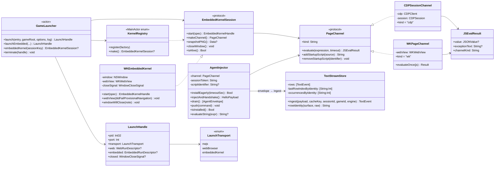
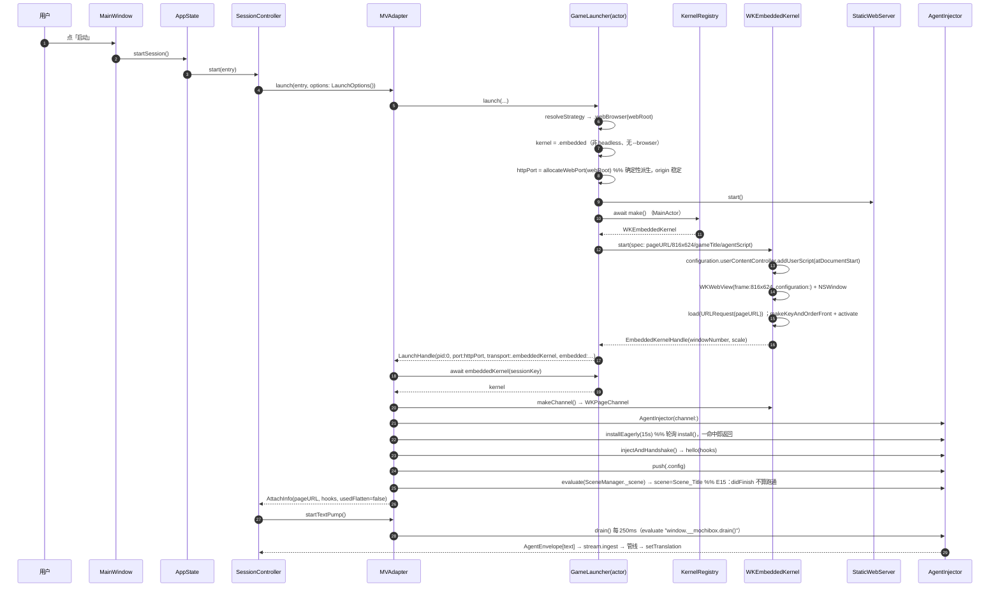
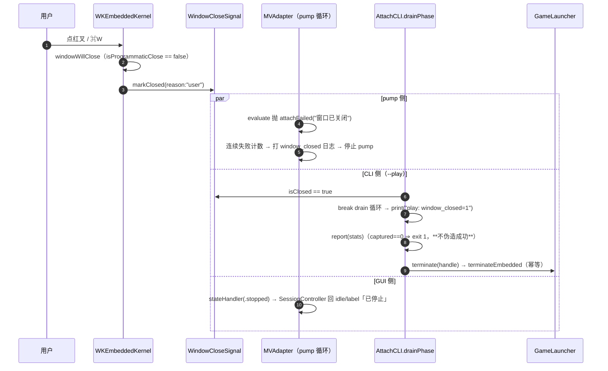
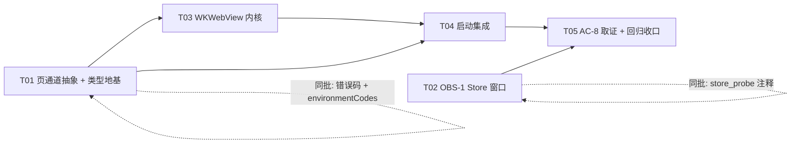

# 架构 v0.4：内置 WebKit 内核 + Store 时间窗口 + AC-8 取证自动化

- 目标分支：`dev`，起点 `HEAD=67284d3`
- 真游戏素材（只读）：`/path/to/Mtool-M/reference/test-games/RJxxxxxx`
  - `data/System.json → advanced.screenWidth/screenHeight = 816 × 624`，`advanced.screenScale = 1`，`gameTitle = "<作品窗口标题>"`，`locale = ja_JP`
  - `index.html` 在根（MZ 形态），`movies/OPFULL.webm`（7.6MB，开场约 135s）、`movies/LOGO.webm`
- 读者：下一位实现工程师。**本文不含本对话上下文**，凡"为什么"都写了理由，凡"改哪里"都给了文件 + 函数/行号。
- 本轮**只读**：不改 `Sources/`、不执行 `Scripts/build.sh`（其内部 `rm -rf build` 会销毁别人的取证基线）。

### 已实测证据（team-lead 独立 spike，2026-10-22，真实 Aqua 会话）

独立 spike（`NSApplication.shared` + `.accessory` + 窗口 816×624 + `WKWebView` + 自写最小带 Range 的静态服务，**只读**游戏目录）在真游戏 `RJxxxxxx`（MZ 1.5.0）上得到：

| 观测 | 值 | 对设计的意义 |
|---|---|---|
| UA | `Macintosh; Intel Mac OS X 10_15_7 AppleWebKit/605.1.15` | 无 `Headless`/`automation` 痕迹，MZ 的 `Utils.isMobileDevice` 不会命中 → **不设 `customUserAgent`** 的决定成立 |
| `devicePixelRatio` | 2 | Retina 成立，截图尺寸必须按 scale 处理（§4.3） |
| `SceneManager._scene` | `Scene_Map`（boot 完成，游戏真的跑起来） | **WKWebView 能跑 MZ**，U1 风险消解；同时给出"跑通"的判据（§5.2 E15） |
| `webgl` | `true` | 不需要任何 GPU 参数；`Graphics` 走 WebGL 渲染器 |
| `canvas` | `w=816, h=624, cw=816, ch=624` | 与 `System.json` 一致 → 窗口内容尺寸 = 游戏分辨率（§4.3）|
| `video` | 先 `LOGO.webm` 后 `OPFULL.webm`，`readyState=4, paused=false, error=null, videoWidth=640` | **WebM 在 WKWebView 能播**（本轮最大风险的实测反证） |
| `takeSnapshot` | 950KB PNG，画面是 OP 视频帧（肉眼非空白） | 可用作诊断产物（**仍不算 AC-8 证据**） |
| 必填配置 | `config.mediaTypesRequiringUserActionForPlayback = []` | 不加则 video 不自动播 → 游戏钉在等待（§4.3 表第一行） |
| **坑** | spike 的**自写**静态服务没做 percent-decode → `Failed to load: js/plugins/NRP_DamageEffect%20(1).js` → 黑底黄字 Error 页 | 见 §9.8：**产品侧已正确解码**（`StaticWebRequest.swift:187`），但这是不可退让的不变量；且"`didFinish` ≠ 跑通"（错误页也触发 `didFinish`）→ 必须看 `Scene_Map/Scene_Title` |

> 引这条证据的两个用途：① 让工程师不必再论证"WKWebView 能不能跑 MZ"；② 明确"跑通"的判据是**场景名**，不是导航回调（§5.2 E15 就是防 BUG-12 同型的假成功）。


### 文档导航（本文件章节 ↔ 交付要求）

| 要求的结构 | 本文位置 |
|---|---|
| 1 决策摘要（含被否方案） | §1（含"为什么不是 CEF / 打包 Chromium"） |
| 2 影响面与模块边界 | §2（§2.1 分层门禁 / §2.3 明确不改） |
| 3 页通道协议（Swift 签名原文 + 隔离说明） | §3（§3.2 签名 / §3.3 JSONValue 桥接 / §3.4 超时语义 / §3.5 隔离） |
| 4 时序图（4 张） | §4.6（GUI 启动 / `--play` 启动 / stop 收尾 / 窗口被关） |
| 5 失败回滚矩阵 | §5（§5.2 矩阵 / §5.3 `environmentCodes` 同步） |
| 6 任务列表（有序 + 依赖 + 验收） | §8（T01–T05） |
| 7 共享知识 / 跨文件约定 | §9（身份三层 / 双端一致 / 日志字段 / 快照纪律） |
| 8 待明确事项 | §10（U1–U7） |
| 附加：需求决策点 B/C/D 的落点 | §4.3（WK 运行器）/ §4.4（策略与传输）/ §4.5 + §8 T04（NSApplication 生命周期） |
| 附加：需求决策点 F（OBS-1）与 G（AC-8 取证） | §6 / §7 |

---

## 1. 决策摘要

### 1.1 三条决策

| # | 决策 | 一句话理由 |
|---|---|---|
| D1 | 页通道抽象 `PageChannel`（"能执行 JS 并取回值"），`AgentInjector` 只依赖它 | Agent 通道**只需要一种能力**（evaluate + 返回值），CDP 与 WKWebView 都能提供；解耦后两个实现同构，`agent_mvmz.js` 一行不改 |
| D2 | 产品窗口模式改用应用内 `WKWebView`（`LaunchTransport.embeddedKernel`）；`--headless` / 显式 `--browser` 仍走 Chromium | 用户要"应用自己的窗口、无地址栏、无 automation 痕迹"；`WKWebView` 天然满足且不引入第三方二进制 |
| D3 | `TextStreamStore` 自己实现 800ms 滑动窗口（键 = **行身份** `surface+raw`），规则与 `Resources/agent_mvmz.js:510-529` **逐条同构** | AC3.1 是"这一行被画了几次"；Agent 侧被绕过（重连 / 多客户端 / 页面自己重装）时 Store 不能再把同一句写成 10 行 |
| D4 | `--kernel-smoke`（v0.4 落地的**独立诊断入口**）**不属于 AC-8 判据链**；AC-8 也**不依赖** `play: scene=` 探针 | 两者都是"多加一条跑法/多养一套判据"的诱因，必须先划清：AC-8 的 fail-closed 链是 `replaced >= 1`（错误页上 `SceneManager` 不存在 → 页面不重绘 → `replaced=0` → 必 FAIL），不需要 `scene=` 来兜底；`--kernel-smoke` 只在"怀疑内核配置漂移"时人工跑，它的 PASS 不能替代 AC-8，AC-8 的 PASS 也不证明内核配置没漂 |

### 1.2 被否方案与理由

**否：CEF / 打包 Chromium。** 四条硬理由：

1. **构建与合规冲突**：`Scripts/build.sh` 是"单 `swiftc` 命令 + 4 个资源文件"的净室构建（无 Xcode、无 SPM、无第三方二进制），`Scripts/Info.plist` 的 `NSHumanReadableCopyright` 明写"不随包分发任何游戏资源、RTP、字体或**第三方工具二进制**"。CEF 是 120–250MB 的第三方二进制 + 自带 CMake/Ninja/gn 构建链 + 多个 helper `.app`，需要逐个签名/公证，等于换掉整条交付纪律。
2. **窗口模式的失败根因不在"哪个内核"，在"谁做沙箱"**：`docs/qa-report-v0.3.md §6` 记载窗口模式撞的是 `sandbox initialization failed: Operation not permitted` → `GPU process isn't usable. Goodbye.`。自带 Chromium 必须自己实现沙箱 helper（`com.apple.security.inherit`）才能避免同一问题；系统 WebKit 的 WebContent 进程由系统托管，沙箱与 GPU 通路都是系统负责的。
3. **维护成本**：CEF 要跟随 Chromium 升级，每次升级重做签名、公证、回归；`WKWebView` 随 macOS 更新，我们的代码零改动。
4. **用户诉求字面对齐**："不要外部 Chrome for Testing、要应用自己的窗口"。`--app` 拉外部浏览器永远会带上 Chromium 的自主品牌痕迹（Dock 图标、进程名、`--user-data-dir` 锁）；`WKWebView` 的进程就是本 App + 系统 WebContent。

**代价（诚实写出）**：WebKit 与 Chromium 的编解码/Web API 有差异，本作开场是 `.webm` 影片 —— 这条风险**已被 team-lead 的独立 spike 实测消解**（`OPFULL.webm` 在 WKWebView 上 `readyState=4, paused=false, error=null`，见文首证据表）。但仍保留 Chromium 路径：它既是 `--headless` 的 E2E 通道，也是遇到**别的**游戏（不同 webm 编码 / 不同插件集）时的排障与回退通道。

**否：让 `TextStreamStore` 只做"收事件、找行、更新"（把窗口完全交给 Agent）。** 理由：`Resources/agent_mvmz.js` 的 `lastEmitAt` 在 `DEDUPE_CAP=1024` 时会整体清空（`agent_mvmz.js:524-527`），且 `--attach` 可附着到**别人已经开着**的页面（Agent 可能是旧版本、窗口状态早已续期）。`store_probe` 的 W 组与 S7 就是按 AC3.1 a/b 写死的期望，属于产品语义而非测试偏好。

### 1.3 三个约束如何被满足（自检）

| 硬约束 | 本方案怎么满足 |
|---|---|
| `Resources/agent_mvmz.js` 不改（sha256 前缀 `842a3c0b`） | Agent 是**轮询式**：`window.__mochibox.drain()` 返回 JSON 字符串、`probe()` 返回 JSON 字符串、`HostCommand.evaluateExpression()` 拼的是 evaluate 表达式。全部只需 "evaluate + 取字符串"，`PageChannel` 完全覆盖，**零改动** |
| `--headless` / `--browser` 仍走 Chromium，不删 `WebGameRunner`/`BrowserResolver`/profile 锁 | 内核选择是 `LaunchOptions` 上的一次判定（§3.4），选 Chromium 时 `launchWeb` 走**原代码路径一字不改**；`GameLauncher` 的 `webRuns` / `terminateWeb` / 锁门禁全部保留 |
| Store 身份三层不混用 | 行身份 `surface+raw`（窗口键、去重、`occurrences`）、翻译身份 `cacheKey`（扇出）、UI 行 id `TextEvent.id`。窗口**只用行身份**（§6.2 给判据） |

---

## 2. 影响面与模块边界

### 2.1 分层门禁是第一约束（先说清，否则方案不成立）

`Scripts/build.sh:27-35` 有一段**硬门禁**：`Sources/Domain`、`Sources/Adapters`、`Sources/Infra`、`Sources/SelfTest`、`Sources/App/AttachCLI.swift`、`Sources/App/Constants.swift` 里**出现 `import SwiftUI` 或 `import AppKit` 就直接 `exit 2`**。`WKWebView` 必须 `import WebKit`（依赖 AppKit）。

因此本方案的模块边界是：

```
Sources/Adapters/PageChannel/**      纯 Foundation：协议、结果类型、注册表、度量读取（无 WebKit）
Sources/UI/EmbeddedKernel/**         WebKit + AppKit：窗口、WKWebView、WKPageChannel、--play 的 NSApplication 引导
Sources/App/AppMain.swift            允许 import AppKit（门禁白名单之外）：只加一个 if 分支
```

`Sources/UI/**` 在门禁里是"允许区"（`build.sh:27` 只 grep 了 Domain/Adapters/Infra/SelfTest + 两个 App 文件），所以 WebKit 代码放这里**不削弱**门禁语义：`--selftest` / `--attach` 仍然一丝 AppKit 都不碰。

**注入点**：Adapters 侧定义一个 `@MainActor` 注册表 `KernelRegistry`，UI 侧在启动时 `register`。Adapters 只用 `any EmbeddedKernelSession`（协议），永远不知道 `WKWebView` 的存在。

> ⚠️ `Scripts/build.sh:53-54` 的 `compile()` 链接参数里**没有 `-framework WebKit`**。T03 必须加，否则链接期 `_OBJC_CLASS_$_WKWebView` 未定义。这是本轮唯一必须改构建脚本的地方。

### 2.2 文件清单（改动性质 → 风险）

| 文件 | 改动性质 | 风险 | 要点 |
|---|---|---|---|
| `Sources/Adapters/PageChannel/PageChannel.swift` | **新增** | 低 | `PageChannel` 协议 + `JSEvalResult` + JS→`JSONValue` 桥接表 |
| `Sources/Adapters/PageChannel/EmbeddedKernel.swift` | **新增** | 低 | `EmbeddedKernelSession` / `EmbeddedKernelSpec` / `EmbeddedKernelHandle` / `KernelRegistry` / `WindowCloseSignal` |
| `Sources/Adapters/PageChannel/GameScreenMetrics.swift` | **新增** | 低 | 读 `System.json → advanced.screenWidth/Height` + `gameTitle`；纯文件 IO，可单测 |
| `Sources/Adapters/AgentInjector.swift` | **重构** | **中** | 构造参数从 `(cdp, session, …)` 改为 `(channel, …)`；`isInstalled(client:)` 去参数；`sessionId` 属性删除（改由 `channel` 承担截图） |
| `Sources/Adapters/EngineAdapter.swift` | **改** | **中** | `LaunchTransport` 加 `.embeddedKernel`；`LaunchHandle` 加 `embedded:` + `closed:`（全部带默认值）；`attach` 拆双路；`stop`/`captureScreenshotPNG` 分流 |
| `Sources/Adapters/Launcher/GameLauncher.swift` | **改** | **中** | `launchWeb` 按内核分流；新增 `launchEmbedded`；`terminate` 三分支；新增 `embeddedKernel(sessionKey:)` 访问器 |
| `Sources/Adapters/CDP/CDPClient.swift` | **微改** | 低 | 实现 `PageChannel`（`evaluate` 转发 + `addStartupScript` 转发到 `addScriptToEvaluateOnNewDocument`）；`CDPEvaluateResult` → `JSEvalResult`（保留 `typealias`） |
| `Sources/Domain/TextStreamStore.swift` | **改** | **中高** | `ingest` 换 800ms 滑动窗口；新增 `lastRowIndexByIdentity`；`trim/clear` 同步重建 |
| `Sources/App/Constants.swift` | **加常量** | 低 | `textStreamWindowMs` / `textStreamClockResetMs` / 内核超时与尺寸夹取 |
| `Sources/Domain/Models.swift` | **加错误码** | 低 | `kernelNoDesktopSession` / `kernelLoadFailed`（+ `uiMessage`） |
| `Sources/App/AttachCLI.swift` | **改** | **中** | `--kernel` 解析；`environmentCodes` 同步加码；`runPlay` 打印 `play: window_id=`；`drainPhase` 支持窗口关闭提前收敛；`PlayControl` |
| `Sources/App/AppMain.swift` | **微改** | 低 | 只加一个 `if`：`--play` 且非 `--headless`/`--browser` → `EmbeddedKernelApp.bootstrap` |
| `Sources/Domain/SessionController.swift` | **微改** | 低 | `adapter.launch(entry, log:)` 不动；只改 `handleAdapterState` 里 `.stopped` 的收尾（窗口被关 → 回到 idle） |
| `Sources/UI/EmbeddedKernel/EmbeddedKernelApp.swift` | **新增** | 中 | `--play` 的 `NSApplication` 引导（§4.D） |
| `Sources/UI/EmbeddedKernel/WKEmbeddedKernel.swift` | **新增** | **高** | 窗口 + 生命周期 + 关闭回传 + `takeSnapshot` |
| `Sources/UI/EmbeddedKernel/WKPageChannel.swift` | **新增** | 中 | `evaluateJavaScript` → `JSEvalResult`；超时竞速 |
| `Scripts/build.sh` | **微改** | 低 | `compile()` 加 `-framework WebKit` |
| `Tests/qa/store_probe.swift` | **同批改** | 低 | 只改 W 组上方那段"我不自行判定"的注释（期望值不动！） |
| `Scripts/ac8_capture.sh` | **新增** | 中 | AC-8 取证自动化（§7.G） |
| `Tests/qa/frame_stats.swift` | **新增** | 低 | 帧非空白判定（像素采样 + 可选 Vision OCR） |
| `Tests/e2e/play_e2e.sh` | **不改** | — | 它全部带 `--headless`，走 Chromium，口径不变 |

### 2.3 明确不改（写下来防"顺手"）

- `Resources/agent_mvmz.js`（sha256 前缀 `842a3c0b`）
- `Sources/Adapters/Web/WebGameRunner.swift` / `BrowserResolver.swift`（含 profile 单实例锁门禁、孤儿回收、幂等 `stop`）
- `Sources/Adapters/Web/StaticWebServer.swift` / `StaticWebRequest.swift`（Range/206、webm MIME、no-cache）。**特别注意**：`StaticWebRequest.resolve(target:root:)`（`:175-236`）已经做了"只解码一次 + 解码后才做穿越检查"的正确顺序（`:187`）。真游戏 `js/plugins.js` 注册了 `"NRP_DamageEffect (1)"` 这种**带空格/括号**的名字，浏览器一定发 `%20%28%29` —— **不允许**新写第二份静态服务，也不允许把解码挪到穿越检查之后（见 §9.8）
- `Tests/e2e/play_e2e.sh`（`--headless` 口径）
- `store_probe` 的 S1–S9 期望值（只有 W 组注释可动）
- `Scripts/Info.plist`：`NSAppTransportSecurity → NSAllowsArbitraryLoads = true` 已存在，`http://127.0.0.1` 不会被 ATS 拦，**无需改动**

---

## 3. 页通道协议

### 3.1 为什么必须解耦

`AgentInjector` 当前的全部 CDP 依赖（`Sources/Adapters/AgentInjector.swift`）：

| 调用点 | 行 | 用途 | 等价能力 |
|---|---|---|---|
| `cdp.evaluate(...)` | 29, 119, 135, 168, 218, 227, 236, 246, 261 | 执行 JS 取返回值 | `evaluate` |
| `cdp.addScriptToEvaluateOnNewDocument` | 111, 160 | 刷新后仍在（早装的核心） | `addStartupScript` |
| `cdp.removeScriptToEvaluateOnNewDocument` | 253 | 卸载 | `removeStartupScript` |
| `session.sessionId`（截图用） | `EngineAdapter.swift:485` | `Page.captureScreenshot` | 从 injector 移走，由 `MVAdapter` 按 transport 分流 |

即：**9 处 evaluate + 1 组 startup script + 1 个截图**。前 10 个进协议，截图不进（它本来就是 CDP 专属）。

### 3.2 协议签名（原文，照抄即可）

```swift
// Sources/Adapters/PageChannel/PageChannel.swift   （只 import Foundation）

/// 跨实现的求值结果。Shape 与旧的 `CDPEvaluateResult` 完全一致
/// （value 是 `returnByValue` 的 JSON；undefined 与 null 都表现为 value == nil）。
struct JSEvalResult: Sendable {
    var value: JSONValue?
    /// 非 nil = 页面内抛了异常（JS 层错误，不是通道故障）。
    var exceptionText: String?
    /// 给日志用：`cdp` / `wk`。
    var channelKind: String
}

protocol PageChannel: AnyObject, Sendable {
    var kind: String { get }                     // "cdp" | "wk"，只进日志

    /// 执行 JS。超时**必须**抛 `MochiBoxError(code: .cdpTimeout)`（见 §3.4）。
    /// 通道故障（WebSocket 断 / WebContent 亡）抛 `.attachFailed`。
    func evaluate(_ expression: String, timeout: TimeInterval) async throws -> JSEvalResult

    /// 下次文档加载时自动执行（CDP: Page.addScriptToEvaluateOnNewDocument；
    /// WK: WKUserScript(.atDocumentStart)）。返回 identifier，重复调用必须幂等。
    func addStartupScript(_ source: String) async throws -> String
    func removeStartupScript(_ identifier: String) async
}
```

`CDPClient` 的适配（新增 extension + 保留旧类型别名，避免一次性改 4 个文件）：

```swift
// CDPClient.swift 末尾
extension CDPClient: PageChannel {
    var kind: String { "cdp" }
    func evaluate(_ expression: String, timeout: TimeInterval) async throws -> JSEvalResult {
        let r = try await evaluate(session: sessionForChannel, expression: expression,
                                  awaitPromise: false, timeout: timeout)      // 见下
        return JSEvalResult(value: r.value, exceptionText: r.exceptionText, channelKind: kind)
    }
}
typealias CDPEvaluateResult = JSEvalResult      // 旧名保留一个版本，减少 churn
```

> `CDPClient.evaluate(_ session:...)` 与协议 `evaluate(_ expression:...)` **首参类型不同**（`CDPSession` vs `String`），Swift 重载可共存，但为了可读性建议把协议实现写成显式的两参私有方法 `evaluateOnSession(_ session:expression:timeout:)`，再由 `CDPSessionChannel`（一个薄壳，持有 `cdp + session`）转发。**推荐用薄壳**：

```swift
// 与 CDPClient 同文件或单独文件；薄壳只做类型收窄，不复制任何 CDP 逻辑
final class CDPSessionChannel: PageChannel, @unchecked Sendable {
    private let cdp: CDPClient
    private let session: CDPSession
    var kind: String { "cdp" }
    init(cdp: CDPClient, session: CDPSession) { self.cdp = cdp; self.session = session }

    func evaluate(_ expression: String, timeout: TimeInterval) async throws -> JSEvalResult {
        let r = try await cdp.evaluate(session, expression: expression,
                                      awaitPromise: false, timeout: timeout)
        return JSEvalResult(value: r.value, exceptionText: r.exceptionText, channelKind: kind)
    }
    func addStartupScript(_ source: String) async throws -> String {
        try await cdp.addScriptToEvaluateOnNewDocument(session, source: source)
    }
    func removeStartupScript(_ identifier: String) async {
        try? await cdp.removeScriptToEvaluateOnNewDocument(session, identifier: identifier)
    }
}
```

（这段是本轮**唯一**允许出现"新 CDP 代码"的地方，且只是转发；任何 CDP 语义改动都不要在这里做。）

**这样 `AgentInjector` 的构造变成 `AgentInjector(channel: any PageChannel, sessionToken:log:)`，`MVAdapter` 里 CDP 分支只多一行 `let channel = CDPSessionChannel(cdp: client, session: session)`，WK 分支只多一行 `let channel = await kernel.makeChannel()`。**

### 3.3 `JSONValue` 如何跨实现复用

两个实现都产出**同一个** `JSONValue`（`Sources/Domain/Models.swift:191`）。WK 侧必须做一次 `Any? → JSONValue?` 桥接，规则写死成表（这是最容易出"`true` 变成 `1`"的地方）：

| `evaluateJavaScript` 回调值 | `JSONValue` | 说明 |
|---|---|---|
| `nil`（`undefined`） | `nil` | 与 CDP 一致：CDP 的 `result.value` 在 undefined 时不存在 |
| `NSNull` | `nil` | 同上；**不要**映射成 `.null`，否则 `value?.boolValue` 的语义会分叉 |
| `NSString` | `.string` | **主路径**：`__mochibox.drain()` / `probe()` 返回的都是 JSON 字符串 |
| `NSNumber`（`CFBooleanGetTypeID`） | `.bool` | 必须先判 Boolean，否则 `true` 会变 `1`（`boolValue` 在 `.number(1)` 上是 nil） |
| `NSNumber` 其他 | `.number(doubleValue)` | |
| `NSArray` | `.array`（逐项递归） | |
| `NSDictionary` | `.object`（逐项递归） | |
| 其他（`WKError` / 循环引用） | `nil` + `exceptionText = "\(error)"` | 走异常分支，不当成通道故障 |

### 3.4 超时与异常语义（两边必须一致，否则 `startTextPump` 的"连续 5 次失败"会被误触发）

| 语义 | CDP 实现 | WK 实现 |
|---|---|---|
| 超时错误码 | `.cdpTimeout`（现状，`CDPClient.request`） | **也必须 `.cdpTimeout`**，message 里写 `"WK evaluate 超时"` |
| 页面抛异常 | `exceptionText = exceptionDetails.text`，**不 throw** | `exceptionText = "\(error)"`，**不 throw** |
| 通道已死 | throw `.attachFailed`（"CDP 连接已关闭"） | throw `.attachFailed`（`"窗口已关闭"` / `"WebContent 进程已终止"`） |
| 超时实现 | 请求-响应表 + deadline（已有） | **竞速**：`async let` 求值 vs `Task.sleep(timeout)`，谁先完成用谁（见下） |
| 取消 | 无（CDP 无取消语义） | 无（`WKWebView` 不支持取消；竞速超时后 continuation 仍在飞，**必须**保证只 resume 一次） |

WK 超时的安全形状（≤ 20 行，务必只用一次 `resume`）：

```swift
// WKPageChannel 内部；MainActor 上执行
private func evaluateOnce(_ js: String) async -> Result<JSEvalResult, Error> {
    await withCheckedContinuation { (cont: CheckedContinuation<Result<JSEvalResult, Error>, Never>) in
        var resumed = false
        let once: (Result<JSEvalResult, Error>) -> Void = { r in
            if resumed { return }; resumed = true; cont.resume(returning: r)
        }
        webView.evaluateJavaScript(js) { value, error in
            once(Self.bridge(value: value, error: error))    // 见 §3.3 桥接表
        }
        DispatchQueue.main.asyncAfter(deadline: .now() + timeout) {
            once(.failure(MochiBoxError(code: .cdpTimeout, message: "WK evaluate 超时")))
        }
    }
}
```

### 3.5 actor / Sendable 约定

| 类型 | 隔离 | 理由 |
|---|---|---|
| `PageChannel` 协议 | 非隔离（`AnyObject, Sendable`），方法全 `async` | 两个实现的隔离域不同（actor / MainActor），协议不能替它们选 |
| `CDPClient` | `actor`（现状） | 已有 |
| `CDPSessionChannel` | `final class ... @unchecked Sendable` | 只转发到 actor，自身无状态 |
| `WKPageChannel` | `@MainActor final class`，conformance 标 `@preconcurrency` | `WKEvaluateJavaScript` 必须在主线程；`@preconcurrency` 用来消掉"main actor-isolated witness for nonisolated async requirement"的诊断（Swift 5 语言模式下允许） |
| `EmbeddedKernelSession` | 协议 `AnyObject, Sendable`；实现 `@MainActor` | `NSWindow` / `WKWebView` 只能主线程 |
| `WindowCloseSignal` | `final class, @unchecked Sendable`（`NSLock` + `Bool`） | 跨 actor 传"窗口关了没有"，不能用 `@Published` |

**如果编译器仍拒绝 `@MainActor` witness**（不同 Swift 版本的宽容度不同），退化写法：协议方法实现标 `nonisolated`，内部 `await self.hopToMain(expression)`。两种写法都写进代码注释，让工程师一次选对，不要现场试。

### 3.6 内核构造必须只有一个入口（v0.4 追加，**本轮未落地，登记为待办**）

现在仓里有**两处**构造 `WKWebViewConfiguration`：

| 位置 | 谁在用 | 配置内容 |
|---|---|---|
| `Sources/UI/EmbeddedKernel/WKEmbeddedKernel.swift`（`startOnMain`） | 产品路径（`--play` 窗口模式 / GUI） | `mediaTypesRequiringUserActionForPlayback = []`、`.default()` store、`allowsContentJavaScript`、`suppressesIncrementalRendering=false`、`WKUserScript(.atDocumentStart)` 在 `WKWebView(frame:)` **之前**加入、`styleMask` 不含 `.resizable` |
| `Sources/UI/EmbeddedKernel/KernelSmokeMain.swift`（`makeWebView`） | **诊断入口** `--kernel-smoke` | 前四条同上 + 一个 4 行 marker 脚本（不注 `agent_mvmz.js`） |

**约束（写死）**：两处必须由**同一个** `makeConfiguration(...)` 产出 —— 参数只允许"注入脚本内容"与"是否加 marker"两个差异位。理由：这两条配置（自动播放、`atDocumentStart`）正是"窗口在、`didFinish` 成功、游戏不动"的唯二成因，一旦并行实现漂移，`--kernel-smoke` 的 PASS 就**不能**迁移到产品路径，等于给假绿开了一条路。

**当前处置**：本轮**不修**（源码冻结在 `c5de5a5e` 对应状态，改它会让今天全部实测证据再次作废）。已由架构师复核登记为 P1 待办，下一轮第一件事就是抽 `makeConfiguration`。在抽出来之前，**`--kernel-smoke` 的结论只能当"这两个开关在当前内核上可用"的证据，不能当"产品路径配置正确"的证据**。

---

## 4. 关键类型、流程与时序图

### 4.1 新增/修改的类型（Mermaid classDiagram）



（同名文件：`docs/archive/v0.4/kernel-v0.4-class.mermaid`。**不要**覆盖 `docs/archive/v0.1/class-diagram.mermaid`，那是 v0.1 基线的取证件。）

### 4.2 页面通道的关键签名（照抄）

```swift
// Sources/Adapters/PageChannel/EmbeddedKernel.swift

struct EmbeddedKernelSpec: Sendable {
    var pageURL: String            // http://127.0.0.1:<httpPort>/index.html
    var screenWidth: Int           // System.json advanced.screenWidth（默认 816）
    var screenHeight: Int          // 默认 624
    var windowTitle: String        // System.json gameTitle（默认目录名）
    var agentScript: String        // AgentInjector.loadScript() 的原文
    var log: SessionLog?
    var closeSignal: WindowCloseSignal
}

struct EmbeddedKernelHandle: Sendable {
    var windowNumber: Int          // == NSWindow.windowNumber == CGWindowID（AC-8 用）
    var contentWidth: Int          // 点（= 游戏分辨率）
    var contentHeight: Int
    var backingScale: Double       // 2.0 on Retina：截图/像素判据要乘它
    var title: String
}

struct EmbeddedRunDescriptor: Sendable {
    var sessionKey: String         // 在 GameLauncher.kernels 里找回内核
    var httpPort: Int
    var webRoot: URL
    var pageURL: String
    var screenWidth: Int
    var screenHeight: Int
    var backingScale: Double
    var windowNumber: Int
    var windowTitle: String
}

protocol EmbeddedKernelSession: AnyObject, Sendable {
    func start(_ spec: EmbeddedKernelSpec) async throws -> EmbeddedKernelHandle
    func makeChannel() async -> any PageChannel
    func snapshotPNG() async throws -> Data?
    func closeWindow() async
    func isAlive() async -> Bool
}

/// 内核注册表：Adapters 只认协议，UI 层注册实现。**未注册 = 硬失败**（不静默回退，见 §5 E2）。
@MainActor
enum KernelRegistry {
    private static var factory: (@MainActor @Sendable () -> any EmbeddedKernelSession)?
    static func register(_ make: @escaping @MainActor @Sendable () -> any EmbeddedKernelSession)
    static func make() -> (any EmbeddedKernelSession)?
}
```

### 4.3 窗口构造（`WKEmbeddedKernel.start`）

**内容尺寸从哪读**：`GameScreenMetrics.read(gameRoot:)`（新文件，纯 IO）：

- 候选顺序：`<root>/data/System.json`（MZ）→ `<root>/www/data/System.json`（MV，Windows 发行版是根布局 + `www/`）
- 取 `advanced.screenWidth` / `advanced.screenHeight`，**夹取到 `K.kernelMinContent ... K.kernelMaxContent`（320…4096）**，解析失败回落 816×624
- `gameTitle` 取顶层 `gameTitle`，缺失回落目录名；**不剥控制码**（真游戏值是纯文本，`<作品窗口标题>`），但写日志时 `SecretMask` 之外不做任何改写

**Retina 处理（三条硬规则）**：

1. **点 = 游戏分辨率**。`contentRect = NSRect(0,0, screenWidth, screenHeight)`（单位是**点**），`styleMask = [.titled, .closable, .miniaturizable]`（**不含 `.resizable`**：一拉大，MZ 的 `Graphics._canvas` 会被 CSS 拉伸，字就糊了，这正是 v0.2 用 `--window-size=1280,720` 留出边距的原因）。
2. **不碰 `backingType`、不设 `pageZoom`、不设 `magnification`**：WebKit 自己按 `devicePixelRatio = backingScaleFactor` 渲染，不需要我们做任何事。`webView.allowsMagnification = false`（双指缩放会改布局）。
3. **截图/像素判据必须乘 `backingScale`，但不要把它写死**：spike 实测 DPR=2 且 `canvas` 属性仍是 `cw=816, ch=624`（MZ 自己管 backing store），所以"PNG 一定是 1632×1248"**不能当成前提**。AC-8 脚本**只断言 `distinct colors > 1`**，并把实测 `w h scale` 打出来；固定尺寸比对一律禁止（v0.2 遗留的坑：`qa-report-v0.2.md §7.8` 记了 Retina 未验）。

`webView.frame = window.contentView!.bounds`；`window.contentView = webView`（**直接当 contentView**，不要塞进 `NSScrollView`，否则多出滚动条与 4px 边距）。

**`WKWebViewConfiguration` 必填项（逐条给理由，缺一条就少一个功能）**：

| 配置 | 值 | 缺了会怎样 |
|---|---|---|
| `mediaTypesRequiringUserActionForPlayback` | `[]` | 等于 Chromium 的 `--autoplay-policy=no-user-gesture-required`。**spike 二次实测**：不加 → `<video>` 不自动播 → MZ 钉在等待（开场 `LOGO.webm`/`OPFULL.webm` 都是 video）。加了 → `readyState=4, paused=false`。这条是功能，不是优化 |
| `userContentController.addUserScript(...)` | `WKUserScript(source: spec.agentScript, injectionTime: .atDocumentStart, forMainFrameOnly: true)`，**必须在 `WKWebView(frame:configuration:)` 之前加入 configuration** | 这是 `Page.addScriptToEvaluateOnNewDocument` 的等价物，也是"早装"的全部基础。晚加 = 首屏（标题菜单 / 开场对白）漏采，整轮 `captured` 只剩 boot 期杂字（v0.2 的根因） |
| `websiteDataStore` | `.default()`（**不要** `.nonPersistent()`） | 存档（MZ 走 localforage/IndexedDB）需要持久化 |
| `defaultWebpagePreferences.allowsContentJavaScript` | `true` | 显式写死，别依赖默认 |
| `preferences.javaScriptCanOpenWindowsAutomatically` | `false` | 游戏页不该开新窗口 |
| `suppressesIncrementalRendering` | `false` | 增量渲染，避免整帧闪烁（对像素判据有利） |
| `customUserAgent` | **不设置** | 默认 UA 里没有 `HeadlessChrome`、没有 `--enable-automation` 痕迹；MZ 的 `Utils.isMobileDevice` 只认 iPhone/iPad/Android，不会命中。**不设** 比设一个假 Safari UA 更干净 |

**为什么不需要"按游戏分 profile"（和 Chromium 的差别，必须讲清）**：

- Chromium 需要 `--user-data-dir=<profileDir>` 有三个原因（`architecture-v0.2 §5.2`）：① 新版 Chrome 在默认 profile 上**直接忽略** `--remote-debugging-port`；② 多个启动共用 profile 会撞 `SingletonLock`；③ 存档按 profile + origin 隔离，共用会互相污染。
- `WKWebView` **一条都不成立**：没有调试端口、没有单实例锁；`websiteDataStore` 是**按 App（bundle id）**一份，存档隔离靠 **origin**。
- 而 origin 已经天然稳定：静态端口是 `sha256(webRoot path)` **确定性派生**（`Sources/Adapters/Launcher/WebPortAssignments.swift`，区间 `K.webPortLow…K.webPortHigh` = 39310–39409），同一游戏每次同端口 → 同 origin → 存档不漂。不同游戏 → 不同 webRoot → 不同端口 → 不同 origin → **天然隔离**。
- 因此：`websiteDataStore = .default()`，存档落在 `~/Library/WebKit/app.mochibox.MochiBox/`（bundle id 见 `Scripts/Info.plist:8`）。**不做**按游戏分 store。
  - 补充：`WKWebsiteDataStore(forIdentifier:)` 能在 macOS 14+ 做自定义 store，但本项目 `target = arm64-apple-macos13.0`（`build.sh:15`）——**不可用**，这也是"为什么这里只能靠 origin"的直接原因。
- 代价（写进 §8 U4）：dev 构建与打包版若 bundle id 相同则共享同一 store，这是有意为之（同一游戏同一 origin 就该共享存档）。

**关闭窗口 / 被用户关掉如何回传**：

- `window.delegate = self`，`window.isReleasedWhenClosed = false`（否则 ARC 下重复释放崩溃）。
- `func windowWillClose(_ note: Notification)`：
  - 若 `closeWindow()` **主动**关（`isProgrammaticClose = true`）→ 只 `closeSignal.markClosed()`，不触发"用户关闭"的回调链。
  - 若是用户点红叉 / ⌘W → `closeSignal.markClosed(reason: "user")`，并调用 `onUserClosed?()`。
- `WindowCloseSignal` 是 Adapters 里的 `NSLock` 盒子，被三处共享：`LaunchHandle.closed`（adapter 侧轮询）、`EmbeddedRunDescriptor`（launcher 侧）、`PlayControl`（`--play` 侧）。
- **`Channel.evaluate` 在窗口关闭后一律 throw `.attachFailed`**（不是 `.cdpTimeout`），这样 `startTextPump` 的 5 次失败计数会快速收敛并打出一条 `window_closed` 日志。

**`takeSnapshot`**：

```swift
let config = WKSnapshotConfiguration()
config.rect = webView.bounds
webView.takeSnapshot(with: config) { image, error in … }   // NSImage → tiff → NSBitmapImageRep → png
```
- 用途：`--screenshot` 的**诊断**产物（进程内渲染快照）。
- **它不算 AC-8 证据**：`docs/qa-addendum.md` 已明确 headless 截图不算，`takeSnapshot` 同理（它证明"WebKit 渲染出了这一帧"，不证明"用户桌面上看见了这个窗口"）。AC-8 只认 `screencapture -l<CGWindowID>`（§7）。

### 4.4 启动策略与传输（`LaunchOptions` / `LaunchStrategy` / `LaunchHandle`）

**`LaunchTransport` 加一个 case**：

```swift
enum LaunchTransport: String, Sendable {
    case nwjs            // v0.1 行为：单进程
    case webBrowser      // v0.2：Chromium + HTTP + 在飞连接
    case embeddedKernel  // v0.4：应用内 WKWebView + HTTP
}
```

**`LaunchHandle` 只加带默认值的字段 → `LaunchHandle(pid: 0, …)` 这类构造点零改动**（`AttachCLI.swift:192` 与自测里的桩 handle 都不用碰一个字）：

```swift
var embedded: EmbeddedRunDescriptor? = nil
var closed: WindowCloseSignal? = nil
```

> ⚠️ **`pid` 必须保持 `0`**（embedded 情形）：`terminate` 的 `.nwjs` 分支会 `kill(handle.pid, SIGTERM)`。若图省事写 `pid = getpid()`，任何一个分支判断失误都会**把 App 自己杀掉**。写死 `0`，并且 `terminate` 里 **`.embeddedKernel` 分支必须排在最前**。`ChildProcessRegistry.register` 已有 `guard pid > 0`（`AppMain.swift:89`），`0` 天然不登记 → 无需改。

**`LaunchStrategy` 不动**（不加 case、不改关联值）：内核选择放 `LaunchOptions`，这样 `SelfTest/LauncherCaseSupport.swift:155` 的 `case .webBrowser(let webRoot, let engine)` 与 `GameLauncher.swift:308` 的 switch **一行都不用改**。

```swift
struct LaunchOptions: Sendable {
    var headless: Bool = false
    var browserPathOverride: String? = nil
    var extraBrowserArgs: [String] = []
    var windowSize: String = K.browserWindowSize
    /// v0.4：nil = 自动（headless 或显式 --browser → chromium，否则 embedded）。
    var kernel: WebKernelKind? = nil
}
enum WebKernelKind: String, Sendable { case chromium, embedded }
```

**`GameLauncher.resolveStrategy` 优先级不变**（nwjs → webRoot → 报错），判定内核在 `launch` 里：

```swift
// GameLauncher.swift:299 launch(...)
case .webBrowser(let webRoot, let engine):
    let kernel = options.kernel ?? ((options.headless || options.browserPathOverride != nil) ? .chromium : .embedded)
    switch kernel {
    case .chromium:  return try await launchWeb(webRoot:engine:gameRoot:options:log:)   // 原样不动
    case .embedded:  return try await launchEmbedded(webRoot:engine:gameRoot:options:log:)
    }
```

**`launchEmbedded` 与 `launchWeb` 的差异（只三处）**：

| 项 | `launchWeb`（Chromium） | `launchEmbedded` |
|---|---|---|
| 端口 | debugPort（随机）+ httpPort（确定性） | **只有** httpPort（确定性，必须保留：它是 origin） |
| 内核 | `WebGameRunner` + `BrowserResolver` + profile 锁门禁 | `await KernelRegistry.make()` → `kernel.start(spec)` |
| 句柄 | `pid = browserPid, transport = .webBrowser, web = …` | `pid = 0, port = httpPort, transport = .embeddedKernel, embedded = …` |

失败回滚（§5 F 表）沿用 `launchWeb` 的形状：`kernel.closeWindow()` + `kernels.removeValue(key)` + `usedWebPorts.remove` + `webPorts.release`。

**`terminate` 三分支**（`GameLauncher.swift:494`）：

```swift
func terminate(_ handle: LaunchHandle) async {
    if handle.transport == .embeddedKernel, let emb = handle.embedded {
        await terminateEmbedded(handle: handle, descriptor: emb); return     // ← 必须最前
    }
    if handle.transport == .webBrowser, let web = handle.web { … }           // 现状
    …                                                                        // .nwjs 现状
}
```
`terminateEmbedded` 幂等（复用 `terminatedSessions` 集合）：`kernels[key]?.closeWindow()` → 等 `isAlive()==false`（最多 `K.killGraceSec`）→ `usedWebPorts.remove` → `webPorts.release(webRoot:)`（**只清运行期占位，持久记录保留**，理由同现状：清了下次换端口 = 换 origin = 丢存档）。

### 4.5 `--play` 与 `--attach` 的输出契约（**改不得的行**）

`Tests/e2e/play_e2e.sh:89` 用 `sed -n 's/^play: http=\([0-9]*\).*/\1/p'` 取静态端口。**因此 `play: http=` 必须永远在行首**：

```
play: root=… engine=mz provider=openai duration=240s
play: http=39360 debug=0 page=http://127.0.0.1:39360/index.html kernel=embedded content=816x624 scale=2
play: window_id=41231 title=<作品窗口标题>          ← 新增，行首是 play: window_id=
attached: url=http://127.0.0.1:39360/index.html hooks=[…] flatten=false
play: probe={"installed":true,…}
captured=… translated=… skipped=…
```

**不要**把 `kernel=` 挪到 `play: http=` 之前，也不要改成 `play: kernel=… http=…`（会直接打断 AC-2/AC-4 两条既有断言）。

#### 4.5.1 端口分区（三段，互不重叠）

| 用途 | 区间 | 分配方式 | 谁写 |
|---|---|---|---|
| Chromium 调试端口（`--headless` / `--browser`） | **39200–39300** | `K.debugPortLow…High`，运行时找空闲 | v0.1 起 |
| 静态服务端口（web 后端，**embedded 与 chromium 共用**） | **39310–39409** | `sha256(webRoot path)` **确定性派生** + 线性探测 | v0.2 起 |
| `--kernel-smoke` 诊断入口 | **39500–39599** | 线性找空闲，**不进持久端口表**（诊断用完即弃） | v0.4 新增 |

#### 4.5.2 **同一款游戏同时只能有一个内置内核实例**（今天一半假失败的根因）

静态端口是 `sha256(webRoot)` 派生的，**不许漂**（存档按 origin 隔离，见 §4.3 与本文件 `K.webPortLow/High` 的注释）。由此推出两条**必然**结论：

1. **同款游戏并发 = 必撞端口**：第二个实例拿到 `error_code: web_port_busy` + exit 3。这不是缺陷，是"存档 origin 稳定"的代价。`MOCHI_E2E_PORT` / `MOCHI_AC8_PORT` 只是**测试脚本的 echo 后端端口**，跟静态端口无关，**改它不会换掉 39366**。
2. **`MOCHI_E2E_WORK` 换目录也没用**：端口按 `webRoot` 派生，不按 `MOCHI_DATA_DIR` —— 换数据目录仍然派生出同一个端口（2026-10-22 实测：换了 `MOCHI_DATA_DIR`、换了符号链接 webRoot，仍然报 39366）。

**运维口径（写进 QA 手册）**：
- **E2E 与 AC-8 不可并发**，`--kernel-smoke` 与窗口冒烟也要串行；
- 跑之前先确认没有别人的实例：`pgrep -f "MochiBox --play"`（有输出就等着，别 `pkill` 全机）；
- 清理残留**只许按本次运行的 `--out` 路径精确匹杀**：`pkill -f -- "--out $JSONL"`。`pkill -f "MochiBox --play"` 是宽匹配，会杀掉机器上**所有** `--play`（2026-10-22 12:01 就这样把别人的 AC-2 在 6s 处静默 SIGTERM 掉，症状是"play.log 停在 `play: scene=…`、没有 `captured=`、没有 `error_code:`、没有崩溃报告"）。

### 4.6 时序图

**（1）GUI 启动**



**（2）`--play` 启动（窗口模式，非 headless）**

```mermaid
sequenceDiagram
    autonumber
    participant SH as shell
    participant AM as AppMain
    participant EK as EmbeddedKernelApp
    participant NSA as NSApplication
    participant CLI as AttachCLI
    participant GL as GameLauncher
    participant WK as WKEmbeddedKernel

    SH->>AM: MochiBox --play <dir> [--out …] [--screenshot …]
    AM->>AM: 无 --headless 且无 --browser ⇒ 走内置内核
    AM->>EK: bootstrap(args)
    EK->>EK: CGSessionCopyCurrentDictionary() == nil ?
    alt 无 Aqua 会话
        EK-->>SH: error_code: kernel_no_desktop_session ；exit 3
    end
    EK->>NSA: NSApplication.shared ; setActivationPolicy(.regular)
    EK->>EK: KernelRegistry.register { WKEmbeddedKernel() }
    EK->>CLI: Task { run(options, control: PlayControl) }
    EK->>NSA: app.run()     %% 主 run loop 服务 MainActor
    CLI->>GL: launch(entry, options(kernel:.embedded))
    GL->>WK: start(spec) → windowNumber
    CLI->>SH: play: http=… kernel=embedded content=816x624 scale=2
    CLI->>SH: play: window_id=41231 title=…
    CLI->>SH: play: scene=Scene_Title   %% E15：错误页也会 didFinish，必须看场景名
    CLI->>CLI: attachPhase(handleOverride: handle) → drainPhase(240s)
    Note over SH,WK: 取证脚本在此期间用 screencapture -l<window_id> 抓真实桌面
```

**（3）stop 收尾（GUI 点「停止」或 CLI 到时）**

```mermaid
sequenceDiagram
    autonumber
    participant SC as SessionController/AttachCLI
    participant AD as MVAdapter
    participant INJ as AgentInjector
    participant GL as GameLauncher
    participant WK as WKEmbeddedKernel
    participant SRV as StaticWebServer

    SC->>AD: stop()
    AD->>AD: pumpTask.cancel()
    AD->>INJ: push(.config(enabled:false))（尽力，失败不阻塞）
    AD->>INJ: uninstall()（removeStartupScript）
    AD->>AD: channel = nil
    AD->>GL: terminate(handle)
    GL->>GL: terminatedSessions 去重（幂等）
    GL->>WK: closeWindow()（isProgrammaticClose = true）
    WK->>WK: window.close() → windowWillClose
    WK->>WK: closeSignal.markClosed(reason:"programmatic")
    GL->>WK: 轮询 isAlive()（≤ killGraceSec）
    GL->>SRV: stop()（等端口真正可再绑）
    GL->>GL: usedWebPorts.remove ; webPorts.release(webRoot)（持久记录保留）
    GL-->>AD: 返回
    AD-->>SC: stateHandler(.stopped)
```

**（4）窗口被用户关掉**



（同名文件：`docs/archive/v0.4/kernel-v0.4-sequence.mermaid`，四张图按顺序拼在一个文件里，用 `%% ---` 分隔。）

---

## 5. 失败与回滚矩阵

### 5.1 错误码（新增 2 个，必须同批加进 `AttachCLI.environmentCodes`）

```swift
// Models.swift ErrorCode
/// 无 Aqua 会话（无 WindowServer/无登录用户）：内置内核无法建窗。
case kernelNoDesktopSession = "kernel_no_desktop_session"
/// WKWebView 起不来 / 导航失败 / WebContent 进程被杀（系统层，重试通常无用）。
case kernelLoadFailed = "kernel_load_failed"
```
`uiMessage`：前者"当前会话没有登录桌面，内置窗口不可用（请用 --headless）"；后者"内置浏览器内核启动失败"。

### 5.2 矩阵

| # | 失败点 | 检测位置 | `ErrorCode` | 退出码 | 日志字段 | `environmentCodes` | 回滚动作 |
|---|---|---|---|---|---|---|---|
| E1 | 无 Aqua 会话（`--play` 无 `--headless`，但 `CGSessionCopyCurrentDictionary()==nil`） | `EmbeddedKernelApp.bootstrap` | `.kernelNoDesktopSession` | **3** | `kernel_reason=no_aqua` | **是（新增）** | 无（尚未占资源） |
| E2 | 内置内核未注册（`KernelRegistry.make()==nil`，例如某条路径漏了 register） | `GameLauncher.launchEmbedded` | `.kernelLoadFailed` | **3** | `kernel_reason=not_registered` | **是（新增）** | 释放 httpPort + `webPorts.release` |
| E3 | 静态服务 bind 失败 / 端口占用 | `StaticWebServer.start()`（现状） | `.webServerFailed` / `.webPortBusy` | **3** | 现状 | 已在集合内 | 现状（不写持久端口表） |
| E4 | `System.json` 读不到 / 字段非法 | `GameScreenMetrics.read` | **不失败** | — | `screen_fallback=816x624` | 否 | 用默认值，继续 |
| E5 | `WKWebView` 导航失败 `didFailProvisionalNavigation`：`NSURLErrorCannotConnectToHost` / 连接被拒 | `WKEmbeddedKernel` | `.webServerFailed` | **3** | `nav_error=<domain>/<code>` | 是（已在集合内） | `closeWindow()` + 端口回滚 |
| E6 | 导航失败：HTTP 404/410（index.html 不在，或 Range/路径穿越被拒） | 同上（读 `error.userInfo["NSURLErrorFailingURLStringErrorKey"]` + 本地探测 index） | `.webRootMissing` | **3** | `nav_error=404` | 是（已在集合内） | 同上 |
| E7 | 其余导航错误（TLS/自定义协议/取消） | 同上 | `.kernelLoadFailed` | **3** | `kernel_reason=navigation` | **是（新增）** | 同上 |
| E8 | WebContent 进程终止 `webViewWebContentProcessDidTerminate` | `WKEmbeddedKernel` | `.kernelLoadFailed` | **3** | `kernel_reason=webcontent_terminated` | **是（新增）** | 同上 |
| E9 | `installEagerly` 15s 超时 **且** 引擎符号缺失 | `MVAdapter.attach`（`waitForGameSymbols` 现状） | `.engineSymbolsMissing` | 1 | `hooks=none` | 否 | `adapter.stop()` → `terminate` |
| E10 | hello 5s 未到（重注入 1 次后） | `AgentInjector.injectAndHandshake`（现状） | `.agentNoHello` | 1 | `agent_no_hello` | 否 | 同上 |
| E11 | 导航后 hook 丢失（页面 reload / 插件覆盖 hook） | pump 里 `isInstalled()==false` | **不失败**：`ensureAgentAlive()` 重注入；连续 2 次仍 false → `.engineSymbolsMissing` | 1（仅后者） | `hook_lost=1 reinstalled=0/1` | 否 | 重注入；最终仍失败走 E9 回滚 |
| E12 | 窗口被用户关闭 | `windowWillClose` → `WindowCloseSignal` | **不是错误** | 按 `report()`：`captured==0 → 1`，否则 `0` | `window_closed=1` | 否 | `terminateEmbedded`（幂等） |
| E13 | `takeSnapshot` 失败 | `captureScreenshotPNG` | **不失败** | 不变 | `screenshot: 未取到数据` | 否 | 无 |
| E14 | 注入时 evaluate 抛异常（页面还在导航） | `installEagerly` 的 `catch`（现状：下一轮再试） | 不失败 | — | 现状 | 否 | 现状 |
| **E15** | **`didFinish` 了但游戏没跑起来**（MZ 停在黑底黄字 Error 页 / 插件 `Failed to load`）：spike 实测过一次（服务没解码 → `NRP_DamageEffect%20(1).js` 404）。**错误页同样触发 `didFinish`**，所以导航回调不能当"跑通"判据 | `MVAdapter.attach`：`hello` 之后进入**宽限窗口**（`K.kernelSceneBootGraceSec`，15s）轮询场景探针 | `.engineSymbolsMissing`（语义就是"这个页面不是跑起来的 RPG Maker 游戏"） | 1 | `play: scene=<name> video=<readyState>/<paused>/<error>`（多行，取 `tail -1`）；宽限窗口内一直是 `none` → 失败；一直停在 `Scene_Boot` → 失败 | 否（换机器也一样，产品/游戏问题） | `adapter.stop()` → `terminate` |

**E15 为什么必须是显式判据（而不是"看 captured>0"）**：`docs/qa-report-v0.3.md §7.1` 的 BUG-12 候选就是"`installed=true`、`已连接`、整帧纯黑、`captured=1`、**无任何错误码**"。E15 把"页面在跑游戏"这件事变成一条可断言的观测（`SceneManager._scene` 的类名），与"Agent 装上了"（`probe.installed`）**分开**——两者都成立才算跑通。

- **通过判据（在宽限窗口内）**：① `SceneManager._scene` 存在（`scene != "none"`）；② 不是一直停在 `Scene_Boot`。

> ### ⚠️ v0.4 实测更正：本节原来写的"evaluate 一次，`scene=none` → 失败"是**错的**
>
> 2026-10-22 在真游戏（RJxxxxxx）上实测：**`hello` 之后第一次采样必然是 `scene=none`**。原因很直接——`hello` 是 Agent 在 `atDocumentStart` 装好 hook 时就 emit 的，而 `Scene_Map` 要等 MZ 的 `DataManager.setupNewGame()` 跑完（本作实测 **1–2s**，`--kernel-smoke` 也测到同样的时间）。
>
> 照旧写法实现的第一版 `--play` **100% 假失败**，日志是：
> ```
> play: scene=none video=0/true/null
> play failed: MochiBoxError(engine_symbols_missing): … 内核已连上但 `SceneManager._scene` 为空
> ```
> 这个"假失败"和它要防的"假成功"是同一种病：**拿一个启动中间态当结论**。
>
> 正确写法（已落地）：**在宽限窗口内轮询**，窗口结束还没出现过非 `none` 且不停在 `Scene_Boot` 才判失败。判据强度没降（窗口一到就判死），只是不再拿第一次采样当判决书。
>
> 日志格式（`scene` 与 `video` **同行**，用来区分"内核没起来"与"游戏在播影片"）：
> ```
> play: scene=Scene_Boot video=0/true/null
> play: scene=Scene_Map video=0/true/null
> ```
> `video=<readyState>/<paused>/<error>`，无 `video` 元素时写 `none/true/null`。
>
> **已知不假红**：本作 `Scene_Boot` 很短（1–2s 就进 `Scene_Map`），OP 是在 `Scene_Map` 里播的。

- **不白名单场景名**：本作装了 97 个插件（`ARTM_InsertOpeningMapMZ`、`CutinMZ`…），自造 `Scene_*` 子类是常态，硬编码 `{Scene_Title, Scene_Map}` 会假红。日志里如实打 `scene=`，由人判断是不是"游戏自己的场景"。
- 探针表达式**只读**，不改页面状态，也不碰 `__mochibox`（避免与锁死的 agent 契约耦合）。
- 该探针在 `--play` 里由 `AttachCLI` 打印成 `play: scene=…`（供人/脚本 grep），在 GUI 里只进日志。
- **作用域**：只对 `--play` 的 web 后端（embedded / chromium）生效。**`--attach` 不加**——它附着的是别人早就开着的页面，不能因为那一刻不在 `Scene_*` 就判失败（v0.1 的一次性符号判定原样保留）。


**为什么 E1/E2/E5/E6/E7/E8 里"环境缺口"标签这么分**：判据是"换一台干净的、有登录桌面的 Mac 会不会自己好"。
- E1（没桌面）/E3（端口被占）/E5（连不上自己的服务）/E8（WebContent 被系统杀）→ 会好 → 环境缺口，退出码 3，脚本可以按码分支重试。
- E9/E10（页面不是 RPG Maker / Agent 装不上）→ 换机器也一样 → 产品/游戏问题，退出码 1，不许伪装成环境问题（这是 `docs/qa-report-v0.3.md §7.1` BUG-12 候选的整改方向：**不许"installed=true 就报成功"**）。
- E12 **不设新码、不改退出码**：窗口被关是用户行为，不产生"环境缺口"语义，退出码仍由 `report()` 按 `captured/translated/writeFailures` 决定 —— 这样"关掉窗口"永远不可能伪造出 exit 0。

### 5.3 `environmentCodes` 同步（硬约束 #4，历史上掉过坑）

`AttachCLI.swift:429-438` 的集合必须变成：

```swift
static let environmentCodes: Set<ErrorCode> = [
    .browserNotFound, .webRootMissing, .webServerFailed, .webPortBusy,
    .browserExitedEarly, .portUnavailable, .profileLocked, .launcherNoExecutable,
    .kernelNoDesktopSession, .kernelLoadFailed,      // ← v0.4 新增，漏了 --play 会掉回 exit 1 且不打 error_code:
]
```
**同批验证方式**：一条命令即可（不需要真内核）：
```bash
grep -c 'kernel_no_desktop_session\|kernel_load_failed' Sources/Domain/Models.swift Sources/App/AttachCLI.swift   # 两个文件都必须 ≥1
```

---

## 6. OBS-1：Store 侧 800ms 滑动窗口

### 6.1 权威语义在哪（先读这个，别自己发明）

`Resources/agent_mvmz.js:510-529` 就是规范的原文（**我们不改它，只是把同一套规则搬到 Store**）：

```js
function shouldEmitFor(surface, identity) {
  var now = nowMs();                              // performance.now()，单调
  var signature = surface + '\u0000' + identity;  // ← 与 TextStreamStore.rowIdentity 完全同一个串
  var last = lastEmitAt[signature];
  if (typeof last === 'number' && now < last) { now = last; }   // 时钟回拨 → 夹到 last
  if (typeof last === 'number' && (now - last) < EMIT_DEDUPE_MS) {  // 800
    lastEmitAt[signature] = now;                  // ← 续期
    return false;                                 // ← 抑制
  }
  lastEmitAt[signature] = now;
  return true;                                    // ← 新一次出现
}
```

对应 QA 侧的固化用例：`Tests/qa/dedupe_race_probe.mjs` 的 **A1–A7**（A3=跨 1600ms 必新增、A4=8×400ms 只 1 条、**A5=续期判别**、A6=多身份交错、A7=`surface` 属身份）。

### 6.2 键用**行身份**还是翻译身份？

**行身份（`surface + U+0000 + raw`）。** 判据三条，逐条可查：

1. **AC3.1 问的是"这一行被画了几次"**。`350` 与 `\C[2]350` 是屏幕上**两行不同内容**（PRD P0-08/P0-09 的反例就在这），它们各自有各自的"上次绘制时刻"。
2. **用 `cacheKey` 会直接撞红 S1/S2**：S1 断言同帧 `350` + `\C[2]350` → **2 行**。若窗口键用 `cacheKey`，第二条会被判"窗内"而合并 → 只剩 1 行 → S1/S2a 立刻红，且这是 BUG-8 的复现形态。
3. **翻译身份本来就只用于扇出**（`rowsSharingCacheKey`），与"画了几次"是两个正交维度；混用会把"多画法"压成"多次出现"，`occurrences` 序列（S4 的 1/2/3、S8 的两行）全部失真。

**结论：窗口键 = `TextStreamStore.rowIdentity(surface:raw:)`，与 Agent 侧 `signature` 逐字节相同**（这也是"双端逐值一致"能成立的原因）。

### 6.3 规则（写死，不许现场调）

`ingest` 的处理顺序（`TextStreamStore.swift:57-107` 整体替换）：

| 步骤 | 条件 | 行为 |
|---|---|---|
| R0 | `ts` 不可用：`!ts.isFinite \|\| ts <= 0` | **降级为严格同帧签名去重**：`signature = frame \| identity` 与"上一条事件"完全相同才合并（= 现状行为）；否则新行。**不动**窗口、**不动** `occurrences`（不把 `ts=0` 当"很久以前"→ 否则每帧新增行；也不当"刚刚"→ 否则永远吞掉） |
| R1 | 该身份**没有**已存在的行 | 新行，`occurrences = occurrencesByIdentity[identity]+1`，窗口基准 = `ts` |
| R2 | `delta = ts - lastSeen`，`delta < -K.textStreamClockResetMs`（**-60000**） | **时钟基重置**（页面 reload：`performance.now()` 归零）→ 按新行处理，窗口重置为 `ts`。理由：Agent 的 `lastEmitAt` 随文档一起消失，Store 侧若把这种回退当"窗内"，reload 后第一句会被并进 reload 前的行 → **丢句**（比多一行难发现得多） |
| R3 | `-60000 ≤ delta < 0` | 与 Agent 同构：**夹到 0**（等价 `now = last`）→ 抑制 + **不**把 `lastSeen` 往回改（`lastSeenTs` 保持 `max`） |
| R4 | `0 ≤ delta < 800` | 抑制：合并到该身份的**最后一行**，`lastSeenTs = ts`（续期），`occurrences` **不变**，`stats.total` **不变** |
| R5 | `delta ≥ 800` | 新行，`occurrences = occurrencesByIdentity[identity]+1`，窗口基准 = `ts` |

**边界写死：`delta == 800` 算"新一次出现"**（Agent 用的是 `< 800` 才抑制）。`store_probe` 的 W4a 用 700ms（窗内）、S4 用 2000ms（窗外），都不踩边界；但实现必须与 Agent 同构，否则真机在 800ms 整数毫秒上会双端不一致。

### 6.4 数据结构（为什么加 `lastRowIndexByIdentity`）

窗口基准就近取该身份**最后一行**的 `lastSeenTs`（`TextEvent.lastSeenTs` 已存在），因此**不需要**第二个 `[identity: lastSeen]` 字典，也就没有"窗口状态与行淘汰不同步"的问题（S5b 的教训）。

但 `rows.lastIndex(where:)` 是 O(n)，S5 会做 5001 次 ingest（5000 行 × 平均 2500 次身份串拼接 ≈ 1200 万次）→ 探针会从"秒级"变成"分钟级"。所以加一个**索引**：

```swift
private var lastRowIndexByIdentity: [String: Int] = [:]   // identity → rows 里的下标
```
- `trimIfNeeded()` 里 `removeFirst(overflow)` 之后，**必须**同时重建（与 `rebuildOccurrencesFromRows()` 合成一个 `rebuildStateFromRows()`：一次遍历同时重建 `occurrencesByIdentity` 与 `lastRowIndexByIdentity`）。
- `clear()` 里清空（否则 S6 会红：`clear` 后同一身份必须从 1 重新开始）。
- 取用前做一次廉价的 `guard rows[idx] 的行身份 == identity`（防御性，防止任何遗漏的淘汰路径造成错位）。

**不需要**镜像 Agent 的 `DEDUPE_CAP=1024` 清空行为：Store 的窗口状态上限天然是 `maxRows=5000`（每身份最多 1 条），比 Agent 还大；且 Agent 清空后重新上报的 `ts` 已经过了一个窗口（≥800ms），Store 侧会判"新行"，两者不会打架。唯一可能差 1 行的情形是"清空发生在 800ms 内"——那是 Agent 侧自己制造的重复，被 Store 併掉**更符合** AC3.1-b。

### 6.5 为什么 S1–S9 与 W1/W4a/W5/W6 **同时**能过（逐条推演）

| 用例 | 输入（身份 / ts） | 新规则下的结果 | 与期望一致 |
|---|---|---|---|
| S1 | `350`@1000 与 `\C[2]350`@1000，同帧 | 两个**不同身份** → 各 R1 → **2 行** | ✅ |
| S2a/b/c | 同上 + 一条 `applyTranslation(cacheKey)` | 2 行；扇出按 `cacheKey` 命中 2 行；`fresh==1` | ✅（扇出逻辑未动） |
| S3 | 同 cacheKey 两行 + `applyError` | 2 行都 `error` | ✅（未动） |
| S4 | 同身份 ts 10000/12000/14000 | 两次 `delta=2000 ≥ 800` → R5 → **3 行**，`occurrences` 取自字典 → **1/2/3** | ✅ |
| S5a/b | 5001 条不同身份 → 5000 行；再插 `line-0` | 全是 R1 → 5000 行；`line-0` 已被淘汰 → 无行 → R1 → `occurrences` 经 `rebuildStateFromRows` 后为 **1** | ✅ |
| S6 | `またね`@20000,21000 → clear → 22000 | clear 清空索引与计数 → R1 → `occurrences=1` | ✅ |
| **S7** | 同身份同帧同 ts ×10 | 首条 R1（occ=1），后 9 条 `delta=0` → **R4 抑制，`occurrences` 不变** → 1 行、occ **1** | ✅（**当前实现是 10，这就是 OBS-1 的红点**） |
| **W1** | 8×400ms | 每步 `delta=400 <800` → R4 → **1 行** | ✅ |
| **W4a** | 50000 → 50700 | `delta=700` → R4 → **1 行** | ✅ |
| **W5** | 8×400ms 后 +100ms | 末步 `delta=100` → R4（这一步专门抓"不续期"：固定窗口实现会在这里多 1 行） | ✅ |
| **W6** | A/B 交错 100ms | 每身份**各自**的窗口（`lastRowIndexByIdentity`）→ `rows == ["A","B"]` | ✅ |
| S8a–d | 同 cacheKey 不同 `\N[n]`，同帧同 ts | 身份不同 → 2 行；译文本行骨架重组（BUG-11 修复，未动） | ✅ |
| S9a–c | 同 cacheKey、段数不符 | 次行 `error`、`translated==nil`（未动） | ✅ |

**基线对照**：当前 `bash Tests/qa/store_probe.sh` = `pass=16 fail=5`（红的是 S7、W1、W4a、W5、W6），改完必须是 **`pass=21 fail=0`**。这个数字是 OBS-1 的验收值，写进报告要绑 binary/源码 sha。

### 6.6 `store_probe.swift` 的同批改动（**只许改注释**）

`Tests/qa/store_probe.swift:259-263` 目前写着"这组的结果有两种解释，**我不自行判定**"。这句话在 v0.4 之后是错的（决策已做），必须改成"Store 自保窗口是设计要求，期望值来自 AC3.1 a/b，与 Agent 侧 A1–A7 同构"。**W 组的 4 个断言期望值一个都不许动**（动了就等于放宽验收）。

> ⚠️ `Tests/qa/store_probe.sh` 只编译 5 个文件（`Models / Segmenter / TextStreamStore / Constants / store_probe`）。**任何新窗口逻辑不得引入新文件**，否则改得再对也编译不过。这是把窗口写进 `TextStreamStore.swift` 本体（而不是新 helper）的原因。

---

## 7. AC-8 取证自动化

### 7.1 判据（不放宽）

必须同时成立，缺一条即 FAIL：

1. `error_code:` 行数 = 0 且退出码 0（**不许用 `installed=true` 冒充成功**，BUG-12 候选）
2. `translated ≥ 1`，且 JSONL 里存在 `"status":"translated"` 行
3. `play: probe=… "replaced": ≥1`（译文真的回绘到页面）
4. `screencapture -l<window_id>` 产出 PNG，且**像素采样 `distinct colors > 1`**（帧非空白）
5. **人工肉眼**在 PNG 上看到 `◇` 前缀译文（echo 后端每段前加 `◇`）
6. 以上全部绑定 **binary sha256** 与取证时刻
7. `play: http=` 那一行必须含 `kernel=embedded`，且 `content=WxH` 宽高均 > 0（要锁死尺寸就设 `MOCHI_AC8_EXPECT_CONTENT=816x624`）
8. `play: window_id=… title=` 标题非空
9. **`play: scene=` 非 `none`，且不停在 `Scene_Boot`**（§5.2 E15；`scene=` 会打多行，取 `tail -1`）

> **判据 9 的定位（team-lead 裁决，v0.4 收口时补）**：判据 2/3 是 fail-closed 的——错误页上 `SceneManager` 不存在 → 页面不会重绘 → `replaced=0` → 必 FAIL。所以即使没有判据 9，AC-8 也挡得住 BUG-12 形态。判据 9 的价值是**诊断精度**（失败时一眼能看出是"内核没起来"还是"游戏在播影片"），不是唯一防线。
> **当前状态**：产品已经打印 `play: scene=`（见 `AttachCLI.verifySceneActivity`），但 `Scripts/ac8_capture.sh` **还没判这一条**（脚本由 team-lead 维护，等它加第 9 条）。在脚本补上之前，AC-8 的机器判据是 **8 条**，判据 9 属于"已有观测、未入门禁"。

**headless 截图 / `takeSnapshot` 都不算**（`docs/qa-addendum.md` 已定；`takeSnapshot` 是进程内渲染，不证明桌面可见）。

### 7.2 窗口 ID 从哪来

产品在窗口 `makeKeyAndOrderFront` **之后**（此时 `NSWindow.windowNumber` 才有效）打印一行：

```
play: window_id=41231 title=<作品窗口标题>
```

**实际输出是三段，不是一个合并行**（v0.4 落地时按实现改成这样，比原样例更好解析）：

```
play: http=39366 debug=0 page=http://127.0.0.1:39366/index.html kernel=embedded content=816x624 scale=2
play: window_id=41231 title=<作品窗口标题>
play: scene=Scene_Boot video=0/true/null          ← 会打好几行，脚本取 tail -1
play: scene=Scene_Map video=0/true/null
```

为什么不把 `content/scale/scene` 都塞进 `window_id=` 那一行：`content=/scale=` 是**起窗时**就知道的事实（`EmbeddedKernelHandle`），而 `scene=` 是 **attach 之后**才有的观测，两者不同时刻产生了不同行。硬塞成一行会让"什么时候打印的"这件事失真，也会让 `window_id` 的 `sed` 依赖 `title=` 之后必须跟固定字段。**`play: http=` 仍必须整行以 `play: ` 开头且在行首**（`play_e2e.sh:89` 就是这么解析的），新字段只能追加在**同一行的行尾**。

`NSWindow.windowNumber` 就是 `CGWindowID`，可直接喂给 `screencapture -l`。**这条打印在 `EmbeddedKernelHandle` 里已经算好了**（`windowNumber` / `backingScale` / `title`），`AttachCLI.runPlay` 只负责 `printFlush`。

> **格式决策**：team-lead 建议的是 `window_id: <n>`，本文固化为 `play: window_id=<n>`。理由：`--play` 的机器可读行统一用 `play: ` 前缀 + `key=value`（`play: http=` / `play: probe=` / `play: window_closed=`），AC-8 脚本只需一套解析规则；`key: value` 混进 `key=value` 里以后必然有人写错 `sed`。**为兼容起见，脚本的正则同时接受两种**：`window_id[=:][ ]*([0-9]+)`。位置约束不变：整行必须以 `play: ` 开头（`play_e2e.sh:89` 就是这么解析 `play: http=` 的）。


### 7.3 脚本形状（`Scripts/ac8_capture.sh`）

```bash
#!/bin/bash
# AC-8：真实桌面窗口取证。必须先跑 §8 的"先取证后重建"（绑定 sha）。
set -uo pipefail
BIN=build/MochiBox.app/Contents/MacOS/MochiBox
GAME=${MOCHI_AC8_GAME:-reference/test-games/RJxxxxxx}
OUT=${MOCHI_AC8_OUT:-/tmp/ac8-$(date +%s)}; mkdir -p "$OUT"
SHA=$(shasum -a 256 "$BIN" | cut -c1-16)
EP=8789; node Fixtures/mock_openai_server.mjs --echo $EP >"$OUT/echo.log" 2>&1 & ECHO=$!

"$BIN" --play "$GAME" --provider openai --endpoint "http://127.0.0.1:$EP" \
       --duration 240 --out "$OUT/text.jsonl" >"$OUT/play.log" 2>&1 & PLAY=$!

# 1) 等窗口出现（最多 30s）。拿不到 window_id 就是"内核没起来"，直接失败并打日志尾。
#    正则同时接受 `play: window_id=<n>` 与 `window_id: <n>`（见 §7.2 的格式决策）。
WID=""; for _ in $(seq 1 60); do
  WID=$(sed -n 's/.*window_id[=:][ ]*\([0-9][0-9]*\).*/\1/p' "$OUT/play.log" | tail -1)
  [ -n "$WID" ] && break; sleep 0.5
done
[ -z "$WID" ] && { echo "AC8 FAIL: no window_id"; tail -30 "$OUT/play.log"; kill $PLAY $ECHO; exit 1; }

# 2) 等开场 OP 播完（本作约 135s），期间每 10s 抓一次，保留最后一帧
sleep 150
screencapture -x -o -l"$WID" "$OUT/window.png"

# 3) 机器判据
xcrun swiftc -O Tests/qa/frame_stats.swift -o "$OUT/frame_stats" -framework AppKit 2>/dev/null
STATS=$("$OUT/frame_stats" "$OUT/window.png")        # 打印 "w h distinct luma"
wait $PLAY; EXIT=$?
kill $ECHO 2>/dev/null
TRANS=$(grep -c '"status":"translated"' "$OUT/text.jsonl" 2>/dev/null || echo 0)
DIAM=$(grep -c '◇' "$OUT/text.jsonl" 2>/dev/null || echo 0)
SCENE=$(sed -n 's/.*scene=\([A-Za-z_]*\).*/\1/p' "$OUT/play.log" | tail -1)   # E15 的场景证据
echo "AC8 sha=$SHA exit=$EXIT window_id=$WID scene=$SCENE translated=$TRANS jsonl_diamond=$DIAM stats=$STATS"
# 失败时必打：play.log 尾 + echo.log 尾 + window.png 路径 + distinct 色数 + scene
```

判据落地（脚本里 5 个 `if`，任一不满足 `exit 1` 并打印对应产物路径）：
`exit==0` / `error_code` 出现 0 次 / **`scene` 非空且非 `none`（E15：错误页也会 `didFinish`；不白名单场景名，见 §10 U7）** / `translated>=1` / `frame_stats` 的 `distinct>1`。
`◇` 的**肉眼可见**只由人确认（脚本把 PNG 路径与 `jsonl_diamond` 打出来，人只看一张图）。

### 7.4 `Tests/qa/frame_stats.swift`（≥ 15 行才算达标，这里给形状）

读 PNG → `NSBitmapImageRep` → 按 16px 步长采样 → 输出 `width height distinct_colors mean_luma`；`distinct_colors > 1` 即"非空白"。
**可选加强（P2）**：`Vision` 的 `VNRecognizeTextRequest`（`recognitionLanguages = ["zh-Hans"]`）把 OCR 文本一并打印 —— 让"肉眼可见 ◇"从"人盯着看"降级为"人核对一行输出"。不作为机器判据（OCR 不稳定，不能用来卡验收）。

### 7.5 失败时输出什么（"证伪也要留证据"）

| 失败形态 | 必须落盘/打印 |
|---|---|
| 30s 内没有 `window_id` | `play.log` 末 30 行；若有 `error_code:` 行原样打印 |
| `error_code: kernel_no_desktop_session` | 提示"本机没有登录桌面，AC-8 不可执行；请在有 Aqua 会话的机器上跑"（**不得**改成 headless 蒙过去） |
| **有 `window_id`、`didFinish` 成功，但 `scene=none` / 停在 `Scene_Boot`** | `play.log` 尾 30 行 + **`play: window.png`（这一帧大概率就是 MZ 的"黑底黄字 Error"页，直接留档当证据）** + 一条提示：先 `curl -o /dev/null -w '%{http_code}' "http://127.0.0.1:<http>/js/plugins/NRP_DamageEffect%20(1).js"` 验 percent-decode（§9.8），再查插件 404（`Failed to load: …`）|
| PNG 全黑/纯色 | `window.png` 路径 + `distinct=1` + `mean_luma`；再补一张 `screencapture -x -o -l$WID` 重试一次（偶发合成延迟） |
| `translated==0` | `text.jsonl` 尾 20 行 + `echo.log`（有没有请求进来）+ `play.log` 里的 `captured=` 行 |
| 窗口被提前关掉 | `window_closed=1` 原样打印；按 `captured==0 → exit 1` 判失败 |

---

## 8. 任务列表（按实现顺序，5 条）

> 纪律：每条任务都必须**先能编译**再谈行为。除标注"同批"的两组（T01 的错误码+environmentCodes、T02 的 Store+store_probe 注释），其他文件不得跨任务顺手改。
> 构建纪律见 §9.6（**先取证后重建**），本轮架构阶段**不执行** `Scripts/build.sh`。

### T01 — 页通道抽象 + 类型地基（P0，无行为变化）

**文件**
- 新增 `Sources/Adapters/PageChannel/PageChannel.swift`：`JSEvalResult`、`PageChannel` 协议（§3.2）
- 新增 `Sources/Adapters/PageChannel/EmbeddedKernel.swift`：`EmbeddedKernelSpec/Handle/RunDescriptor`、`EmbeddedKernelSession`、`KernelRegistry`、`WindowCloseSignal`
- 新增 `Sources/Adapters/PageChannel/GameScreenMetrics.swift`：`read(gameRoot:)`（MIME 表式的纯函数，带夹取与回落）
- 新增 `Sources/Adapters/PageChannel/CDPSessionChannel.swift`：`PageChannel` 的 CDP 薄壳（不复制任何 CDP 逻辑）
- 改 `Sources/Adapters/CDP/CDPClient.swift`：`CDPEvaluateResult` → `typealias CDPEvaluateResult = JSEvalResult`（其余不动）
- 改 `Sources/Adapters/EngineAdapter.swift`：`LaunchTransport` 加 `.embeddedKernel`；`LaunchHandle` 加 `embedded:`/`closed:`（都带默认值 `nil`，**既有构造点零改动**）
- 改 `Sources/Domain/Models.swift`：两个新 `ErrorCode` + `uiMessage` + `retryable`（都落 default(false)）
- 改 `Sources/App/Constants.swift`：`textStreamWindowMs=800`、`textStreamClockResetMs=60000`、`kernelMinContent=320`、`kernelMaxContent=4096`、`kernelAttachTimeoutSec=15`
- **同批**改 `Sources/App/AttachCLI.swift:429` 的 `environmentCodes`（加两个新码）

**验收**
1. `bash Scripts/build.sh` 通过（此时没有 WebKit 代码，不需要 `-framework WebKit`）
2. `--selftest` 仍是 `pass 45 fail 0`
3. `grep -c kernel_ Sources/Domain/Models.swift Sources/App/AttachCLI.swift` 两个文件都 ≥1

### T02 — OBS-1：Store 时间窗口（P0，可与 T01 并行）

**文件**
- 改 `Sources/Domain/TextStreamStore.swift`
  - `ingest`（**:57-107**）按 §6.3 的 R0–R5 重写判定分支
  - 加 `private var lastRowIndexByIdentity: [String: Int] = [:]`（**:21 附近**）
  - `clear()`（**:250-256**）清该索引
  - `trimIfNeeded()`（**:263-271**）里 `rebuildOccurrencesFromRows()` → 改名/扩为 `rebuildStateFromRows()`，一次遍历同时重建 occurrences 与索引
  - 删掉 `lastFrameSignature`（只在 R0 退化路径里还需要"上一条签名"，改名为 `lastRawSignature` 并只在该路径写）
- **同批**改 `Tests/qa/store_probe.swift:259-263`：只改注释（决策已做），**期望值一字不动**

**验收**
1. `bash Tests/qa/store_probe.sh` → **`SUMMARY | pass=21 fail=0`**（基线 16/5）
2. `bash Scripts/build.sh` + `--selftest` 45/45（Store 是 GUI 主链路，不能把别的组带红）
3. 人工复核 `git diff` 里 S1–S9 的期望值 **0 处变化**

### T03 — WKWebView 内核（P0，依赖 T01）

**文件**
- 新增 `Sources/UI/EmbeddedKernel/WKPageChannel.swift`：`evaluateJavaScript` + §3.3 桥接表 + §3.4 超时竞速 + 关闭后抛 `.attachFailed`
- 新增 `Sources/UI/EmbeddedKernel/WKEmbeddedKernel.swift`：`NSWindow`（`contentRect` = 游戏分辨率点、`styleMask` 无 `.resizable`、`isReleasedWhenClosed=false`）+ `WKWebViewConfiguration`（§4.3 表逐条）+ `WKNavigationDelegate`（`didFailProvisionalNavigation` / `didFinish` / `didTerminate`）+ `windowWillClose` + `takeSnapshot`
- 改 `Scripts/build.sh:53-54`：`compile()` 加 `-framework WebKit`
- 改 `Scripts/build.sh:27-35` 的注释（说明 `Sources/UI/**` 是 WebKit 的合法落点，防止后人误把 WebKit 代码塞进 Adapters）

**验收**
1. `bash Scripts/build.sh` 通过（链接期不再出现 `_OBJC_CLASS_$_WKWebView` 未定义）
2. `--selftest` 45/45（此时仍无任何代码调用内核）
3. **`--kernel-smoke <游戏目录>` 冒烟（本任务必须有，别推到 T04）**：`NSApplication(.regular)` + 816×624 窗口 + `StaticWebServer`（复用，勿新写）+ 本内核加载真游戏，启动 20s 后 `evaluate` 一次并打印：
   - `scene=<SceneManager._scene.constructor.name>` → 必须 `Scene_Boot`/`Scene_Title`/`Scene_Map`
   - `canvas=<w>x<h>` → 必须 `816x624`
   - `video=<readyState>/<paused>/<error>` → `4/false/null`（或 `0/true/null`，取决于当前场景）
   - 若 `scene=none`：**先怀疑静态服务**，用 `curl -o /dev/null -w '%{http_code}' "http://127.0.0.1:<p>/js/plugins/NRP_DamageEffect%20(1).js"` 验证 percent-decode（必须 200，见 §9.8）
   > 这一步不是"重新论证可行性"（team-lead 已实测过），而是验证**我们的**内核代码没漏掉 `mediaTypesRequiringUserActionForPlayback = []` 与 `WKUserScript(.atDocumentStart)` 这两条关键配置 —— 漏了它们的症状恰好就是"窗口在、`didFinish` 成功、游戏不动"。

### T04 — 启动集成（P0，依赖 T01 + T03）

**文件**
- 改 `Sources/Adapters/AgentInjector.swift`：构造 `init(channel:sessionToken:log:)`；9 处 `cdp.evaluate` → `channel.evaluate`；2 处 startup script → `channel.addStartupScript`；`isInstalled(client:)` 去参；删 `sessionId` 属性
- 改 `Sources/Adapters/EngineAdapter.swift`
  - `attach`（**:255-357**）拆成 `attachViaCDP`（原体搬走，**逐字不改**）与 `attachViaKernel`（`await launcher.embeddedKernel(sessionKey:)` → `makeChannel()` → 同一个 `AgentInjector` 流程）
  - `:312` 与 `:322` 的 `handle.transport == .webBrowser` → `handle.transport != .nwjs`（早装与重试对两种 Web 后端都成立）
  - `stop()`（**:438-461**）：`cdp?.close()` 只在 CDP 分支；pump 收尾加 `window_closed` 日志
  - `captureScreenshotPNG`（**:480-490**）：按 transport 分流（CDP `Page.captureScreenshot` / WK `kernel.snapshotPNG`）
  - `startTextPump`（**:401-425**）：失败分支读 `closed?.isClosed == true` → 打 `window_closed` 并返回
- 改 `Sources/Adapters/Launcher/GameLauncher.swift`：`launch` 分内核（§4.4）、新增 `launchEmbedded`、`terminate` 三分支 + `terminateEmbedded`、`embeddedKernel(sessionKey:)` 访问器、`kernels: [String: any EmbeddedKernelSession]`
- 新增 `Sources/UI/EmbeddedKernel/EmbeddedKernelApp.swift`：§4.D 的 `NSApplication` 引导（含 `CGSessionCopyCurrentDictionary()` 守卫）
- 改 `Sources/App/AppMain.swift:27-29`：加"`--play` 且非 headless/非 --browser → `EmbeddedKernelApp.bootstrap(arguments)`"
- 改 `Sources/App/AttachCLI.swift`：`--kernel` 解析（与 `--headless` 冲突 → exit 2）、`PlayControl`、`attachPhase(handleOverride:)`、`runPlay` 的双形态 `play: http=` 打印 + `play: window_id=`、`drainPhase` 的窗口关闭提前收敛
- 改 `Sources/Domain/SessionController.swift`：`handleAdapterState` 的 `.stopped` → 回 idle（GUI 里窗口被关后状态别卡在"已连接"）
- 改 `Sources/UI/MainWindow.swift`：**不改**（确认 transport 显示走 `session.port/pageURL`，已够用）

**验收**
1. `bash Scripts/build.sh` + `--selftest` 45/45（`browser_launch_and_terminate` 走 `--headless` → Chromium 路径，必须原样绿）
2. `bash Tests/e2e/play_e2e.sh` 全绿（**它全程 `--headless`**，验证"Chromium 路径没被破坏"）
3. `MochiBox --play <RJxxxxxx> --duration 30`：出现 `play: window_id=`、窗口标题 = `<作品窗口标题>`、内容区 816×624、`captured > 0`（30s 只能拿到 boot 期文本，属正常）
4. **`E15` 场景判据必须成立**：`--duration 240` 那次必须打出 `scene=Scene_Title`（或 `Scene_Map`）；只看到 `attached:` 与 `didFinish` **不算跑通**
5. `MochiBox --play <RJxxxxxx> --headless --duration 8`：走 Chromium，输出与 v0.3 同形
6. **GUI 路径必须同一条内核（team-lead 决策 2）**：`open build/MochiBox.app` → 添加/选中该游戏 → 点「启动」→ 必须弹出**同一个** 816×624 应用内窗口（标题 = gameTitle）、无地址栏、Dock 里没有第二个浏览器图标；`ps` 里**没有** `Google Chrome for Testing` 进程。人工点一次并留截图（这是"内置内核不只对 CLI 生效"的唯一证据）。
   - 注册点是 `AppDelegate.applicationDidFinishLaunching` → `EmbeddedKernelRegistration.install()`（`Sources/UI/EmbeddedKernel/`）。**不要**在 `SessionController`（Domain 层，被 UI 门禁约束）里注册。
   - 若 GUI 起的是 Chromium：说明 `LaunchOptions()` 默认没走 embedded，或注册发生在首次 `launch` 之后 → 会得到 `kernel_load_failed / kernel_reason=not_registered`（E2），这是**故意**的硬失败，不许改成静默回退。

### T05 — AC-8 取证 + 回归收口（P0，依赖 T02 + T04）

**文件**
- 新增 `Scripts/ac8_capture.sh`（§7.3）
- 新增 `Tests/qa/frame_stats.swift`（§7.4）
- 改 `docs/README.md`：索引这篇文档 + 新的 `.mermaid` 文件
- 新增 `docs/archive/v0.4/kernel-v0.4-class.mermaid` / `docs/archive/v0.4/kernel-v0.4-sequence.mermaid`（**不要覆盖** `docs/archive/v0.1/class-diagram.mermaid` 与 `docs/archive/v0.1/sequence-diagram.mermaid`）

**执行顺序（**先取证后重建**，硬约束 #6）**
1. **冻结现有基线**：`shasum -a 256 build/MochiBox.app/Contents/MacOS/MochiBox` 记录；`cp -R build/MochiBox.app /tmp/MochiBox-<sha8>.app`（v0.3 就是这么做的）
2. **确认没有并发构建**：`pgrep -fl 'swiftc|build.sh'` 必须为空；告知全队"我要重建"
3. `rm -rf build && bash Scripts/build.sh` → 记录新 sha（全值 + 前 16 位）
4. "源码晚于二进制"检查：`find Sources Resources -name '*.swift' -o -name '*.js'` 逐个 `-nt` 对比二进制 → 必须 **0 个更新**
5. 跑 `--selftest`、`store_probe.sh`、`play_e2e.sh`、`skip_parity.sh`、`lookup_variant_probe.mjs`（全部绑新 sha）
6. 跑 `Scripts/ac8_capture.sh`（真桌面、240s、echo 后端）→ 留 `play.log` / `text.jsonl` / `window.png` / `frame_stats` 输出

**验收**：`pass=21 fail=0`（store）+ 45/45（selftest）+ `PLAY_E2E_PASS` + AC-8 六条判据全中 + 所有数字带 sha。

### 依赖图



---

## 9. 共享知识 / 跨文件约定

### 9.1 三层身份（**永不混用**）

| 概念 | 定义 | 唯一用途 | 取值处 |
|---|---|---|---|
| 行身份 | `surface + "\u{0000}" + raw` | 去重、`occurrences`、**800ms 窗口键**、UI 合并 | `TextStreamStore.rowIdentity` / Agent 的 `signature` |
| 翻译身份 | `cacheKey`（`Segmenter.cacheKey`，材料 = `normalize(join(text))`） | 缓存查找、批量请求、`setTranslation` 下发、`applyTranslation/applySkip/applyError` **扇出** | `TextEvent.key` |
| 页面映射键 | `mapKey`（`Segmenter.mapKey(segments)`） | 只用于下发（`TranslationPushItem.key`） | `mapKeyByCacheKey` |

**`lookup` 空串契约**：空串命中会把人名擦白（`\N[1]` → 空）。任何新增代码不得把 `translatedRaw == ""` 当成有效译文下发。

### 9.2 双端逐值一致（不许单边改）

- 跳过判据：Swift `SkipRules` 与 `agent_mvmz.js` 的 `skipReasonOf` 必须逐值一致（`Tests/qa/skip_parity.sh` 9/9）
- 逃逸码表：`K.escapeTableVersion = 2` 与 Agent 的 `ESCAPE_TABLE_VERSION` 同值
- **新增**：800ms 窗口规则（Store `R0–R5` ↔ Agent `shouldEmitFor`）。改了 Store 的阈值/边界必须回来对一遍 `agent_mvmz.js:510-529`（但**不许改 agent**；不一致时改 Store）

### 9.3 错误码与退出码

- `--play` 退出码：`2` 参数错误 / `3` 环境缺口（**必须**同时打 `error_code: <raw>`）/ `1` 其他失败 / `0` 成功
- 新增码 → **同批**进 `AttachCLI.environmentCodes`（漏了会掉回 exit 1 且不打 `error_code:`，历史坑）
- `ErrorCode.retryable`：两个新码落 `default(false)`（换机器才可能好，不是"再试一次"）

### 9.4 通道语义（两个实现必须同构）

- 超时 → `.cdpTimeout`（**WK 也用这个码**，不新增 `kernel_eval_timeout`）
- 页面异常 → `exceptionText` 非 nil，**不 throw**
- 通道死（窗口关 / WebContent 亡 / WebSocket 断）→ `.attachFailed`
- `addStartupScript` 幂等（WK 侧第二次调用返回第一次的 identifier）

### 9.5 日志字段（脚本会 grep，命名不许改）

`kernel=embedded|chromium`、`kernel_window_id=`、`kernel_content=816x624`、`kernel_scale=2`、`kernel_reason=no_aqua|not_registered|navigation|webcontent_terminated`、`nav_error=<domain>/<code>`、`window_closed=1`、`hook_lost=1`、`screen_fallback=816x624`、**`scene=Scene_Title|Scene_Map|Scene_Boot|none`**、`kernel=… http=… debug=…`

**`play: http=` 必须在行首**（`play_e2e.sh:89` 依赖），新字段一律追加在行尾。

### 9.6 快照与构建纪律（硬约束 #6）

1. **任何验证数字必须绑定 binary sha256**（全值 + 前 16 位）与取证时刻
2. **构建前确认无并发构建**：`pgrep -fl swiftc` 为空；`Scripts/build.sh` 内部有 `rm -rf build`（`build.sh:68`），会把别人的取证基线一起删掉（`docs/qa-baseline-834d603d.md §6` 就是这么丢的）
3. **先取证后重建**：先 `shasum` + 复制 `.app` 到 `/tmp`，再重建；重建后做"源码晚于二进制"检查
4. 架构/文档阶段**不执行** `Scripts/build.sh`

### 9.7 被测源码的最小可编译集合（改了要同步）

`Tests/qa/store_probe.sh` 编译 5 个文件：`Models.swift / Segmenter.swift / TextStreamStore.swift / Constants.swift / store_probe.swift`。
→ **OBS-1 的实现不得引入新文件**，新常量放 `Constants.swift`（已在集合内）。

### 9.8 静态服务：唯一实现 + 不可退让的四条不变量

内置内核**复用** `StaticWebServer` / `StaticWebRequest`（两个内核一份服务）。围绕它有四条不许动的不变量：

1. **不许写第二份静态服务**（spike 就是自写了一份，直接踩坑）。任何"我自己起个简单的 HTTP 服务先试试"都是把 AC-2/AC-4 的既有证据口径作废。
2. **percent-decode 必须做，且只做一次**：`StaticWebRequest.resolve(target:root:)` 在 `:187` 用 `removingPercentEncoding` 解一次。真游戏 `js/plugins.js` 里有 `"NRP_DamageEffect (1)"`（**带空格 + 括号，文件真实存在**），浏览器发的是 `NRP_DamageEffect%20(1).js` / `%20%281%29.js`。不解码 → 404 → MZ 黑底黄字 "Error" 页（spike 实测）。递归解码会把 `%252e%252e` 变成 `..`，那是漏洞。
3. **解码必须在穿越检查之前**（现状即如此，顺序不可调换）：`:187` 解码 → `:190` NUL → `:194` 反斜杠 → `:204` `..` 段 → `:213-220` 符号链接后的 root 归属检查。
4. **失败症状要认得**：`Failed to load: js/plugins/xxx%20(1).js` 或 `scene=none`，第一嫌疑是解码/路径，不是"WKWebView 不支持 MZ"。

---

## 10. 待明确事项

| # | 事项 | 我的默认处理 | 需要谁定 |
|---|---|---|---|
| U1 | ~~`.webm` 能否在 WKWebView 播放~~ → **已消解（实测）**：`OPFULL.webm` `readyState=4, paused=false, error=null`，`Scene_Map` 达成（见文首证据表）。**残留**：本机 macOS 版本之外的更老系统（`LSMinimumSystemVersion=13.0` 已是下限）、以及**别的游戏**可能用 VP9 Profile 2 / AV1 等 WebKit 不支持的编码 | 不设任何编码相关开关；遇到别的游戏播不了 → 保留 Chromium 回退（`--browser` / `--headless`），不改游戏文件、不改 agent | team-lead（仅当出现新反例） |
| U2 | MZ 在 `devicePixelRatio=2` 下的 canvas backing store 行为（spike 显示 `cw/ch` 仍是 816/624） | **不假设尺寸**：判据只用 `distinct>1`；`frame_stats` 打印 `w h` 与 `scale=`，让每次取证自带答案。若某个 macOS 版本改成 1632×1248，报告里如实记，不改判据 | QA |
| U3 | `--play` 窗口的激活策略：`.regular`（Dock 图标、能接收键盘）vs `.accessory`（不出现在 Dock） | **按 team-lead 决策取 `.regular`** + `NSApp.activate(ignoringOtherApps: true)`：MZ 需要键盘输入，且窗口必须真正置前才能被 `screencapture -l` 抓到。（spike 用 `.accessory` 也能跑通游戏，但取证稳定性不如 `.regular`） | 已定（team-lead） |
| U4 | 内置内核的存档落在 `~/Library/WebKit/app.mochibox.MochiBox/`（按 bundle id 一份，按 origin 隔离）。dev 构建与打包版共享同一目录 | 接受（同一游戏同一 origin 就该共享）。若用户要求"dev 与发行隔离"→ 用 `MOCHI_DATA_DIR` 类似机制做 bundle id 分身，属 P2 | 用户 |
| U5 | 窗口被关闭后 `--play` 的退出码口径 | 按 `report()`：`captured==0 → 1`，否则 `0`；**不新增码、不伪造成功** | QA（确认可接受） |
| U6 | `MVAdapter.probe` 里的 `launchLayout = .webBrowser`（`EngineAdapter.swift:22`）在 v0.4 之后语义变成了"走 Web 后端"（内核可能是 embedded） | 保留枚举名不动（它进 `AdapterProbe` 与日志，改名会牵 UI 与自测），在注释里写明"内核由 `LaunchOptions.kernel` 决定，与 layout 无关" | 无（我直接定） |
| U7 | 场景探针（E15）用 `SceneManager._scene.constructor.name`，在游戏自定义了 `Scene_*` 子类（本作装了 97 个插件，很可能有）时名字不是 MZ 原生名 | 判据放宽为"非 `none` 且非 `Scene_Boot` 超过 15s"，并把 `scene=` 原样打印；**不要**白名单硬编码场景名（本作 `ARTM_InsertOpeningMapMZ` 之类插件会造新场景） | QA（确认判据措辞） |

---

## 11. 实现偏离登记（v0.4 落地时实际做的选择）

> 本节由工程师在落地后补写：凡是**和上面设计不一致但有意为之**的地方都记在这里，并写一句理由。读代码时如果发现"文档没这么写、代码这么做了"，先来这里查，别当成 bug 改回去。

| # | 偏离 | 理由 |
|---|---|---|
| D-1 | `AttachCLI` 里所有"立刻要被人/脚本看见"的行改用 `printFlush()`（`print` + `fflush(stdout)`），而不是裸 `print` | stdout 被重定向到文件时是**全缓冲**：`play: window_id=` 不 flush 就永远等不到（进程活着时日志里根本没这一行）。AC-8 脚本是"进程活着时轮询日志"，裸 `print` 对它等于不存在 |
| D-2 | `StaticWebServer` 实例由 `GameLauncher` 持有（`webServers[sessionKey]`），不再让 `WebGameRunner` 独占；`--kernel-smoke` 自己起一个（端口 39500–39599） | 内置内核没有浏览器进程可依附，服务生命周期必须归 launcher；诊断入口不该复用产品端口表 |
| D-3 | CDP 的 `sessionId` 记在 `MVAdapter` 上（`cdpSessionId`），不再留在 `AgentInjector` 里 | `AgentInjector` 把 `client/session` 收进 `PageChannel` 后，`sessionId` 只剩一个用途：`Page.captureScreenshot`。留在适配器上比在通道里透传一个"只有截图用"的字段更干净 |
| D-4 | E6（HTTP 404/410）**不**用导航回调判 | WebKit 把 404 当成一个正常文档交付（随后还会 `didFinish`），导航回调拿不到 404。真实判据是"`captured == 0` + 静态服务日志里有 404"（与 §5.2 E6 的"读 `NSURLErrorFailingURLStringErrorKey`"不符，按实测改为服务端观测） |
| D-5 | `--play` 无 `--out` 时结尾打 `error: 有 1 行 JSONL 写入失败`、退出码 1 | **v0.2 起就有的既有缺陷**（`JSONLWriter.init(path: nil)` 把 `isWritable` 设成 true，但 `write()` 的 `guard let handle else { return false }` 被计成失败）。已在冻结基线 `3151cb53` 上复现，确认与 v0.4 无关；本轮**不修**，单独开票 |
| D-6 | `Scripts/ac8_capture.sh` 里 `echo "# 抓帧 $i：distinct=…"` 用了**全角冒号**紧跟 `$i` | **这是本轮引入的 bash 陷阱**：`$i` 后紧跟多字节字符时，bash（macOS 自带 3.2）会把字节吃进变量名，`set -u` 下直接 `line 138: i?: unbound variable` 并终止脚本 —— AC-8 自动化"抓完第一张就死"就是这个。修法：`${i}：` 或半角 `$i:`。**脚本已移交 team-lead 维护，本轮不在此文件改**，登记待修 |
